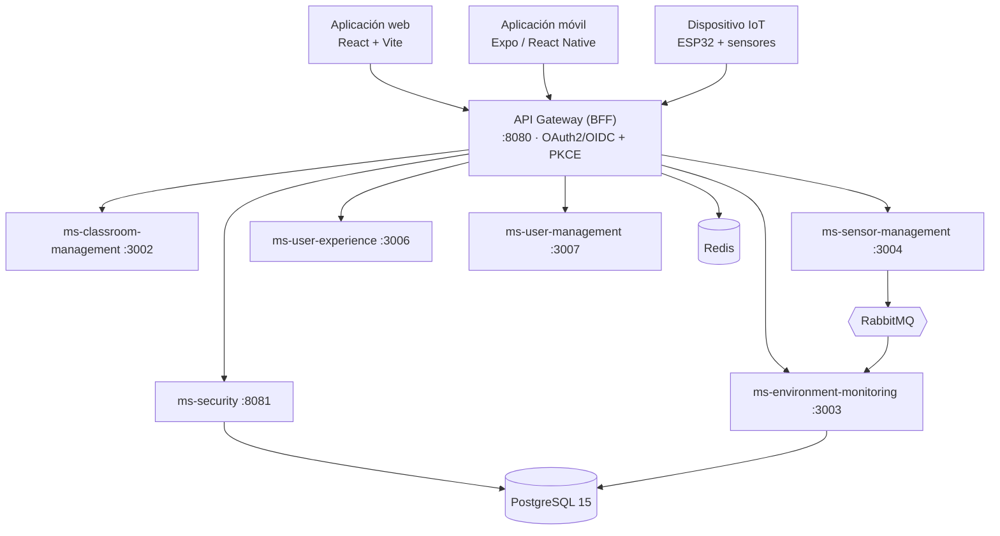

# EduAirControl — Documento General del Proyecto

> Visión general, alcance, arquitectura, organización y estado del proyecto

**Servicio Nacional de Aprendizaje** · Análisis y Desarrollo de Software – 3145556  
**Integrantes:** María de los Ángeles Olaya García; Jhon Jairo Cortez Vargas  
**Instructores:** Todos los instructores del programa  
**Versión 1.0** · 9 de octubre de 2026 · 2025-2026

---

## Tabla de contenido

- [1. Información general del proyecto](#1-información-general-del-proyecto)
- [2. Introducción](#2-introducción)
- [3. Planteamiento del problema](#3-planteamiento-del-problema)
- [4. Propósito y justificación](#4-propósito-y-justificación)
  - [4.1 Propósito](#41-propósito)
  - [4.2 Justificación](#42-justificación)
- [5. Objetivos](#5-objetivos)
  - [5.1 Objetivo general](#51-objetivo-general)
  - [5.2 Objetivos específicos](#52-objetivos-específicos)
- [6. Alcance](#6-alcance)
  - [6.1 Capacidades incluidas en el MVP](#61-capacidades-incluidas-en-el-mvp)
  - [6.2 Fuera del alcance de esta versión](#62-fuera-del-alcance-de-esta-versión)
  - [6.3 Restricciones y supuestos](#63-restricciones-y-supuestos)
- [7. Descripción del producto](#7-descripción-del-producto)
  - [7.1 Usuarios y roles](#71-usuarios-y-roles)
  - [7.2 Variables monitoreadas](#72-variables-monitoreadas)
  - [7.3 Recorridos principales](#73-recorridos-principales)
- [8. Arquitectura y tecnología](#8-arquitectura-y-tecnología)
  - [8.1 Servicios del backend](#81-servicios-del-backend)
  - [8.2 Pila tecnológica](#82-pila-tecnológica)
  - [8.3 Hardware IoT](#83-hardware-iot)
- [9. Equipo y organización del trabajo](#9-equipo-y-organización-del-trabajo)
  - [9.1 Equipo](#91-equipo)
  - [9.2 Metodología](#92-metodología)
- [10. Estado actual y planificación](#10-estado-actual-y-planificación)
  - [10.1 Estado de los requisitos](#101-estado-de-los-requisitos)
  - [10.2 Hitos del proyecto](#102-hitos-del-proyecto)
  - [10.3 Hoja de ruta](#103-hoja-de-ruta)
- [11. Riesgos principales](#11-riesgos-principales)
- [12. Entregables del proyecto](#12-entregables-del-proyecto)
- [13. Glosario](#13-glosario)
- [14. Referencias](#14-referencias)

---

## 1. Información general del proyecto

Este documento presenta una visión completa y de alto nivel de **EduAirControl**: qué problema resuelve, a quién sirve, qué incluye y qué no, cómo está construido, quién lo construye, cómo se gestiona el trabajo y cuál es su estado actual. Es el punto de entrada al resto de los entregables del proyecto; cada tema se profundiza en el documento indicado en la sección 12.

| Campo | Detalle |
|---|---|
| Nombre del proyecto | EduAirControl |
| Tipo de solución | Sistema de monitoreo ambiental escolar basado en IoT, con aplicación web, aplicación móvil y backend de microservicios |
| Programa de formación | Tecnólogo en Análisis y Desarrollo de Software – 3145556 |
| Entidad | Servicio Nacional de Aprendizaje – SENA |
| Integrantes | María de los Ángeles Olaya García; Jhon Jairo Cortez Vargas |
| Instructores | Todos los instructores del programa |
| Periodo | 2025-2026 |
| Estado del producto | MVP en desarrollo (versión no liberada) |
| Documentación base | SRS v1.1 (IEEE 830), actualizado el 08/10/2026 contra el código y la documentación de ingeniería |
| Repositorio de documentación | github.com/code-sena/ea-control-docs |
| Versión de este documento | 1.0 – 9 de octubre de 2026 |

## 2. Introducción

El bienestar en los entornos escolares se ha convertido en un factor clave para una educación de calidad. Las condiciones ambientales dentro del aula influyen directamente en la concentración, el rendimiento académico y la salud de estudiantes y docentes. En ese contexto surge la necesidad de soluciones tecnológicas que permitan monitorear y mejorar estos espacios.

**EduAirControl** es un sistema de monitoreo ambiental escolar basado en tecnología IoT (Internet de las Cosas). Registra la temperatura, el dióxido de carbono (CO₂), la humedad y el nivel de ruido de los ambientes educativos y los presenta en una aplicación web y una aplicación móvil, junto con alertas por severidad, análisis histórico y recomendaciones para mejorar las condiciones medidas.

El proyecto busca, además de optimizar las condiciones físicas del aula, fomentar una cultura de conciencia ambiental y tecnológica en la comunidad educativa, en línea con los principios de sostenibilidad, salud y transformación digital.

## 3. Planteamiento del problema

En muchas instituciones educativas, las condiciones del ambiente (temperatura, CO₂, humedad y ruido) no se monitorean de manera continua. Son variables invisibles, pero afectan la concentración, el aprendizaje y la salud de estudiantes y docentes. Sin información en tiempo real no es posible tomar decisiones oportunas, como ventilar un salón cuando el CO₂ sube, y las mediciones que existen quedan dispersas y sin historial que permita ver cambios en el tiempo.

> **Pregunta de investigación.** ¿Cómo puede el monitoreo continuo de variables ambientales como la temperatura, el dióxido de carbono, la humedad y el nivel de ruido en las instituciones educativas mejorar la concentración, el aprendizaje y la salud de estudiantes y docentes?

## 4. Propósito y justificación

### 4.1 Propósito

Desarrollar e implementar un sistema de monitoreo ambiental escolar que utilice tecnología IoT para registrar en tiempo real las variables ambientales del aula, mejorar las condiciones físicas del entorno educativo y apoyar con datos la toma de decisiones que fortalezcan la calidad del aprendizaje.

### 4.2 Justificación

Según las guías de la Organización Mundial de la Salud (2021), una ventilación deficiente en espacios cerrados como los salones de clase acumula CO₂, lo que produce somnolencia, fatiga y menor capacidad de atención. Satish et al. (2012) encontraron efectos negativos sobre la toma de decisiones con concentraciones de CO₂ por encima de 1.000 ppm. La EPA (2020) reporta, además, que la exposición a temperaturas elevadas puede reducir el rendimiento de los estudiantes y que el exceso de ruido aumenta la probabilidad de errores en las tareas escolares.

En Colombia, la mayoría de las instituciones educativas públicas carecen de sistemas que permitan monitorear estas variables. EduAirControl responde con una solución accesible: recolecta y analiza datos ambientales en tiempo real, genera alertas y estadísticas útiles para decisiones pedagógicas y administrativas, y promueve la apropiación tecnológica, alineándose con los lineamientos del Ministerio de Educación Nacional y los Objetivos de Desarrollo Sostenible de la Agenda 2030.

## 5. Objetivos

### 5.1 Objetivo general

Desarrollar un sistema de monitoreo ambiental escolar basado en tecnología IoT que permita registrar y visualizar en tiempo real la temperatura, el dióxido de carbono (CO₂), la humedad y el nivel de ruido, con el fin de mejorar las condiciones de aprendizaje y el bienestar de estudiantes y docentes en los ambientes educativos.

### 5.2 Objetivos específicos

- Diseñar un sistema de software que integre sensores para el monitoreo en tiempo real de temperatura, CO₂, humedad y ruido en ambientes educativos de una o varias instituciones.
- Desarrollar una interfaz intuitiva que permita a administradores y docentes visualizar los datos ambientales y recibir alertas cuando las condiciones salgan de los rangos óptimos.
- Crear un módulo de análisis que procese el histórico de mediciones por día, semana, mes y año para identificar patrones y apoyar la toma de decisiones.
- Integrar un sistema de alertas y notificaciones por severidad que informe a los responsables sobre anomalías y facilite acciones correctivas inmediatas.
- Garantizar el acceso seguro y aislado por institución y sede mediante autenticación estándar OAuth2/OpenID Connect y control de acceso por roles.

## 6. Alcance

### 6.1 Capacidades incluidas en el MVP

| # | Capacidad | Descripción | Servicio responsable |
|---|---|---|---|
| 1 | Autenticación y registro | Registro, inicio de sesión (correo y Google/Facebook), recuperación de contraseña y control de acceso por roles. | ms-security |
| 2 | Instituciones y sedes | Alta y administración de instituciones (tenants) y sedes; aislamiento de datos por institución. | ms-security, ms-classroom-management |
| 3 | Ambientes educativos | Registro, consulta, edición y eliminación de ambientes con tipo, ubicación y capacidad. | ms-classroom-management |
| 4 | Gestión de sensores | Registro, instalación/retiro y configuración de sensores y de las variables que miden. | ms-sensor-management |
| 5 | Monitoreo ambiental | Recepción y almacenamiento de mediciones; estado actual de temperatura, humedad, CO₂ y ruido. | ms-environment-monitoring |
| 6 | Dashboard y análisis histórico | Visualización actual e histórica por día, semana, mes y año. | ms-environment-monitoring, frontend |
| 7 | Alertas y notificaciones | Alertas por umbral (INFO, WARNING, CRITICAL) y estado de lectura por usuario. | ms-environment-monitoring, ms-user-experience |
| 8 | Favoritos, calificación y preferencias | Ambientes favoritos, calificación de 1 a 5 con comentario, idioma, tema y accesibilidad. | ms-user-experience |
| 9 | Aplicaciones cliente | Aplicación web (React) y móvil (Expo/React Native) con configuración BLE de dispositivos ESP32. | frontend |

### 6.2 Fuera del alcance de esta versión

- Predicción ambiental avanzada.
- Control automático de equipos (ventilación, aire acondicionado).
- Integración con sistemas externos de control ambiental.
- Desarrollo del hardware de los sensores (lo aporta un proveedor o la institución).

### 6.3 Restricciones y supuestos

- La aplicación requiere acceso a internet y los dispositivos IoT deben estar encendidos y conectados a una red Wi-Fi.
- Tecnología base: React, Expo/React Native, Spring Boot, PostgreSQL 15, Redis, RabbitMQ y Docker.
- El trabajo se organiza en sprints de una semana.
- El presupuesto para sensores y microcontroladores es limitado, lo que condiciona la cantidad y calidad de los equipos.
- Cada usuario pertenece a una sola institución y a una sola sede, y no puede ver datos de otras instituciones.
- Se asume Wi-Fi estable y alimentación eléctrica adecuada en los espacios, y que los sensores elegidos tienen precisión aceptable para un monitoreo básico.

## 7. Descripción del producto

### 7.1 Usuarios y roles

| Rol | Perfil | Qué hace en el sistema |
|---|---|---|
| SUPER_ADMIN | Equipo técnico de la plataforma | Crea y administra instituciones; gestiona usuarios y roles de toda la plataforma; atiende errores y apoya a los administradores. |
| ADMIN | Responsable de una institución, con conocimientos de ofimática | Administra ambientes, sensores, dispositivos y umbrales de su institución. |
| USER | Docentes, directivos y estudiantes | Consulta ambientes y variables, filtra, marca favoritos, califica ambientes, revisa alertas y configura sus preferencias. |

### 7.2 Variables monitoreadas

Las variables y sus rangos se definen una sola vez (ADR-014) y las usan por igual el backend, la web y la aplicación móvil. Los umbrales de normal, advertencia y crítico se configuran por tipo de ambiente (aula, laboratorio y biblioteca).

| Variable | Código | Unidad | Rango válido | Ejemplo aula: normal |
|---|---|---|---|---|
| Temperatura | TEMP | °C | -10 a 50 | 20 – 26 |
| Humedad | HUM | % | 0 a 100 | 40 – 60 |
| Dióxido de carbono | CO2 | ppm | 0 a 5000 | 0 – 800 |
| Nivel de ruido | NOISE | dB | 0 a 140 | 0 – 45 |

### 7.3 Recorridos principales

- **Consulta autorizada:** el usuario se registra con el código de su institución o inicia sesión, elige un ambiente, ve sus métricas en tiempo real y consulta el histórico por día, semana, mes o año.
- **Preparación administrativa:** el administrador crea el ambiente, registra el sensor, lo instala en el ambiente, asocia las variables que mide y define los umbrales.
- **De la medición a la decisión:** el sensor envía una medición; el sistema la valida, la guarda, la compara con los umbrales y genera una alerta si es necesario; el usuario la ve en el panel y actúa (por ejemplo, ventilar).

## 8. Arquitectura y tecnología

EduAirControl sigue una arquitectura de microservicios con Spring Boot detrás de un API Gateway que actúa como BFF (Backend for Frontend). Cada servicio tiene su propio esquema de base de datos (ADR-003), se organiza con arquitectura hexagonal (ADR-009) y se comunica con los demás por REST o por eventos en RabbitMQ.

*Figura 1. Vista general de componentes de EduAirControl. El detalle completo está en 05_Diseno_Software.*

### 8.1 Servicios del backend

| Servicio | Responsabilidad | Puerto | Estado |
|---|---|---|---|
| api-gateway | Punto único de entrada, autenticación, enrutamiento y límite de tasa (BFF). | 8080 | Activo |
| ms-security | Registro, inicio de sesión, OAuth2/OIDC, tokens, roles e instituciones. | 8081 | En desarrollo |
| ms-classroom-management | Ambientes educativos, tipos de ambiente y sedes. | 3002 | En desarrollo |
| ms-environment-monitoring | Mediciones, análisis histórico, umbrales y alertas. | 3003 | Activo |
| ms-sensor-management | Sensores, variables e instalaciones. | 3004 | En desarrollo |
| ms-user-experience | Favoritos, calificaciones, preferencias, búsquedas y estado de notificaciones. | 3006 | Activo |
| ms-user-management | Información de usuarios. | 3007 | En desarrollo |
| ms-alert | Retirado: sus funciones pasaron a ms-environment-monitoring (ADR-015). | — | Deprecado |

### 8.2 Pila tecnológica

| Capa | Tecnología | Función |
|---|---|---|
| Frontend web | React 19, Vite | Interfaz web responsiva con modo claro/oscuro y temas para daltonismo |
| Aplicación móvil | Expo 54, React Native 0.81 | App para Android e iOS con configuración BLE de dispositivos |
| Backend | Java 17, Spring Boot | Servicios de dominio y APIs bajo arquitectura hexagonal |
| Entrada API | Spring Cloud Gateway | Enrutamiento, autenticación, límite de tasa y sesión por cookie httpOnly |
| Autenticación | Spring Authorization Server, JWT RS256 | OAuth2/OIDC con Authorization Code + PKCE; Google y Facebook |
| Datos | PostgreSQL 15, Liquibase | Persistencia relacional y control de versiones del esquema |
| Soporte | Redis, RabbitMQ | Sesiones y tokens revocados; eventos entre servicios |
| Contratos | OpenAPI | Contrato por servicio en 07-api/contracts/openapi |
| DevOps | Docker, Jenkins, GitHub | Contenedores, integración continua y control de código fuente |
| Observabilidad | Prometheus, Grafana, OpenTelemetry | Métricas, paneles y trazas (definidas en ADR-012) |

### 8.3 Hardware IoT

El prototipo de medición se basa en un microcontrolador **ESP32** con sensores económicos. La aplicación móvil configura la red Wi-Fi del dispositivo mediante Bluetooth Low Energy (el dispositivo se anuncia como `ESP32_Config`).

| Componente | Función |
|---|---|
| ESP32 | Controlador y comunicación Wi-Fi/BLE |
| DHT11 | Temperatura y humedad del aire |
| KY-038 | Nivel de sonido relativo |
| MQ-135 | Gases y calidad del aire; no es un medidor de CO₂ de precisión y requiere adaptar el voltaje antes del ADC |

> **Estado actual del hardware.** Existen programas de prueba para el DHT11 y el KY-038. El firmware final que envía las lecturas a la API, y la conexión definitiva del MQ-135, siguen pendientes de confirmación. Por eso el sistema puede recibir mediciones por HTTPS/MQTT, pero la cadena completa sensor → API no se considera cerrada en este entregable.

## 9. Equipo y organización del trabajo

### 9.1 Equipo

| Integrante | Rol | Responsabilidad | Contacto |
|---|---|---|---|
| María de los Ángeles Olaya García | Desarrolladora fullstack | Análisis de información, diseño y programación | mariadelosangelesolayagar@gmail.com |
| Jhon Jairo Cortez Vargas | Desarrollador fullstack y líder técnico | Análisis de información, diseño y programación; decisiones técnicas | cortezvargasjhon01@gmail.com |

### 9.2 Metodología

El equipo trabaja con un enfoque ágil basado en **sprints de una semana** y con documentación guiada por especificaciones (*spec-driven*): primero se documenta el requisito, la decisión o el contrato, y luego se construye. Las prácticas que se aplican en el repositorio son:

- **Gobernanza documentada:** convenciones ágiles, definición de listo (DoR) y de hecho (DoD), convenciones de Git, reglas de documentación y políticas de seguridad (carpeta 00-governance).
- **Decisiones de arquitectura:** 17 ADR numerados (ADR-001 a ADR-017) que registran el porqué de cada decisión.
- **Ramas por tipo de trabajo:** `feat/`, `fix/`, `docs/` y `chore/`, integradas mediante pull requests con plantilla.
- **Trazabilidad:** historias de usuario, matriz de trazabilidad y requisitos funcionales y no funcionales vinculados entre sí (carpeta 04-requirements).
- **Contratos primero:** cada microservicio publica su contrato OpenAPI antes de integrarse.

## 10. Estado actual y planificación

### 10.1 Estado de los requisitos

De acuerdo con el SRS v1.1 (actualizado el 08/10/2026), los 40 requisitos funcionales se encuentran así:

| Estado | Cantidad | Requisitos |
|---|---|---|
| Implementado | 26 | RF1.1, 1.3–1.9; RF2.1, 2.4; RF3.1, 3.2; RF5.1; RF6.1, 6.2, 6.4; RF7.1–7.5; RF8.1; RF9.1–9.4 |
| Parcial | 12 | RF2.2, 2.3; RF3.3, 3.4; RF4.1, 4.2; RF5.2, 5.3; RF6.3; RF8.2, 8.3; RF9.5 |
| Pendiente | 2 | RF1.2 (verificación en 2 pasos); RF6.5 (notificación externa por push o correo) |

### 10.2 Hitos del proyecto

| Fecha | Hito |
|---|---|
| 2025 | Versión inicial del SRS (IEEE 830). |
| 2026-09-03 | Inicio del repositorio de documentación de ingeniería (Docs-ea-control). |
| 2026-09-15 / 17 | Depuración de producto, requisitos y arquitectura; documentación UX/UI y mockups web y móvil. |
| 2026-10-05 | Contrato de análisis de ms-environment-monitoring. |
| 2026-10-08 | Auditoría del código fuente, registro de riesgos y SRS v1.1 alineado con la implementación. |
| 2026-10-09 | Documento general y consolidación de los entregables del proyecto. |

### 10.3 Hoja de ruta

| Horizonte | Enfoque | Contenido | Condición de salida |
|---|---|---|---|
| H1 – Ahora | MVP central | Registro y autenticación, gestión de ambientes y sensores, ingesta de mediciones, dashboard y análisis histórico, favoritos y calificaciones. | Un usuario representativo completa el recorrido de consulta autorizada con datos válidos. |
| H2 – Siguiente | Iteración validada | Mejorar claridad del dashboard, filtros, preferencias y búsquedas según evidencia de un piloto; reforzar datos completos y visibilidad operativa. | La evidencia de uso identifica mejoras concretas sin salir del dominio del producto. |
| H3 – Después | Expansión controlada | Notificaciones externas, análisis operativo más rico u otras integraciones, solo con valor, propiedad de datos y contratos aprobados. | Cada ampliación tiene requisitos, datos, API y revisión de arquitectura explícitos. |

## 11. Riesgos principales

El registro de riesgos se actualizó a partir de la auditoría del código del 08/10/2026. A continuación se resumen los riesgos activos; sus planes de mitigación y las acciones correctivas, preventivas y de mejora se detallan en el documento **08_Calidad_Mejoras**.

| ID | Riesgo | Nivel |
|---|---|---|
| R-001 | Suplantación de identidad mediante las cabeceras X-User-*, que los servicios aceptan sin verificar su origen. | Crítico |
| R-002 | Clave privada RSA incluida en el repositorio de ms-security. | Crítico |
| R-003 | CORS abierto con credenciales en el gateway. | Alto |
| R-004 | Cobertura de pruebas sin exigir en la integración continua, pese al RNF6. | Alto |
| R-005 | ms-user-experience ausente del despliegue en Kubernetes y de la integración continua. | Alto |
| R-006 | Observabilidad documentada pero no efectiva en el código. | Alto |
| R-007 | Diferencia entre ADR-003 (base de datos por servicio) y el despliegue real. | Medio |
| R-008 | Circuit breaker documentado (ADR-013) pero no implementado. | Medio |
| R-009 | Firmware del dispositivo fuera del contrato de la API. | Medio |
| R-010 | Frontend sin pruebas ni contratos compartidos. | Medio |
| R-011 | Documentación que describe elementos que aún no existen. | Medio |

## 12. Entregables del proyecto

El proyecto se entrega en una carpeta con la siguiente organización. Este documento corresponde al primer archivo; los demás se elaboran sobre la misma base y con el mismo formato. Cada documento se entrega en PDF y Markdown, en español e inglés.

| Entregable | Contenido |
|---|---|
| 01_Documento_General_Proyecto | Visión general del proyecto (este documento). |
| 02_Especificacion_Requisitos | SRS v1.1: requisitos funcionales, no funcionales, umbrales y casos de uso. |
| 03_Analisis_Software | Análisis y vistas dinámicas del software. |
| 04_Propuesta_Tecnica | Propuesta técnica, decisiones y justificación de la tecnología. |
| 05_Diseno_Software | Interfaces gráficas, modelo arquitectónico, patrones de diseño y modelo de datos. |
| 06_Base_Datos | Modelo entidad-relación, diccionario de datos y script SQL. |
| 07_Pruebas | Plan de pruebas y evidencias. |
| 08_Calidad_Mejoras | Acciones correctivas, preventivas y de mejoramiento. |
| 09_Implementacion | Procedimiento de implementación del software. |
| 10_Manual_Tecnico · 11_Manual_Instalacion · 12_Manual_Usuario | Manuales técnico, de instalación y de usuario final. |
| 13_Articulo_Proyecto | Artículo del proyecto. |
| 14_Anexos · 15_Enlace_Repositorio_GitHub | Material de apoyo y enlace al repositorio del código. |

## 13. Glosario

| Término | Descripción |
|---|---|
| Ambiente educativo | Espacio (aula, laboratorio, biblioteca) monitoreado por EduAirControl. |
| Institución (tenant) | Organización educativa que usa la plataforma; sus datos están aislados de los de otras. |
| Sede | Subdivisión de una institución que contiene ambientes y sensores. |
| IoT | Internet de las Cosas: red de sensores y microcontroladores conectados. |
| ESP32 | Microcontrolador con Wi-Fi y Bluetooth usado en los dispositivos de medición. |
| BLE | Bluetooth Low Energy; se usa para configurar el dispositivo desde la app móvil. |
| OAuth2 / OIDC / PKCE | Estándares de autorización e identidad usados para el inicio de sesión. |
| BFF | Backend for Frontend: el gateway guarda los tokens y entrega al navegador solo una cookie httpOnly. |
| RBAC | Control de acceso basado en roles (USER, ADMIN, SUPER_ADMIN). |
| ADR | Registro de decisión de arquitectura. |
| SRS | Especificación de Requisitos de Software. |

## 14. Referencias

- Organización Mundial de la Salud. (2021). *Guías sobre calidad del aire en interiores*. OMS.
- Satish, U., Mendell, M. J., Shekhar, K., Hotchi, T., Sullivan, D., Streufert, S., & Fisk, W. J. (2012). Is CO₂ an indoor pollutant? Direct effects of low-to-moderate CO₂ concentrations on human decision-making performance. *Environmental Health Perspectives, 120*(12), 1671–1677.
- U.S. Environmental Protection Agency. (2020). *Indoor air quality and student performance*. EPA.
- Ministerio de Educación Nacional. (2022). *Lineamientos para ambientes escolares saludables*. MEN.
- Naciones Unidas. (2015). *Objetivos de Desarrollo Sostenible – Agenda 2030*. ONU.
- IEEE. (1998). *IEEE Std 830-1998: Recommended practice for software requirements specifications*. IEEE.
- EduAirControl. (2026). *Especificación de Requisitos de Software, versión 1.1*. SENA.
- EduAirControl. (2026). *Docs-ea-control: ADR-001 – ADR-017, modelo de datos y contratos OpenAPI*. https://github.com/code-sena/ea-control-docs

