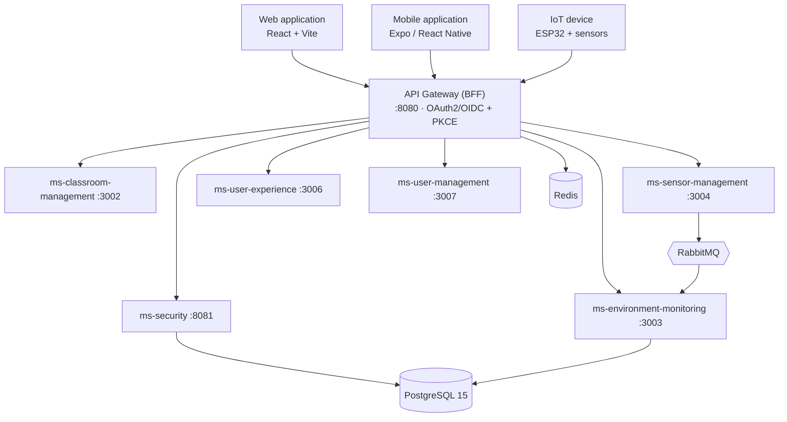

# EduAirControl — General Project Document

**María de los Ángeles Olaya García; Jhon Jairo Cortez Vargas**

Servicio Nacional de Aprendizaje (SENA), Programa ADSO-3145556

Instructora: Karol Daniela Correa

12 de octubre de 2026

---

# EduAirControl — General Project Document

> Overview, scope, architecture, organization and project status

**Servicio Nacional de Aprendizaje** · Analysis and Software Development – 3145556  
**Team members:** María de los Ángeles Olaya García; Jhon Jairo Cortez Vargas  
**Instructors:** All instructors of the program  
**Version 1.0** · 9 October 2026 · 2025-2026

---

## Table of contents

- [1. Project overview](#1-project-overview)
- [2. Introduction](#2-introduction)
- [3. Problem statement](#3-problem-statement)
- [4. Purpose and justification](#4-purpose-and-justification)
  - [4.1 Purpose](#41-purpose)
  - [4.2 Justification](#42-justification)
- [5. Objectives](#5-objectives)
  - [5.1 General objective](#51-general-objective)
  - [5.2 Specific objectives](#52-specific-objectives)
- [6. Scope](#6-scope)
  - [6.1 Capabilities included in the MVP](#61-capabilities-included-in-the-mvp)
  - [6.2 Out of scope for this version](#62-out-of-scope-for-this-version)
  - [6.3 Constraints and assumptions](#63-constraints-and-assumptions)
- [7. Product description](#7-product-description)
  - [7.1 Users and roles](#71-users-and-roles)
  - [7.2 Monitored variables](#72-monitored-variables)
  - [7.3 Main flows](#73-main-flows)
- [8. Architecture and technology](#8-architecture-and-technology)
  - [8.1 Backend services](#81-backend-services)
  - [8.2 Technology stack](#82-technology-stack)
  - [8.3 IoT hardware](#83-iot-hardware)
- [9. Team and work organization](#9-team-and-work-organization)
  - [9.1 Team](#91-team)
  - [9.2 Methodology](#92-methodology)
- [10. Current status and planning](#10-current-status-and-planning)
  - [10.1 Requirements status](#101-requirements-status)
  - [10.2 Project milestones](#102-project-milestones)
  - [10.3 Roadmap](#103-roadmap)
- [11. Main risks](#11-main-risks)
- [12. Project deliverables](#12-project-deliverables)
- [13. Glossary](#13-glossary)
- [14. References](#14-references)

---

## 1. Project overview

This document provides a comprehensive, high-level view of **EduAirControl**: what problem it solves, who it serves, what is included and what is not, how it is built, who builds it, how the work is managed, and its current status. It is the entry point to the rest of the project deliverables; each topic is explored in depth in the document referenced in section 12.

| Field | Detail |
|---|---|
| Project name | EduAirControl |
| Solution type | School environmental monitoring system based on IoT, with web application, mobile application and microservices backend |
| Training program | Technologist in Analysis and Software Development – 3145556 |
| Entity | Servicio Nacional de Aprendizaje – SENA |
| Team members | María de los Ángeles Olaya García; Jhon Jairo Cortez Vargas |
| Instructors | All instructors of the program |
| Period | 2025-2026 |
| Product status | MVP in development (unreleased version) |
| Base documentation | SRS v1.1 (IEEE 830), updated on 08/10/2026 against code and engineering documentation |
| Documentation repository | github.com/code-sena/ea-control-docs |
| Version of this document | 1.0 – 9 October 2026 |

## 2. Introduction

Well-being in school environments has become a key factor for quality education. The environmental conditions inside the classroom directly influence concentration, academic performance and the health of students and teachers. In that context, there is a need for technological solutions that allow monitoring and improving these spaces.

**EduAirControl** is a school environmental monitoring system based on IoT (Internet of Things) technology. It records temperature, carbon dioxide (CO₂), humidity and noise level in educational environments and presents them in a web application and a mobile application, along with severity alerts, historical analysis and recommendations to improve the measured conditions.

Besides optimizing the physical conditions of the classroom, the project also aims to foster a culture of environmental and technological awareness within the educational community, aligned with the principles of sustainability, health and digital transformation.

## 3. Problem statement

In many educational institutions, environmental conditions (temperature, CO₂, humidity and noise) are not monitored continuously. These are invisible variables, but they affect concentration, learning and the health of students and teachers. Without real-time information it is not possible to make timely decisions, such as ventilating a classroom when CO₂ rises, and existing measurements remain dispersed and without history that allows seeing changes over time.

> Research question. How can continuous monitoring of environmental variables such as temperature, carbon dioxide, humidity and noise level in educational institutions improve concentration, learning and the health of students and teachers?

## 4. Purpose and justification

### 4.1 Purpose

Develop and implement a school environmental monitoring system that uses IoT technology to record classroom environmental variables in real time, improve the physical conditions of the educational environment and support data-driven decision-making that strengthens the quality of learning.

### 4.2 Justification

According to the World Health Organization (2021) guidelines, poor ventilation in enclosed spaces such as classrooms allows CO₂ to accumulate, which causes drowsiness, fatigue and reduced attention capacity. Satish et al. (2012) found negative effects on decision-making at CO₂ concentrations above 1,000 ppm. The U.S. EPA (2020) also reports that exposure to high temperatures can reduce student performance and that excessive noise increases the likelihood of errors in school tasks.

In Colombia, most public educational institutions lack systems that allow monitoring these variables. EduAirControl responds with an accessible solution: it collects and analyzes environmental data in real time, generates alerts and useful statistics for pedagogical and administrative decisions, and promotes technological appropriation, aligning with the guidelines of the Ministry of National Education and the Sustainable Development Goals of the 2030 Agenda.

## 5. Objectives

### 5.1 General objective

Develop an IoT-based school environmental monitoring system that enables recording and visualizing in real time temperature, carbon dioxide (CO₂), humidity and noise level, in order to improve learning conditions and the well-being of students and teachers in educational environments.

### 5.2 Specific objectives

- Design a software system that integrates sensors for real-time monitoring of temperature, CO₂, humidity and noise in educational environments of one or multiple institutions.
- Develop an intuitive interface that allows administrators and teachers to visualize environmental data and receive alerts when conditions fall outside optimal ranges.
- Create an analytics module that processes historical measurements by day, week, month and year to identify patterns and support decision-making.
- Integrate an alert and notification system by severity that informs responsible parties about anomalies and facilitates immediate corrective actions.
- Ensure secure and isolated access by institution and campus using standard OAuth2/OpenID Connect authentication and role-based access control.

## 6. Scope

### 6.1 Capabilities included in the MVP

| # | Capability | Description | Responsible service |
|---|---|---|---|
| 1 | Authentication and registration | Registration, login (email and Google/Facebook), password recovery and role-based access control. | ms-security |
| 2 | Institutions and campuses | Creation and administration of institutions (tenants) and campuses; data isolation by institution. | ms-security, ms-classroom-management |
| 3 | Educational environments | Registration, query, editing and deletion of environments with type, location and capacity. | ms-classroom-management |
| 4 | Sensor management | Registration, installation/removal and configuration of sensors and the variables they measure. | ms-sensor-management |
| 5 | Environmental monitoring | Reception and storage of measurements; current status of temperature, humidity, CO₂ and noise. | ms-environment-monitoring |
| 6 | Dashboard and historical analysis | Current and historical visualization by day, week, month and year. | ms-environment-monitoring, frontend |
| 7 | Alerts and notifications | Threshold alerts (INFO, WARNING, CRITICAL) and read state per user. | ms-environment-monitoring, ms-user-experience |
| 8 | Favorites, rating and preferences | Favorite environments, rating from 1 to 5 with comment, language, theme and accessibility. | ms-user-experience |
| 9 | Client applications | Web application (React) and mobile app (Expo/React Native) with BLE configuration of ESP32 devices. | frontend |

### 6.2 Out of scope for this version

- Advanced environmental prediction.
- Automatic control of equipment (ventilation, air conditioning).
- Integration with external environmental control systems.
- Development of the sensor hardware (provided by a supplier or the institution).

### 6.3 Constraints and assumptions

- The application requires internet access and the IoT devices must be turned on and connected to a Wi‑Fi network.
- Base technology: React, Expo/React Native, Spring Boot, PostgreSQL 15, Redis, RabbitMQ and Docker.
- Work is organized in one-week sprints.
- The budget for sensors and microcontrollers is limited, which constrains the quantity and quality of equipment.
- Each user belongs to a single institution and a single campus, and cannot view data from other institutions.
- It is assumed there is stable Wi‑Fi and adequate power supply in the spaces, and that the chosen sensors have acceptable accuracy for basic monitoring.

## 7. Product description

### 7.1 Users and roles

| Role | Profile | What they do in the system |
|---|---|---|
| SUPER_ADMIN | Platform technical team | Creates and administers institutions; manages users and roles across the platform; handles errors and supports administrators. |
| ADMIN | Person responsible for an institution, with office software knowledge | Manages environments, sensors, devices and thresholds for their institution. |
| USER | Teachers, administrators and students | Queries environments and variables, filters, marks favorites, rates environments, reviews alerts and configures their preferences. |

### 7.2 Monitored variables

The variables and their ranges are defined once (ADR-014) and are used equally by the backend, the web and the mobile application. The thresholds for normal, warning and critical are configured by environment type (classroom, laboratory and library).

| Variable | Code | Unit | Valid range | Classroom example: normal |
|---|---|---|---|---|
| Temperature | TEMP | °C | -10 to 50 | 20 – 26 |
| Humidity | HUM | % | 0 to 100 | 40 – 60 |
| Carbon dioxide | CO2 | ppm | 0 to 5000 | 0 – 800 |
| Noise level | NOISE | dB | 0 to 140 | 0 – 45 |

### 7.3 Main flows

- Authorized query: the user registers with their institution code or logs in, selects an environment, views its metrics in real time and consults the history by day, week, month or year.
- Administrative preparation: the administrator creates the environment, registers the sensor, installs it in the environment, associates the variables it measures and defines the thresholds.
- From measurement to decision: the sensor sends a measurement; the system validates it, saves it, compares it with thresholds and generates an alert if necessary; the user sees it on the dashboard and acts (for example, ventilates).

## 8. Architecture and technology

EduAirControl follows a microservices architecture with Spring Boot behind an API Gateway that acts as a BFF (Backend for Frontend). Each service has its own database schema (ADR-003), is organized with hexagonal architecture (ADR-009) and communicates with others via REST or events in RabbitMQ.

*Figure 1. Overview of EduAirControl components. The complete detail is in 05_Diseno_Software.*

### 8.1 Backend services

| Service | Responsibility | Port | Status |
|---|---|---|---|
| api-gateway | Single entry point, authentication, routing and rate limiting (BFF). | 8080 | Active |
| ms-security | Registration, login, OAuth2/OIDC, tokens, roles and institutions. | 8081 | In development |
| ms-classroom-management | Educational environments, environment types and campuses. | 3002 | In development |
| ms-environment-monitoring | Measurements, historical analysis, thresholds and alerts. | 3003 | Active |
| ms-sensor-management | Sensors, variables and installations. | 3004 | In development |
| ms-user-experience | Favorites, ratings, preferences, searches and notification state. | 3006 | Active |
| ms-user-management | User information. | 3007 | In development |
| ms-alert | Removed: its functions moved to ms-environment-monitoring (ADR-015). | — | Deprecated |

### 8.2 Technology stack

| Layer | Technology | Function |
|---|---|---|
| Web frontend | React 19, Vite | Responsive web interface with light/dark mode and themes for color blindness |
| Mobile application | Expo 54, React Native 0.81 | App for Android and iOS with BLE configuration of devices |
| Backend | Java 17, Spring Boot | Domain services and APIs under hexagonal architecture |
| API entry | Spring Cloud Gateway | Routing, authentication, rate limiting and session via httpOnly cookie |
| Authentication | Spring Authorization Server, JWT RS256 | OAuth2/OIDC with Authorization Code + PKCE; Google and Facebook |
| Data | PostgreSQL 15, Liquibase | Relational persistence and schema versioning |
| Support | Redis, RabbitMQ | Sessions and revoked tokens; events between services |
| Contracts | OpenAPI | Per-service contract in 07-api/contracts/openapi |
| DevOps | Docker, GitHub Actions, GHCR | Containers, continuous integration and image registry (GitHub Actions and GitHub Container Registry) |
| Observability | Prometheus, Grafana, OpenTelemetry | Metrics, dashboards and traces (defined in ADR-012) |

### 8.3 IoT hardware

The measurement prototype is based on an **ESP32** microcontroller with economical sensors. The mobile application configures the device's Wi‑Fi via Bluetooth Low Energy (the device advertises as `ESP32_Config`).

| Component | Function |
|---|---|
| ESP32 | Controller and Wi‑Fi/BLE communication |
| DHT11 | Air temperature and humidity |
| KY-038 | Relative sound level |
| MQ-135 | Gases and air quality; not a precision CO₂ meter and requires adapting the voltage before the ADC |

> Current hardware status. There are test programs for the DHT11 and the KY-038. The final firmware that sends readings to the API, and the final connection of the MQ-135, are pending confirmation. Therefore the system can receive measurements via HTTPS/MQTT, but the full sensor → API chain is not considered closed in this deliverable.

## 9. Team and work organization

### 9.1 Team

| Member | Role | Responsibility | Contact |
|---|---|---|---|
| María de los Ángeles Olaya García | Fullstack developer | Information analysis, design and programming | mariadelosangelesolayagar@gmail.com |
| Jhon Jairo Cortez Vargas | Fullstack developer and technical lead | Information analysis, design and programming; technical decisions | cortezvargasjhon01@gmail.com |

### 9.2 Methodology

The team works with an agile approach based on **one-week sprints** and with documentation guided by specifications (spec-driven): first the requirement, decision or contract is documented, and then it is built. The practices applied in the repository are:

- **Documented governance:** agile conventions, definition of ready (DoR) and done (DoD), Git conventions, documentation rules and security policies (folder 00-governance).
- **Architecture decisions:** 17 numbered ADRs (ADR-001 to ADR-017) recording the rationale for each decision.
- **Branches by work type:** `feat/`, `fix/`, `docs/` and `chore/`, merged via pull requests with template.
- **Traceability:** user stories, traceability matrix and linked functional and non-functional requirements (folder 04-requirements).
- **Contracts first:** each microservice publishes its OpenAPI contract before integrating.

## 10. Current status and planning

### 10.1 Requirements status

According to SRS v1.1 (updated on 08/10/2026), the 40 functional requirements are as follows:

| Status | Quantity | Requirements |
|---|---|---|
| Implemented | 26 | RF1.1, 1.3–1.9; RF2.1, 2.4; RF3.1, 3.2; RF5.1; RF6.1, 6.2, 6.4; RF7.1–7.5; RF8.1; RF9.1–9.4 |
| Partial | 12 | RF2.2, 2.3; RF3.3, 3.4; RF4.1, 4.2; RF5.2, 5.3; RF6.3; RF8.2, 8.3; RF9.5 |
| Pending | 2 | RF1.2 (two-step verification); RF6.5 (external notification by push or email) |

### 10.2 Project milestones

| Date | Milestone |
|---|---|
| 2025 | Initial version of the SRS (IEEE 830). |
| 2026-09-03 | Start of the engineering documentation repository (Docs-ea-control). |
| 2026-09-15 / 17 | Product, requirements and architecture refinement; UX/UI documentation and web and mobile mockups. |
| 2026-10-05 | Analysis contract for ms-environment-monitoring. |
| 2026-10-08 | Source code audit, risk register and SRS v1.1 aligned with implementation. |
| 2026-10-09 | General document and consolidation of project deliverables. |

### 10.3 Roadmap

| Horizon | Focus | Content | Exit condition |
|---|---|---|---|
| H1 – Now | Core MVP | Registration and authentication, management of environments and sensors, ingestion of measurements, dashboard and historical analysis, favorites and ratings. | A representative user completes the authorized query flow with valid data. |
| H2 – Next | Validated iteration | Improve dashboard clarity, filters, preferences and searches based on pilot evidence; strengthen complete data and operational visibility. | Usage evidence identifies concrete improvements without leaving the product domain. |
| H3 – Later | Controlled expansion | External notifications, richer operational analysis or other integrations, only with value, data ownership and approved contracts. | Each expansion has explicit requirements, data, API and architecture review. |

## 11. Main risks

The risk register was updated following the code audit of 08/10/2026. Below are the active risks summarized; their mitigation plans and corrective, preventive and improvement actions are detailed in the document **08_Calidad_Mejoras**.

| ID | Risk | Level |
|---|---|---|
| R-001 | Identity spoofing via X-User-* headers, which services accept without verifying origin. | Critical |
| R-002 | RSA private key included in the ms-security repository. | Critical |
| R-003 | CORS open with credentials on the gateway. | High |
| R-004 | Test coverage not enforced in continuous integration, despite RNF6. | High |
| R-005 | ms-user-experience missing from Kubernetes deployment and continuous integration. | High |
| R-006 | Observability documented but not effective in code. | High |
| R-007 | Difference between ADR-003 (database per service) and actual deployment. | Medium |
| R-008 | Circuit breaker documented (ADR-013) but not implemented. | Medium |
| R-009 | Device firmware outside the API contract. | Medium |
| R-010 | Frontend without tests or shared contracts. | Medium |
| R-011 | Documentation describing elements that do not yet exist. | Medium |

## 12. Project deliverables

The project is delivered in a folder with the following organization. This document corresponds to the first file; the others are developed on the same basis and with the same format. Each document is delivered in PDF and Markdown, in Spanish and English.

| Deliverable | Content |
|---|---|
| 01_Documento_General_Proyecto | Project overview (this document). |
| 02_Especificacion_Requisitos | SRS v1.1: functional, non-functional requirements, thresholds and use cases. |
| 03_Analisis_Software | Analysis and dynamic views of the software. |
| 04_Propuesta_Tecnica | Technical proposal, decisions and technology justification. |
| 05_Diseno_Software | Graphical interfaces, architectural model, design patterns and data model. |
| 06_Base_Datos | Entity-relationship model, data dictionary and SQL script. |
| 07_Pruebas | Test plan and evidence. |
| 08_Calidad_Mejoras | Corrective, preventive and improvement actions. |
| 09_Implementacion | Software deployment procedure. |
| 10_Manual_Tecnico · 11_Manual_Instalacion · 12_Manual_Usuario | Technical, installation and end-user manuals. |
| 13_Articulo_Proyecto | Project article. |
| 14_Anexos · 15_Enlace_Repositorio_GitHub | Supporting material and link to the code repository. |

## 13. Glossary

| Term | Description |
|---|---|
| Educational environment | Space (classroom, laboratory, library) monitored by EduAirControl. |
| Institution (tenant) | Educational organization that uses the platform; its data are isolated from others. |
| Campus | Subdivision of an institution that contains environments and sensors. |
| IoT | Internet of Things: network of sensors and microcontrollers connected. |
| ESP32 | Microcontroller with Wi‑Fi and Bluetooth used in measurement devices. |
| BLE | Bluetooth Low Energy; used to configure the device from the mobile app. |
| OAuth2 / OIDC / PKCE | Authorization and identity standards used for login. |
| BFF | Backend for Frontend: the gateway stores tokens and delivers only an httpOnly cookie to the browser. |
| RBAC | Role-Based Access Control (USER, ADMIN, SUPER_ADMIN). |
| ADR | Architecture Decision Record. |
| SRS | Software Requirements Specification. |

## 14. References

- World Health Organization. (2021). Guidelines on indoor air quality. WHO.
- Satish, U., Mendell, M. J., Shekhar, K., Hotchi, T., Sullivan, D., Streufert, S., & Fisk, W. J. (2012). Is CO₂ an indoor pollutant? Direct effects of low-to-moderate CO₂ concentrations on human decision-making performance. Environmental Health Perspectives, 120(12), 1671–1677.
- U.S. Environmental Protection Agency. (2020). Indoor air quality and student performance. EPA.
- Ministry of National Education. (2022). Guidelines for healthy school environments. MEN.
- United Nations. (2015). Sustainable Development Goals – 2030 Agenda. UN.
- IEEE. (1998). IEEE Std 830-1998: Recommended practice for software requirements specifications. IEEE.
- EduAirControl. (2026). Software Requirements Specification, version 1.1. SENA.
- EduAirControl. (2026). Docs-ea-control: ADR-001 – ADR-017, data model and OpenAPI contracts. https://github.com/code-sena/ea-control-docs