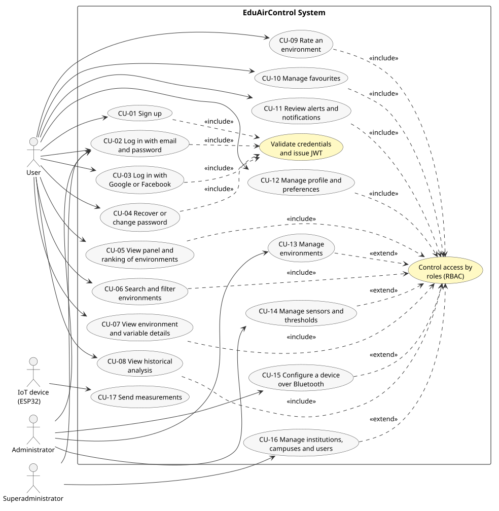
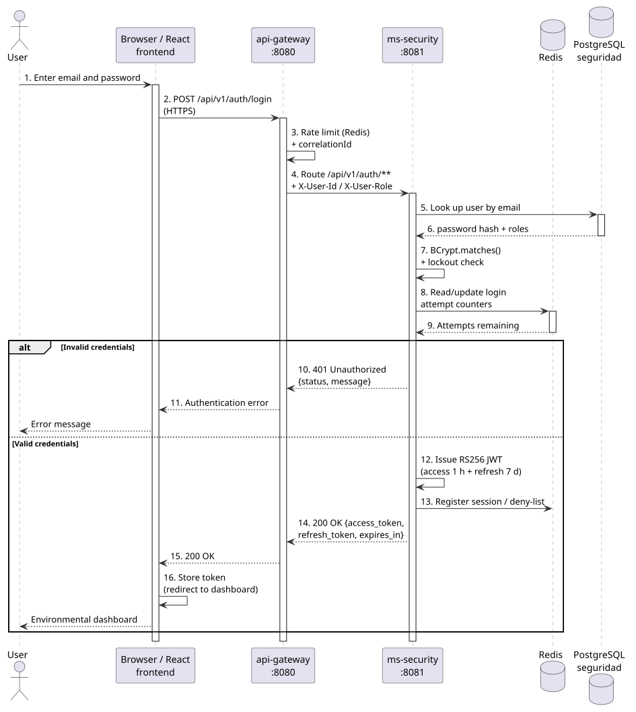
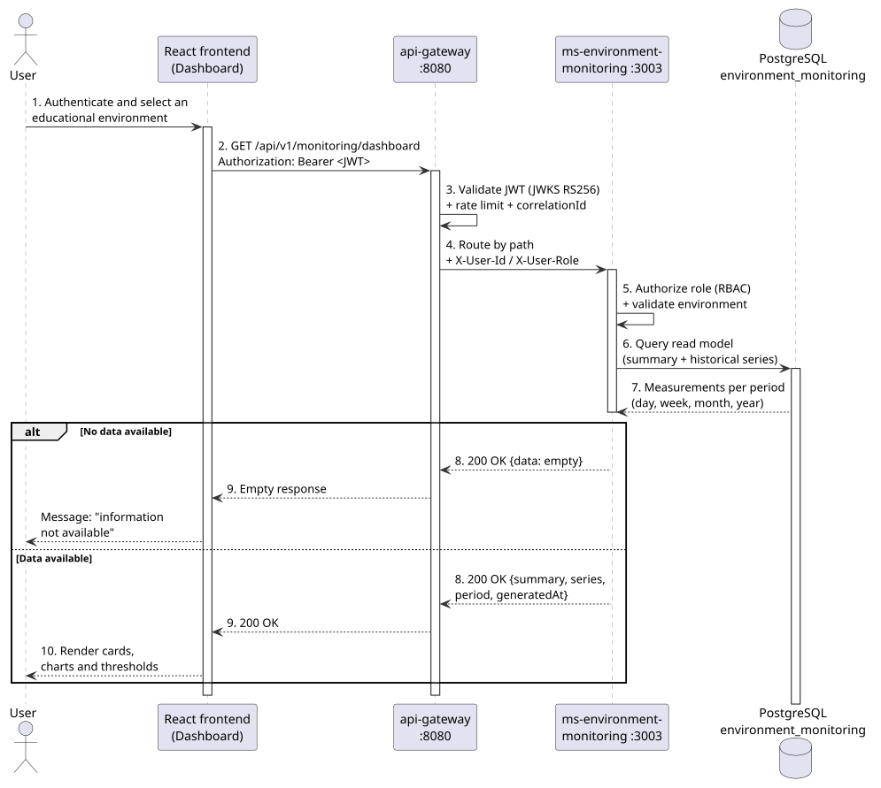
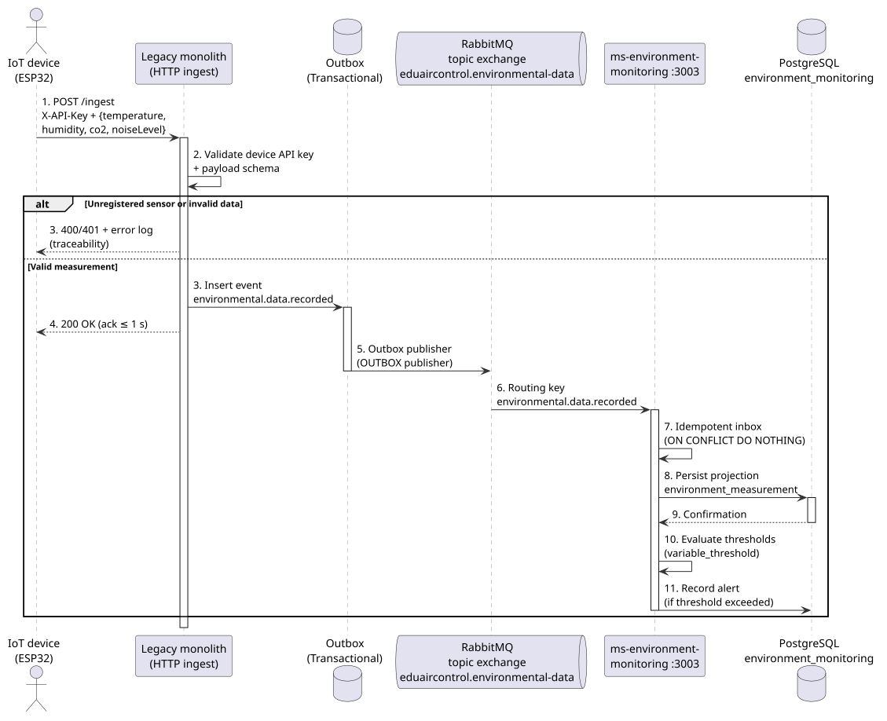
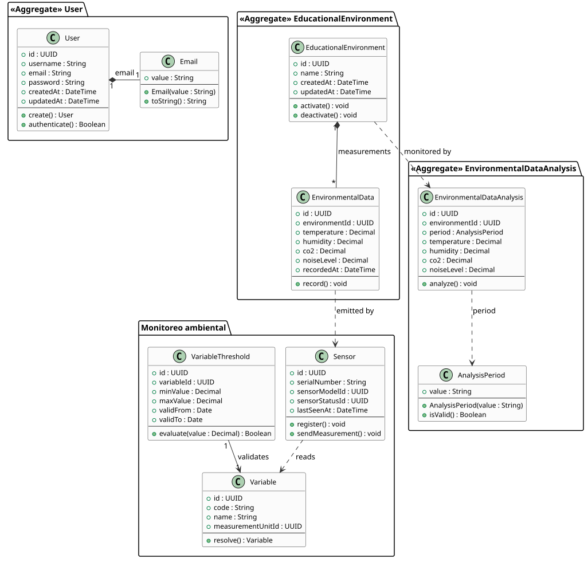

> **Software Analysis of the EduAirControl Platform**  
> María de los Ángeles Olaya García; Jhon Jairo Cortez Vargas  
> Technology Program in Software Analysis and Development – 3145556, Servicio Nacional de Aprendizaje (SENA)  
> Software Analysis and Development – 3145556  
> All instructors of the program  
> October 9, 2026 · 2025-2026

# Abstract

This document presents the software analysis of EduAirControl, a web platform for environmental monitoring and analysis in educational environments. The analysis defines the problem context, the scope of the minimum viable product, the actors, the functional and non-functional requirements, and the UML modelling of the system: use cases, sequence diagrams for the critical flows (authentication, dashboard query, and measurement ingestion), and a class diagram of the domain model. In addition, the logic of the core algorithms is described in pseudocode, the technical, economic, and operational feasibility of the solution is evaluated, and the main project risks are identified. The information comes from the project documentation, with the Software Requirements Specification (Deliverable 02) as the source of the `RF`, `RNF`, and `CU` identifiers, and is organized according to the analysis phase of the software life cycle. The document serves as a reference for the planning, design, and implementation phases and as evidence for the learning outcome related to specifying and evaluating software solution requirements.

*Keywords:* software analysis, functional requirements, use cases, UML, environmental monitoring, microservices.

# 1. Introduction

This document is the software analysis of the EduAirControl project, developed within the training process of the Software Analysis and Development (ADSO) program. Its purpose is to translate the client's need into a verifiable analytical specification: what the system does, who it interacts with, what requirements it must satisfy, how its main flows behave, and what feasibility and risk constraints accompany the solution.

The analysis was prepared from the project documentation, which acts as the single source of truth. Its normative basis is the **Software Requirements Specification (Deliverable 02)**, from which the identifiers `RFx.y`, `RNFx`, and `CU-xx` are adopted unchanged; to it are added the product vision and problem framing (Deliverable 01), the Technical Proposal with the time and budget figures (Deliverable 04), the entity-relationship model (Deliverable 06), and the complementary governance documentation (user stories, traceability matrix, and architectural decision records known as ADRs). When the documentation and the code disagree, the executable state is taken as the reference and the deviation is reported as a risk (Section 11).

The document is addressed to the development team, the evaluating instructor, and the actors involved in the planning and design phases. It is organized as follows: Section 2 (general description), Section 3 (scope and objectives), Section 4 (actors), Section 5 (requirements), Section 6 (use cases), Section 7 (sequence diagrams), Section 8 (class diagram), Section 9 (algorithms and logical processes), Section 10 (feasibility), Section 11 (risks), Section 12 (conclusions), references, and appendices.

**Table 1.** *Project deliverables related to this document*

| Deliverable | Content | Use in this document |
|-------------|---------|----------------------|
| `01_Documento_General_Proyecto` | Vision, scope, architecture, and project status | Context (Section 2), risks (Section 11) |
| `02_Especificacion_Requisitos` | Requirements `RFx.y`, `RNFx`, and use cases `CU-xx` | Full numbering of Sections 5 and 6, Appendix A |
| `04_Propuesta_Tecnica` | Architecture, schedule, and budget | Feasibility (Section 10) |
| `06_Base_Datos` | Entity-relationship model and SQL script | Class diagram (Section 8) |
| `05_Diseno_Software` | Detailed design | Destination of this analysis (Section 12) |
| `07_Pruebas` to `15_Enlace_Repositorio_GitHub` | Tests, quality, implementation, manuals, and annexes | Downstream consumers of the analysis |

# 2. General Description of the Project

## 2.1 Context and Problem

Educational institutions need to understand the environmental conditions of classrooms and other educational spaces (temperature, humidity, CO₂, and noise level). Before the system, sensor information was consulted in a fragmented and scattered way, which prevented measurements from being centralized, compared over time, and used to make decisions about the monitored spaces.

**Table 2.** *Dimensions of the problem and their implication for the product*

| Dimension | Current problem | Product implication |
|-----------|-----------------|---------------------|
| Access | There is no clear place to consult environmental information | Authenticated dashboard access |
| Centralization | Measurements remain isolated from the space they belong to | Management of environments, sensors, and measurement references |
| Understanding | Raw values do not show how conditions change | Historical analysis by day, week, month, and year |
| Traceability | A measurement is only useful if its source, environment, and time are known | Sensor–environment–timestamp relationships preserved |
| Governance | User and administrator access must be controlled | IAM roles, permissions, sessions, and audit information |

With the system, environmental information is centralized and presented through a controlled dashboard so that users and administrators can monitor conditions and make informed decisions.

## 2.2 Proposed Solution

EduAirControl is an IoT-based web platform for environmental monitoring and analysis that centralizes temperature, humidity, CO₂, and noise information and presents it through dashboards of current conditions and historical analysis by day, week, month, and year (product vision).

The product promise can be summarized in four commitments: (a) centralization of information in a common access point, (b) context for every measurement associated with an educational environment, sensor, and recording time, (c) understanding through current queries and analysis of the supported periods, and (d) protection of access through registration, authentication, permissions, and auditing.

## 2.3 System Components and Services

**Table 3.** *Deployable components of the system*

| Component | Responsibility | Port |
|-----------|----------------|------|
| api-gateway | Single entry point: routing, JWT validation, rate limiting, and correlation IDs | 8080 |
| ms-security | Registration, authentication, OAuth2/OIDC authorization server, JWT issuing (RS256), and token revocation | 8081 |
| ms-user-management | User profile management and query | 3007 |
| ms-classroom-management | Classroom, campus, and educational environment type management | 3002 |
| ms-sensor-management | Sensor, variable, and installation registration and configuration | 3004 |
| ms-environment-monitoring | Measurement reception, persistence, query, analysis, dashboard, and alerts | 3003 |
| ms-user-experience | Preferences, favourites, and environment ratings | 3006 |
| React / React Native frontend | Web and mobile interfaces for authentication, management, monitoring, and analysis | — |
| PostgreSQL 15 | Persistence (one instance per service in the `infra` stack) | 5433–5439 |
| RabbitMQ | Asynchronous event communication (topic exchange + durable queue + DLQ) | 5672 |
| Redis | Rate limiting, sessions, token deny-list, and lockout counters | 6379 |

The adopted architecture is a microservices style with an API Gateway and event-driven communication, applying the strangler-fig pattern over a legacy monolith. Each service owns its data (domain separation) and communicates with the others through versioned REST APIs (`/api/v1`) or asynchronous events with transactional outbox and idempotent inbox.

## 2.4 Current Project Status

The project is in the MVP development phase, with no released version. According to the status reported in Section 6 of Deliverable 02, of the 41 functional sub-requirements, 26 are implemented in the source, 12 are partial, and 2 are pending (RF1.2 second factor and RF6.5 external notification). The local deployment stack (`infra/docker-compose.yml`) starts all seven applications together with their databases, which confirms that the full environment is executable.

# 3. Scope and Objectives

## 3.1 Minimum Viable Product Scope

**Table 4.** *Capabilities included in the MVP*

| # | Capability | Description | Responsible service |
|---|------------|-------------|---------------------|
| 1 | User authentication and registration | Secure registration and platform access | ms-security |
| 2 | Educational environment management | Management and query of educational spaces | ms-classroom-management |
| 3 | Sensor management | Registration, configuration, and status of environmental sensors | ms-sensor-management |
| 4 | Environmental monitoring | Query of temperature, humidity, CO₂, and noise measurements | ms-environment-monitoring |
| 5 | Environmental dashboard | Visual presentation of current and historical information | ms-environment-monitoring and frontend |
| 6 | Historical analysis | Data query by day, week, month, and year | ms-environment-monitoring |
| 7 | Favourite environments | Adding and removing environments from a personal list | ms-user-experience |
| 8 | Environment rating | Rating the conditions of an educational environment | ms-user-experience |
| 9 | Alerts and notifications | Threshold evaluation, `WARNING`/`CRITICAL` alerts, and notification centre | ms-environment-monitoring |

## 3.2 Out of Scope

**Table 5.** *Capabilities excluded from the MVP*

| # | Excluded capability | Reason |
|---|---------------------|--------|
| 1 | Environmental ranking | The current scope focuses on monitoring, visualization, and analysis |
| 2 | Advanced predictive analysis | Not part of the MVP; to be evaluated in a future release |
| 3 | Automatic control of environmental equipment | The system monitors and analyses but does not control equipment |
| 4 | Integration with external environmental control systems | Not defined for the current version |

In addition, sensor hardware development and external infrastructure services are third-party responsibilities: EduAirControl consumes the data; it does not manufacture the physical devices.

## 3.3 Objectives

**General objective:** to analyse and specify the requirements and modelling of the EduAirControl software for monitoring and analysing the environmental conditions of an institution's educational environments.

**Specific objectives:**

1. Characterize the problem context, the actors, and the system scope.
2. Specify the verifiable functional and non-functional requirements of the MVP.
3. Model the use cases, interaction flows, and static structure of the system using UML.
4. Describe the logic of the critical domain algorithms using pseudocode.
5. Evaluate the technical, economic, and operational feasibility of the solution.
6. Identify the project risks and their mitigation strategies.

## 3.4 Assumptions and Constraints

**Table 6.** *Scope assumptions, constraints, and dependencies*

| Type | Condition | Consequence if it does not hold |
|------|-----------|---------------------------------|
| Assumption | Environmental measurements are available through the defined ingestion mechanisms | Ingestion and monitoring requirements must be reviewed |
| Assumption | Users access the system through a web interface | User experience requirements must be reviewed |
| Assumption | PostgreSQL is available for relational persistence | Data and architectural decisions must be reviewed |
| Assumption | Data allows analysis by day, week, month, and year | Dashboard queries and analysis requirements must be adjusted |
| Constraint (time) | Work is organized in one-week sprints | Scope must be renegotiated per sprint |
| Constraint (budget) | No budget or cost limit has been defined | Cost is estimated in team effort/hours |
| Constraint (technology) | React, Spring Boot, and PostgreSQL 15 with Docker, Jenkins, and GitHub | Stack changes require a new ADR |
| Constraint (team) | Two developers and one Tech Lead responsibility | Mandatory prioritization (MoSCoW) |
| Dependency | GitHub repository, Docker environment, and sensor connectivity | Delay in continuous integration and ingestion |

# 4. System Actors

**Table 7.** *Actors of the EduAirControl system*

| Actor | Type | Description | Main interaction |
|-------|------|-------------|------------------|
| User | Primary | Person who accesses the platform to consult environmental information | Authenticates, queries environments, current conditions, and historical analysis |
| Administrator | Primary | Person responsible for managing platform information | Manages users, educational environments, and sensors according to permissions |
| IoT device (ESP32) | Secondary | Physical device that sends environmental measurements | Sends temperature, humidity, CO₂, and noise over HTTP with `X-API-Key` |
| api-gateway | Secondary | Routing and edge validation infrastructure | Validates JWT, applies rate limiting, and propagates identity |
| Messaging system (RabbitMQ) | Secondary | Event infrastructure between services | Publishes and consumes measurement and installation events |

# 5. System Requirements

## 5.1 Functional Requirements

Functional requirements describe what the system must do. The `RFx.y` identifiers are those of the **Software Requirements Specification (Deliverable 02)**, so both documents share a single nomenclature. They are gathered here with the responsible service, the user story (HU), and the priority; full traceability is provided in Appendix A.

**Table 8.** *Functional requirements of the MVP (RF1.1–RF9.5)*

| ID | Requirement | Responsible service | HU | Priority |
|----|-------------|----------------------|----|----------|
| RF1.1 | Log in with email and password and issue access tokens (1 h) and refresh tokens (7 d). | ms-security | HU-IAM-002 | High |
| RF1.2 | Provide a second authentication factor. | ms-security | — | Low |
| RF1.3 | Register with name, email, password, institution code, and optional campus; reject duplicate emails. | ms-security | HU-IAM-001 | High |
| RF1.4 | Sign in with Google/Facebook (OAuth2) when configured; link existing accounts or create new ones. | ms-security | — | Medium |
| RF1.5 | Accept terms and conditions during registration. | ms-security | — | Medium |
| RF1.6 | Recover the password through a code sent by email, validate it, and define a new one (with resend). | ms-security | — | Medium |
| RF1.7 | Change the password and request account deletion with confirmation. | ms-security | — | Medium |
| RF1.8 | Restrict routes and operations by `USER`, `ADMIN`, and `SUPER_ADMIN` roles (401 without authentication, 403 without permission). | ms-security | HU-IAM-003 | High |
| RF1.9 | Log out and refresh the token; revocation invalidates the token according to the configured strategy. | ms-security | HU-IAM-003 | Medium |
| RF2.1 | Create, query, and edit institutions with a unique code (superadministrator). | ms-user-management | — | Medium |
| RF2.2 | Register, query, edit, and delete campuses associated with an institution. | ms-user-management | — | Medium |
| RF2.3 | Isolate data by institution and campus in tokens, gateway, and queries; no user accesses another institution's data. | api-gateway | HU-ARCH-001 | High |
| RF2.4 | Query users and assign roles from the administration functions. | ms-user-management | HU-USER-001 | Medium |
| RF3.1 | Show authorized environments with their environmental status and access to detail. | ms-environment-monitoring | HU-ANA-005 | High |
| RF3.2 | Show temperature, humidity, CO₂, and noise with value, unit, and status. | ms-environment-monitoring | HU-MON-004 | High |
| RF3.3 | Compute a 0–100 score and a ranking of environments based on range compliance. | ms-environment-monitoring | — | Low |
| RF3.4 | Query current and historical data by day, week, month, and year, selecting period and variable. | ms-environment-monitoring | HU-ANA-001 to HU-ANA-004 | Medium |
| RF3.5 | Show charts or indicators that allow comparing the evolution of measurements. | ms-environment-monitoring / frontend | HU-ANA-005 | Medium |
| RF4.1 | Search environments by name and query, register, or delete the search history. | ms-classroom-management | — | Medium |
| RF4.2 | Filter environments by block, floor, favourites, and environmental status. | ms-classroom-management | — | Medium |
| RF5.1 | Show location, capacity, type, environmental quality, current metrics, reference ranges, and recommendations. | ms-classroom-management | HU-CLASS-001 | Medium |
| RF5.2 | Rate an environment from 1 to 5 and write a comment of up to 1,000 characters. | ms-user-experience | — | Medium |
| RF5.3 | Query the detail of a variable, its current value, status, and history. | ms-environment-monitoring | — | Medium |
| RF6.1 | Compare each measurement with active thresholds and classify deviations as `WARNING` or `CRITICAL`. | ms-environment-monitoring | HU-MON-001 | High |
| RF6.2 | List alerts and allow acknowledging them. | ms-environment-monitoring | — | Medium |
| RF6.3 | Show notifications sorted by date, open the related item, and mark it as read. | ms-environment-monitoring / ms-user-experience | — | Medium |
| RF6.4 | Enable or disable alerts, warnings, daily summary, and sound according to preferences. | ms-user-experience | — | Medium |
| RF6.5 | Send alerts outside the application through push notification or email to responsible people. | ms-user-experience | — | Low |
| RF7.1 | Edit name, job title, phone, location, and profile photo. | ms-user-management | — | Medium |
| RF7.2 | Mark or unmark favourite environments and query one's own list. | ms-user-experience | — | Medium |
| RF7.3 | Offer dark mode, three colour-blindness options, and three font sizes. | frontend | — | Low |
| RF7.4 | Offer Spanish, English, French, and Portuguese. | frontend | — | Low |
| RF7.5 | Save date format, time zone, and reminder preferences; local storage when offline. | ms-user-experience | — | Low |
| RF8.1 | Create, edit, and delete environments with name, location, floor, capacity, and type (administrator). | ms-classroom-management | HU-CLASS-001 | Medium |
| RF8.2 | Register, edit, enable or disable, and remove sensors; associate variables and install or remove them from environments. | ms-sensor-management | HU-SENS-001 | High |
| RF8.3 | Configure normal, warning, and critical thresholds per variable and environment type, with time validity. | ms-environment-monitoring | — | Medium |
| RF9.1 | Receive, validate, and persist measurements, avoiding duplicates on retries (base HTTP/HTTPS channel). | ms-environment-monitoring | HU-MON-001, HU-SENS-002 | High |
| RF9.2 | Keep measurements for historical query by day, week, month, and year. | ms-environment-monitoring | HU-ANA-001 to HU-ANA-004 | Medium |
| RF9.3 | Query the most recent value of each variable per environment. | ms-environment-monitoring | HU-MON-003 | Medium |
| RF9.4 | Configure an ESP32 device from the mobile application over BLE, with permissions and network sending. | mobile frontend | — | Low |
| RF9.5 | Register devices with MAC, name, type, firmware, network, and status, and assign them to environments. | ms-sensor-management | — | Medium |

Traceability note: the `FR-001` to `FR-017` identifiers used in previous versions of this document and in the local governance matrix correspond to the `RFx.y` identifiers above (see Appendix A, column "Previous FR").

## 5.2 Non-Functional Requirements

Non-functional requirements define the measurable qualities of the system; every target must be verifiable. The `RNF1`–`RNF10` identifiers are those of the Software Requirements Specification (Deliverable 02); the verification column is kept here, since it fixes how each target is demonstrated.

**Table 9.** *Non-functional requirements and their acceptance targets*

| ID | Category | Acceptance target | Verification |
|----|----------|-------------------|--------------|
| RNF1 | Performance | P95 latency ≤ 500 ms on critical endpoints; historical analysis P95 ≤ 2 s; dashboard P95 ≤ 3 s; ingestion ack P95 ≤ 1 s; error rate < 1 % | Load tests (k6/JMeter) in staging |
| RNF2 | Availability and resilience | Monthly availability ≥ 99.5 %; restart without state loss; retries do not duplicate measurements | Health checks (`/health`, `/health/ready`) and fault-injection tests |
| RNF3 | Scalability | Horizontal scaling up to 5 instances per service; new instances when CPU > 70 %; recovery ≤ 2 min | Load and scaling tests |
| RNF4 | Security and privacy | JWT required on private endpoints (1 h expiry, 7 d refresh); HTTPS/TLS 1.2+ in production; BCrypt password hashing; OWASP Top 10 review; secrets kept out of the code and full tokens never logged | Static analysis (SonarQube), dependency scanning, and DAST |
| RNF5 | Observability | Structured logs with correlationId, metrics (Prometheus/Grafana), traces (OpenTelemetry), and operational alerts | Logging and monitoring smoke tests |
| RNF6 | Maintainability and documentation | Coverage ≥ 80 % of lines (≥ 90 % in business logic); cyclomatic complexity ≤ 10; build < 5 min; OpenAPI contract updated for every exposed API | JaCoCo / SonarQube in CI |
| RNF7 | Portability and deployment | All services deployable as Docker images; configuration through environment variables; Compose as the documented minimum target | Image build and execution in CI |
| RNF8 | Recovery | RTO < 5 min (service), < 30 min (primary database); RPO ≤ 24 h with verified daily backups | Backup and restoration tests |
| RNF9 | Usability, accessibility, and languages | Main flows understandable; Spanish, English, French, and Portuguese; light/dark mode and colour-blindness options; keyboard navigation and WCAG 2.1 AA target on main flows | Usability review and accessibility audit (Lighthouse/WAVE) |
| RNF10 | Compatibility and adaptation | Chrome, Firefox, Edge, and Safari browsers; Android/iOS according to the project's Expo SDK; responsive design from 360×640 px to 1280×720 px without horizontal overflow | Cross-platform tests (BrowserStack/real devices) |

## 5.3 Business Rules (Invariants)

Business rules are validated on every operation and may never be violated. The `INV-xxx` identifiers come from the domain model; the last column links each invariant to the equivalent rule in Section 10 of Deliverable 02 (Requirements Specification), which defines no identifiers of its own.

**Table 10.** *Domain invariants (business rules)*

| ID | Rule | Violated when... | Associated rule (Doc. 02 §10) | Implementation |
|----|------|------------------|-------------------------------|----------------|
| INV-001 | A user's email must have a valid format | A user registers with an invalid email | Input validation in RF1.3 | Validation on user creation |
| INV-003 | Every educational environment has a unique identifier | An environment is created without an ID | Mandatory fields validated in RF8.1 | Automatic generation on creation |
| INV-004 | Every educational environment must have a name | An environment is created without a name | Mandatory fields validated in RF8.1 | Validation on creation |
| INV-005 | Every measurement belongs to an educational environment | A measurement is recorded without an environment | Measurements must identify sensor, variable, and environment | `environmentId` validation |
| INV-006 | The measurement must include temperature, humidity, CO₂, and noise | A required variable is missing | Out-of-range data is rejected or marked invalid | Schema validation |
| INV-007 | The analysis must use a supported period: day, week, month, or year | An unsupported period is submitted | Query parameter validation | `AnalysisPeriod` validation |
| INV-009 | Every sensor has a unique identifier | A sensor is created without an ID | Measurements must identify sensor, variable, and environment | Automatic generation on creation |
| INV-010 | Every sensor has a unique serial number | A serial number is duplicated | Measurements must identify sensor, variable, and environment | Uniqueness validation |
| INV-013 | `validFrom` must be earlier than `validTo` | A threshold has an inverted date range | Thresholds have a validity window and keep history | Range validation |
| INV-014 | `minValue` must be lower than `maxValue` | A threshold has an inverted value range | `WARNING` in the warning band; `CRITICAL` at the critical limits | Range validation |

The remaining rules of Doc. 02 §10 —identity and authorization on every protected operation, institution and campus scope, no duplicates on retries, differentiation of `401` and `403`, absence of credentials and secrets in logs, and consistent date/time and time-zone handling— are verified in the algorithms of Section 9 and in requirements RNF2, RNF4, and RNF5.

# 6. Use Case Modelling

## 6.1 Use Case Diagram

Diagram 1 (Figure 1) shows the main actors of the system and the `CU-xx` use cases defined in Section 9 of Deliverable 02 (Requirements Specification). Query use cases include (`<<include>>`) the internal access control —credential validation and JWT issuance, and role-based authorization (`RBAC`)—, while management operations extend (`<<extend>>`) that control according to the role.

**Figure 1.** *Use case diagram of the EduAirControl system*



*Note.* Elaborated from the CU-01–CU-17 catalog of Deliverable 02 and the RF requirements of Section 5.

## 6.2 Use Case Catalog

**Table 11.** *Use case catalog (CU-01–CU-17)*

| ID | Use case | Main actor | Associated RFs | Focal service |
|----|----------|------------|----------------|---------------|
| CU-01 | Sign up for the platform | User | RF1.3, RF1.5 | ms-security |
| CU-02 | Log in with email and password | User, Administrator, Superadministrator | RF1.1, RF1.8 | ms-security |
| CU-03 | Log in with Google or Facebook | User | RF1.4 | ms-security |
| CU-04 | Recover or change password | User | RF1.6, RF1.7 | ms-security |
| CU-05 | Consult environment panel and ranking | User | RF3.1–RF3.3 | ms-environment-monitoring |
| CU-06 | Search and filter environments | User | RF4.1, RF4.2 | ms-classroom-management |
| CU-07 | View environment detail and its variables | User | RF5.1, RF5.3 | ms-classroom-management |
| CU-08 | Consult historical analysis | User | RF3.4, RF9.2 | ms-environment-monitoring |
| CU-09 | Rate an environment | User | RF5.2 | ms-user-experience |
| CU-10 | Manage favourites | User | RF7.2 | ms-user-experience |
| CU-11 | Review alerts and notifications | User | RF6.1–RF6.4 | ms-environment-monitoring |
| CU-12 | Manage profile and preferences | User | RF7.1, RF7.3–RF7.5 | ms-user-management |
| CU-13 | Administer environments | Administrator | RF8.1 | ms-classroom-management |
| CU-14 | Administer sensors and thresholds | Administrator | RF8.2, RF8.3 | ms-sensor-management |
| CU-15 | Configure a device over Bluetooth | Administrator | RF9.4, RF9.5 | mobile frontend |
| CU-16 | Administer institutions, campuses, and users | Superadministrator | RF2.1–RF2.4 | ms-user-management |
| CU-17 | Send measurements | IoT device | RF9.1 | ms-environment-monitoring |

Two internal use cases do not appear in the table because the system performs them itself within other cases: *Validate credentials and issue JWT* (executed by `ms-security` during CU-02, CU-03, and CU-04) and *Control access by role (RBAC)* (executed by `api-gateway` and `ms-security` on every protected operation, RF1.8). In the diagram they are represented with `<<include>>`.

## 6.3 Detailed Use Case Descriptions

### 6.3.1 CU-02: Log In

**Primary actors:** User, Administrator.

**Preconditions:** the user has a registered account (CU-01) and is not locked out.

**Successful postconditions:** an access token with a one-hour lifetime and a refresh token with a seven-day lifetime are issued; the session is registered.

**Failure postconditions:** no token is issued; the attempt counter is incremented and, when the limit is exceeded, the account is temporarily locked.

*Main flow:*

1. The actor opens the login form and enters email and password.
2. The frontend sends `POST /api/v1/auth/login` over HTTPS to the API Gateway.
3. The gateway applies rate limiting, generates a `correlationId`, and routes to `ms-security`.
4. The service looks up the user by email and verifies the password with BCrypt.
5. The service reads and updates the lockout counters in Redis.
6. Tokens are issued and `200 OK` is returned with the session information.
7. The frontend stores the token and redirects to the environmental dashboard.

*Alternative flow 5a – invalid credentials:* the service returns `401 Unauthorized` with the `{status, message}` format and the frontend displays an error message without revealing which field failed.

*Exception flow – locked account:* authentication is rejected even if the credentials are correct, until the lockout time expires.

### 6.3.2 CU-08: Consult Historical Analysis

**Primary actor:** User.

**Preconditions:** the user is authenticated with query permissions; measurements exist for the environment.

**Successful postconditions:** the historical series and the summary (minimum, maximum, and average) of the environmental variables for the requested period are displayed.

**Partial postconditions:** if there is no data, the message "information not available" is displayed (HU-ANA-005).

*Main flow:*

1. The user selects an educational environment and a period (day, week, month, or year).
2. The frontend requests `GET /api/v1/monitoring/dashboard?period=...` with the `Authorization: Bearer <token>` header.
3. The API Gateway validates the JWT against the `ms-security` JWKS and routes the request.
4. `ms-environment-monitoring` authorizes the role, validates the environment (INV-005), and queries the read model.
5. The system returns the summary and series; the frontend charts them and highlights exceeded thresholds.

*Alternative flow – unsupported period:* if the period is not in `{day, week, month, year}`, the request is rejected with `400 Bad Request` (INV-007).

### 6.3.3 CU-17: Send Environmental Measurements

**Primary actor:** IoT device (ESP32).

**Preconditions:** the sensor is registered, has an active installation, and holds a valid API key.

**Successful postconditions:** the measurement is recorded in the outbox and, after asynchronous processing, persisted in `environment_measurement`; the device receives `200 OK` within the one-second target (RNF1).

**Failure postconditions:** `400` or `401` is returned and the error event is recorded for traceability.

*Main flow:*

1. The device sends `POST /ingest` with `X-API-Key` and the payload `{temperature, humidity, co2, noiseLevel, recordedAt}`.
2. The ingestion service validates the device API key and the measurement schema (INV-006).
3. The `environmental.data.recorded` event is inserted into the outbox table within the same transaction.
4. `200 OK` is returned to the device (acknowledgment).
5. The outbox publisher delivers the event to RabbitMQ; `ms-environment-monitoring` consumes it with an idempotent inbox and persists the projection.
6. Thresholds are evaluated and, if applicable, an alert is raised.

*Alternative flow – unregistered sensor:* the measurement is rejected and the attempt is recorded (HU-SENS-002).

### 6.3.4 CU-11: Review Alerts and Notifications

**Primary actor:** User.

**Preconditions:** the user is authenticated and at least one measurement has been evaluated against active thresholds (RF8.3).

**Successful postconditions:** the alerts within the authorized scope are listed; the user can acknowledge them, open them, and mark them as read (RF6.2, RF6.3).

**Partial postconditions:** if there are no active alerts, an empty list is displayed; the notification preferences (alerts, warnings, daily summary, and sound) apply according to the user's settings (RF6.4).

*Main flow:*

1. `ms-environment-monitoring` evaluates each incoming measurement with the `EvaluateThresholds` algorithm (Section 9.3) and creates the `WARNING` or `CRITICAL` alert when the value falls outside the normal range.
2. The user opens the notification centre; the frontend requests `GET /api/v1/monitoring/alerts?status=active` with `Authorization: Bearer <token>`.
3. The API Gateway validates the JWT and routes the request; the service returns the alerts sorted by date with value, variable, environment, and severity.
4. The user selects an alert, reviews the detail and, if applicable, acknowledges it (`POST .../alerts/{id}/acknowledge`).
5. The alert status is updated and the notification is marked as read for that user.

*Alternative flow – no alerts:* `200 OK` is returned with an empty collection and the frontend shows the "no news" status.

*Exception flow – no permission:* a user without access to the environment receives `403 Forbidden` (RF1.8).

# 7. Sequence Diagrams

## 7.1 User Authentication

Diagram 2 (Figure 2) describes the complete authentication flow, including rate limiting at the gateway, credential verification, lockout control in Redis, and token issuing.

**Figure 2.** *User authentication sequence*



*Note.* Elaborated from CU-02 and RF1.1 (Deliverable 02), HU-IAM-002, and RNF4.

Note: the alternative flows for invalid credentials and locked accounts are included in the diagram through the `alt` construct.

## 7.2 Environmental Dashboard Query

Diagram 3 (Figure 3) describes the dashboard query: JWT validation at the edge, role authorization, read-model query, and information presentation, including the no-data case.

**Figure 3.** *Environmental dashboard query sequence*



*Note.* Elaborated from CU-05 and CU-08, RF3.1, RF3.4, and RF9.3 (Deliverable 02), HU-ANA-005, and RNF1.

## 7.3 Measurement Ingestion from the Sensor

Diagram 4 (Figure 4) describes the environmental data path: HTTP ingestion with `X-API-Key`, transactional outbox writing, RabbitMQ publication, idempotent consumption, persistence, and threshold evaluation.

**Figure 4.** *Environmental measurement ingestion sequence*



*Note.* Elaborated from CU-17 and RF9.1 (Deliverable 02), HU-SENS-002, HU-MON-001, and ADR-004 and ADR-007.

# 8. Class Diagram

## 8.1 Entities and Aggregates

Diagram 5 (Figure 5) models the static structure of the domain according to the DDD tactical model: entities identified by their ID, immutable value objects, and aggregates with their own root.

**Figure 5.** *Class diagram of the EduAirControl domain model*



*Note.* Elaborated from the project domain documentation and the entity-relationship model of Deliverable 06.

**Table 12.** *Tactical building blocks of the domain*

| Name | Type | Bounded context | Aggregate root | Equivalent table (Doc. 06) |
|------|------|-----------------|----------------|----------------------------|
| User | Entity | User management | Yes | `seguridad.users` (+ `user_management.user_profiles`) |
| Email | Value object | Shared | — (belongs to User) | Attribute of `seguridad.users.email` |
| EducationalEnvironment | Entity | Environmental monitoring | Yes | `classrooms.educational_environment` (projected in `environment_monitoring.educational_environment`) |
| EnvironmentalData | Entity | Environmental monitoring | No (internal to the aggregate) | `environment_monitoring.environment_measurement` |
| EnvironmentalDataAnalysis | Entity | Environmental data analysis | Yes | `environment_monitoring.environmental_analysis` |
| AnalysisPeriod | Value object | Environmental data analysis | — (belongs to the aggregate) | Parameter of `environmental_analysis` / `analysis_result` |
| Sensor | Entity | Environmental monitoring | No | `sensors.sensor` (+ `sensors.sensor_installation`) |
| Variable | Entity | Environmental monitoring | No | `sensors.variable` / `environment_monitoring.variable` |
| VariableThreshold | Entity | Environmental monitoring | No | `environment_monitoring.variable_threshold` |

## 8.2 Relationships and Rules

The main relationships in the model are: (a) `User` composes a validated `Email`; (b) `EducationalEnvironment` holds a collection of `EnvironmentalData` (associated measurements, INV-005); (c) `EnvironmentalDataAnalysis` analyses an environment within an `AnalysisPeriod` (INV-007); (d) `Sensor` delivers the measurements and reads the supported `Variable` entries; and (e) `VariableThreshold` defines the acceptable range of a `Variable` with a time validity window (INV-013, INV-014).

The applicable golden rule is that transactions do not cross aggregate boundaries: when an operation must modify two aggregates, it is coordinated through a domain event, which in the implementation is materialized by the outbox/inbox pattern (ADR-007).

The diagram's relationships match those of the entity-relationship model in Deliverable 06: `seguridad.users` 1:N `user_roles` and `refresh_tokens`, `classrooms.campuses` 1:N `educational_environment`, `sensors.sensor` 1:N `sensor_installation` and `sensor_variable`, and `environment_monitoring.variable` 1:N `variable_threshold`. The alerts generated by threshold evaluation (RF6.1, Section 9.3) are persisted in `environment_monitoring.environment_alert`, a table not modelled as its own aggregate because it is a by-product of the monitoring aggregate.

# 9. Analysis of Algorithms and Logical Processes

This section describes, in pseudocode, the core logical processes of the software. Each algorithm indicates inputs, outputs, preconditions derived from the invariants, and its estimated complexity.

## 9.1 Measurement Validation and Ingestion

The following algorithm corresponds to the CU-17 flow and supports requirement RF9.1 with the ≤ 1 s acknowledgment target (RNF1).

```text
ALGORITHM ProcessMeasurement(input)
  INPUT  : input = { apiKey, sensorSerial, temperature, humidity,
                     co2, noiseLevel, recordedAt }
  OUTPUT : 200 OK | 400 Bad Request | 401 Unauthorized
  PRE    : physical device powered on and connected

  1. if apiKey does not belong to a registered device then
  2.       logEvent(LEVEL=ERROR, cause="api_key_invalida")
  3.       return 401 Unauthorized
  4. end if

  5. if sensorSerial does not exist in the database  or  any required
        variable is missing (temperature, humidity, co2, noiseLevel) then
  6.       logEvent(LEVEL=ERROR, cause="esquema_invalido")     // INV-006
  7.       return 400 Bad Request
  8. end if

  9. beginTransaction()
 10.       insertIntoOutbox(type="environmental.data.recorded",
                             naturalKey = (sensorSerial, recordedAt))
 11. commitTransaction()           // atomic commit: measurement + event
 12. return 200 OK                                    // device ack
END ALGORITHM

Complexity : O(1) per measurement (two indexed lookups).
Note       : latency is dominated by the outbox write;
             the asynchronous publisher delivers the event to RabbitMQ
             outside the critical response path.
```

## 9.2 Historical Analysis by Period

Algorithm for CU-08 (RF3.4 and RF9.2), with a P95 ≤ 2 s target for historical analysis (RNF1).

```text
ALGORITHM ConsultAnalysis(environmentId, period, currentDate)
  INPUT  : environmentId (UUID), period ∈ {day, week, month, year}
  OUTPUT : { summary{avg,min,max per variable}, series[] } | 400

  1. if period ∉ {day, week, month, year} then
  2.       return 400 Bad Request                       // INV-007
  3. end if

  4. range ← computeRange(period, currentDate)
  5.         day   : [currentDate - 24 h,  currentDate]
  6.         week  : [ISO-8601 week start, +7 days]
  7.         month : [first day of month, last day of month]
  8.         year  : [January 1, December 31]

  9. rows ← SELECT bucket(recorded_at, period) AS t,
                   AVG/MIN/MAX(temperature | humidity | co2 | noiseLevel)
              FROM environment_measurement
             WHERE environment_id = environmentId
               AND recorded_at BETWEEN range.start AND range.end
             GROUP BY t
             ORDER BY t                                   // composite index

 10. if rows is empty then
 11.       return 200 OK with data = []        // "information not available"
 12. end if

 13. return 200 OK with { summary, series }
END ALGORITHM

Complexity : O(n log n) for grouping and sorting n measurements.
Target     : P95 ≤ 2 s for the supported period and data range.
```

## 9.3 Threshold Evaluation and Alert Generation

Algorithm associated with the monitoring domain: it implements the threshold evaluation of RF6.1 with the thresholds configured in RF8.3, and is governed by ADR-014 (environmental variables and thresholds).

```text
ALGORITHM EvaluateThresholds(measurement)
  INPUT  : measurement = { environmentId, temperature, humidity,
                           co2, noiseLevel, recordedAt }
  OUTPUT : 0..n created alerts

  1. environmentType ← typeOf(measurement.environmentId)
  2. thresholds ← SELECT * FROM variable_threshold
                   WHERE environment_type_id = environmentType
                     AND valid_from <= measurement.recordedAt
                     AND (valid_to IS NULL OR valid_to >= measurement.recordedAt)
                                                                       // INV-013
  3. for each variable v ∈ {temperature, humidity, co2, noiseLevel} do
  4.       t ← thresholds[v]
  5.       if t ≠ ∅ and (measurement[v] < t.minValue  or
                         measurement[v] > t.maxValue) then             // INV-014
  6.             if NOT activeAlertExists(v, measurement.environmentId) then
  7.                   createAlert(v, severity = t.severity,
                                      value = measurement[v])   // raiseIfAbsent
  8.             end if
  9.       end if
 10. end for
END ALGORITHM

Complexity : O(v) with v = 4 variables (small fixed number).
Invariants : INV-013 (validity range) and INV-014 (value range).
```

## 9.4 Authentication and Access Control

Algorithm for use case CU-02 and the internal credential-validation case (RF1.1 and RF1.8), supported by RNF4.

```text
ALGORITHM Authenticate(email, password)
  INPUT  : user credentials
  OUTPUT : 200 OK {access, refresh} | 401 Unauthorized | 423 Locked

  1. user ← findByEmail(email)                            // unique index
  2. if user = NULL or accountLocked(user) then
  3.       return 401 Unauthorized             // lockout checked in Redis
  4. end if

  5. if NOT BCrypt.matches(password, user.passwordHash) then
  6.       attempts ← INCR login_attempts:{email}               // TTL 15 min
  7.       if attempts >= MAX_ATTEMPTS then
  8.             lock(account, TTL = 15 min)    // lockout policy (app.security)
  9.             return 423 Locked
 10.       end if
 11.       return 401 Unauthorized
 12. end if

 13. DEL login_attempts:{email}                   // resets the counter
 14. issue RS256 JWT { sub, roles, jti } with exp = 1 h     // RNF4
 15. issue refresh token with exp = 7 d (mandatory rotation)
 16. registerSessionInRedis(jti, exp)
 17. return 200 OK { access_token, refresh_token, expires_in }
END ALGORITHM

Complexity : O(1) response time (indexed operations and Redis).
Security   : passwords and secrets are never written to logs (RNF5).
```

# 10. Feasibility Analysis

## 10.1 Technical Feasibility

The solution relies on consolidated open-source technologies: Java 17 with Spring Boot for the services, Spring Cloud Gateway for the edge, React and React Native for the interfaces, PostgreSQL 15 for persistence, RabbitMQ for events, and Redis for transient state. The hexagonal architecture with ports and adapters (ADR-009) isolates the domain logic from infrastructure technologies, which reduces coupling and facilitates unit testing.

Available technical evidence: the local deployment stack starts all seven applications together with their databases; services expose public health checks and OpenAPI/Swagger documentation; and a testing strategy is defined (H2 for fast tests and Testcontainers for PostgreSQL and RabbitMQ integration). As a documented technical risk, there are deviations between ADRs and code (database strategy, dual JWT scheme) that must be reconciled (Section 11).

Based on the above, the solution is technically feasible.

## 10.2 Economic Feasibility

The Technical Proposal (Deliverable 04) estimates the project cost with reference figures documented in that deliverable: the software development equals **$20,000,000 COP** in team effort; the development and test hardware (two computers, ESP32, DHT11, KY-038, and MQ-135) amounts to **$11,390,000 COP**; and electricity and internet services during the project's 18 months are estimated at **$3,600,000 COP**, for a **total estimated budget of $34,990,000 COP** (Deliverable 04, Sections 15 to 19).

As for time, the project was prepared over an elapsed period of 18 months, but it can be developed in **4 to 5 months of intensive work** (8 hours a day). Within the current training framework, the plan is organized into four one-week sprints with two developers and one Tech Lead responsibility (approximately 120 person-hours). The platform uses exclusively open-source tooling (IDE, Docker, Jenkins, GitHub, SonarQube), so there are no licensing costs, and the monetary figures are presented as an estimate, not as verified expenditure.

Conclusion: the solution is economically feasible: it requires no licenses, its hardware is affordable, and its development cost is within the order of magnitude of a training project of this scope.

## 10.3 Operational Feasibility

The team, composed of two developers and one Tech Lead responsibility, covers backend, frontend, and operations profiles. Deployment uses Docker Compose, which allows the complete environment to be reproduced on any machine with Docker installed, and continuous integration is automated with Jenkins. Operating the system requires health check monitoring, periodic PostgreSQL backups, and review of structured logs—tasks already covered by RNF2, RNF5, and RNF8. The installation documentation and product manuals (Deliverables 10, 11, and 12) support deployment by a third party.

Conclusion: the solution is operationally feasible, subject to the validation of backup and restoration procedures.

## 10.4 Delivery Schedule

**Table 13.** *Sprint plan derived from the traceability matrix*

| Sprint | Delivered user stories | Covered requirements | Focus |
|--------|------------------------|----------------------|-------|
| Sprint 1 | HU-IAM-001, HU-IAM-002, HU-IAM-003 | RF1.1, RF1.3, RF1.8 | Identity and access |
| Sprint 2 | HU-USER-001, HU-CLASS-001, HU-SENS-001, HU-ARCH-001 | RF2.3, RF2.4, RF8.1, RF8.2 | Management and routing |
| Sprint 3 | HU-SENS-002, HU-MON-001 to HU-MON-004 | RF9.1, RF9.3, RF6.1, RF3.2 | Ingestion and monitoring |
| Sprint 4 | HU-ANA-001 to HU-ANA-005 | RF3.1, RF3.4, RF3.5, RF9.2 | Analysis and dashboard |

# 11. Risk Analysis

**Table 14.** *Project risk register*

| # | Risk | Probability | Impact | Mitigation strategy | Source |
|---|------|-------------|--------|----------------------|--------|
| 1 | Drift between ADRs and code (database strategy, dual RS256/HS256 JWT scheme) | High | High | Reconcile decisions at every review; complete ADR-017 and close deviations D-002 and D-003 | Doc. 01 §11 |
| 2 | Ingestion dependent on the legacy monolith (bottleneck and coupling) | Medium | High | Continue the strangler migration: extract ingestion into `ms-sensor-management` | Analysis |
| 3 | Unavailability of real ESP32 sensor data (firmware pending; MQ-135 not closed) | Medium | High | Ingestion simulator in CI and validation with traceable test data | Doc. 01 §7 |
| 4 | RNF1–RNF10 without automated validation (performance, coverage, recovery) | High | Medium | Add quality gates in CI (k6, JaCoCo, backup tests) | Doc. 02 §8 |
| 5 | Tests requiring Docker (Testcontainers) in every environment | Medium | Medium | Fast tests on H2 and an integration suite in the Docker-enabled pipeline | Analysis |
| 6 | Limited team capacity (2 developers, 4 sprints) | Medium | High | MoSCoW prioritization per story and scope reduction through the defined change process | Analysis |
| 7 | Documentation outdated with respect to the code (e.g., the `ms-security` README) | Low | Medium | Documentation checklist in the Definition of Done | Analysis |
| 8 | Data loss due to primary database failure | Low | High | Daily backups with periodic restoration verification (RNF8) | Doc. 02 §8 |
| 9 | Open CORS with credentials on the gateway (`R-003`) | Medium | High | Review the origin policy on the gateway before deploying; automated CORS test | Doc. 01 §11 |
| 10 | Difference between ADR-003 (database per service) and the actual deployment (`R-007`) | Medium | Medium | Verify the real number of PostgreSQL instances in `infra` and align the ADR | Doc. 01 §11 |
| 11 | Requirements of Doc. 02 marked as "Pending" (RF1.2 second factor and RF6.5 external notification) | High | Medium | Confirm the scope with the client and either leave them explicitly out of this version or plan them | Doc. 02 §6 |

# 12. Conclusions

1. The analysis specifies in a verifiable way what EduAirControl does: 41 functional sub-requirements (RF1.1–RF9.5) and ten measurable non-functional requirements (RNF1–RNF10), each with a responsible service and traceable to user stories; the numbering is the same as the one in the Software Requirements Specification (Deliverable 02), which removes ambiguity between documents.
2. UML modelling (17 use cases `CU-xx`, authentication/dashboard/ingestion sequences, and class diagram) translates the requirements into structures that are understandable for the team and the evaluator, and documents the critical flows of the system.
3. The pseudocode description of the ingestion, historical analysis, threshold evaluation, and authentication algorithms closes the gap between specification and implementation by fixing inputs, outputs, invariants, and complexity.
4. The solution is feasible on the three planes evaluated: technical (consolidated stack and executable environment), economic (total estimated budget of $34,990,000 COP and intensive development of 4 to 5 months, Deliverable 04), and operational (containerized deployment and defined monitoring).
5. The dominant risk is the documentary drift between architectural decisions and code; its mitigation must be a recurring team ritual rather than a one-off activity.
6. The document serves as direct input for the `05_Diseno_Software` and for the test plan of the evaluation phase.

# References

- Docker. (n.d.). *Docker documentation*. https://docs.docker.com
- EduAirControl. (2026). *General project documentation of EduAirControl* (Deliverable 01) [Internal project document].
- EduAirControl. (2026). *Software requirements specification of EduAirControl* (Deliverable 02) [Internal project document].
- EduAirControl. (2026). *Entity-relationship model and database script of EduAirControl* (Deliverable 06) [Internal project document].
- EduAirControl. (2026). *Technical proposal of EduAirControl* (Deliverable 04) [Internal project document].
- Hohpe, G., & Woolf, B. (2003). *Enterprise integration patterns: Designing, building, and deploying messaging solutions*. Addison-Wesley.
- IEEE. (2018). *Systems and software engineering—Life cycle processes—Requirements engineering* (IEEE Std 29148-2018). IEEE.
- ISO. (2011). *ISO/IEC 25010:2011—Systems and software engineering—Systems and software Quality Requirements and Evaluation (SQuaRE)—System and software quality models*. ISO.
- OWASP. (n.d.). *OWASP Top Ten*. https://owasp.org/www-project-top-ten/
- PlantUML. (n.d.). *PlantUML*. https://plantuml.com
- PostgreSQL. (n.d.). *PostgreSQL 15 documentation*. https://www.postgresql.org/docs/15/
- RabbitMQ. (n.d.). *RabbitMQ tutorials*. https://www.rabbitmq.com/tutorials
- React. (n.d.). *React*. https://react.dev
- Sena. (n.d.). *Servicio Nacional de Aprendizaje*. https://www.sena.edu.co
- Sommerville, I. (2016). *Software engineering* (10th ed.). Pearson.
- Spring. (n.d.). *Spring Boot reference documentation*. https://docs.spring.io/spring-boot/reference/
- Spring. (n.d.). *Spring Cloud Gateway*. https://spring.io/projects/spring-cloud-gateway
- WeasyPrint. (n.d.). *WeasyPrint*. https://weasyprint.org
# Appendix A. Requirement–Story–Service Traceability Matrix

The matrix links each `RFx.y` requirement of Deliverable 02 with its identifier in the previous version of this document (`FR-xxx`), the user story, the verification test, the responsible service, and the status reported in Section 6 of Deliverable 02.

**Table 15.** *Traceability matrix RF → HU → service → test*

| RF | Abbreviated description | Previous FR | HU | Verification test | Service | Status (Doc. 02) |
|----|-------------------------|-------------|----|-------------------|---------|------------------|
| RF1.1 | Login and tokens | FR-002 | HU-IAM-002 | `auth.login.test` | ms-security | Implemented |
| RF1.2 | Second factor | — | — | `auth.2fa.test` | ms-security | Pending |
| RF1.3 | User registration | FR-001 | HU-IAM-001 | `auth.register.test` | ms-security | Implemented |
| RF1.4 | Google/Facebook login | — | — | `auth.oauth2.test` | ms-security | Implemented |
| RF1.5 | Terms acceptance | — | — | `auth.terms.test` | ms-security | Implemented |
| RF1.6 | Password recovery | — | — | `auth.password.reset.test` | ms-security | Implemented |
| RF1.7 | Password change and deletion | — | — | `auth.password.change.test` | ms-security | Implemented |
| RF1.8 | Role-based access control | FR-015 | HU-IAM-003 | `authorization.roles.test` | ms-security | Implemented |
| RF1.9 | Logout and refresh | FR-002 | HU-IAM-003 | `auth.refresh.test` | ms-security | Implemented |
| RF2.1 | Institution management | — | — | `institutions.management.test` | ms-user-management | Implemented |
| RF2.2 | Campus management | — | — | `campuses.management.test` | ms-user-management | Partial |
| RF2.3 | Institution/campus isolation | FR-016 | HU-ARCH-001 | `tenant.isolation.test` | api-gateway | Partial |
| RF2.4 | Users and roles | FR-003 | HU-USER-001 | `users.management.test` | ms-user-management | Implemented |
| RF3.1 | Environment panel | FR-013 | HU-ANA-005 | `dashboard.environmental.test` | ms-environment-monitoring | Implemented |
| RF3.2 | Variables on the panel | FR-014 | HU-MON-004 | `environmental.variables.test` | ms-environment-monitoring | Implemented |
| RF3.3 | Score and ranking | — | — | `dashboard.ranking.test` | ms-environment-monitoring | Partial |
| RF3.4 | Data by day/week/month/year | FR-009 to FR-012 | HU-ANA-001 to HU-ANA-004 | `analysis.period.test` | ms-environment-monitoring | Partial |
| RF3.5 | Evolution charts | FR-013 | HU-ANA-005 | `dashboard.charts.test` | ms-environment-monitoring | To verify |
| RF4.1 | Environment search | — | — | `search.environments.test` | ms-classroom-management | Partial |
| RF4.2 | Panel filters | — | — | `search.filters.test` | ms-classroom-management | Partial |
| RF5.1 | Environment detail | FR-004 | HU-CLASS-001 | `environment.detail.test` | ms-classroom-management | Implemented |
| RF5.2 | Environment rating | — | — | `ratings.test` | ms-user-experience | Partial |
| RF5.3 | Variable detail | FR-008 | — | `variable.detail.test` | ms-environment-monitoring | Partial |
| RF6.1 | Threshold evaluation | — | HU-MON-001 | `alerts.threshold.test` | ms-environment-monitoring | Implemented |
| RF6.2 | Alert listing and acknowledgement | — | — | `alerts.ack.test` | ms-environment-monitoring | Implemented |
| RF6.3 | Notification centre | — | — | `notifications.test` | ms-environment-monitoring | Partial |
| RF6.4 | Notification preferences | — | — | `notification.preferences.test` | ms-user-experience | Implemented |
| RF6.5 | External notification (push/email) | — | — | `notifications.external.test` | ms-user-experience | Pending |
| RF7.1 | Profile editing | — | — | `profile.test` | ms-user-management | Implemented |
| RF7.2 | Favourite environments | — | — | `favorites.test` | ms-user-experience | Implemented |
| RF7.3 | Dark mode, colour blindness, font size | — | — | `accessibility.preferences.test` | frontend | Implemented |
| RF7.4 | Four languages | — | — | `i18n.test` | frontend | Implemented |
| RF7.5 | Date format and reminders | — | — | `preferences.format.test` | ms-user-experience | Implemented |
| RF8.1 | Environment administration | FR-004 | HU-CLASS-001 | `classroom.management.test` | ms-classroom-management | Implemented |
| RF8.2 | Sensor administration | FR-005 | HU-SENS-001 | `sensor.management.test` | ms-sensor-management | Partial |
| RF8.3 | Thresholds per variable and environment | — | — | `thresholds.management.test` | ms-environment-monitoring | Partial |
| RF9.1 | Measurement reception | FR-006, FR-017 | HU-MON-001, HU-SENS-002 | `environmental.data.test` | ms-environment-monitoring | Implemented |
| RF9.2 | Historical retention | FR-007 | HU-ANA-001 to HU-ANA-004 | `environmental.history.test` | ms-environment-monitoring | Implemented |
| RF9.3 | Latest value per environment | FR-008 | HU-MON-003 | `environmental.current.test` | ms-environment-monitoring | Implemented |
| RF9.4 | BLE device configuration | FR-017 | — | `device.ble.test` | mobile frontend | Implemented |
| RF9.5 | Device registration | FR-005 | — | `devices.management.test` | ms-sensor-management | Partial |
