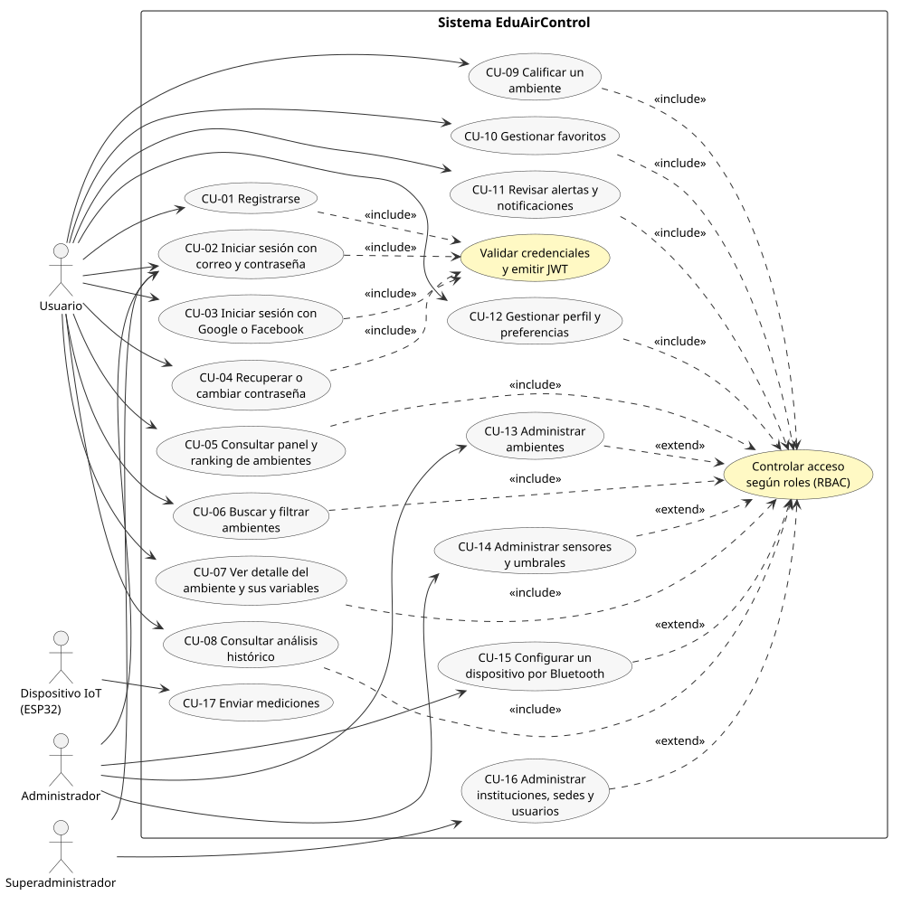
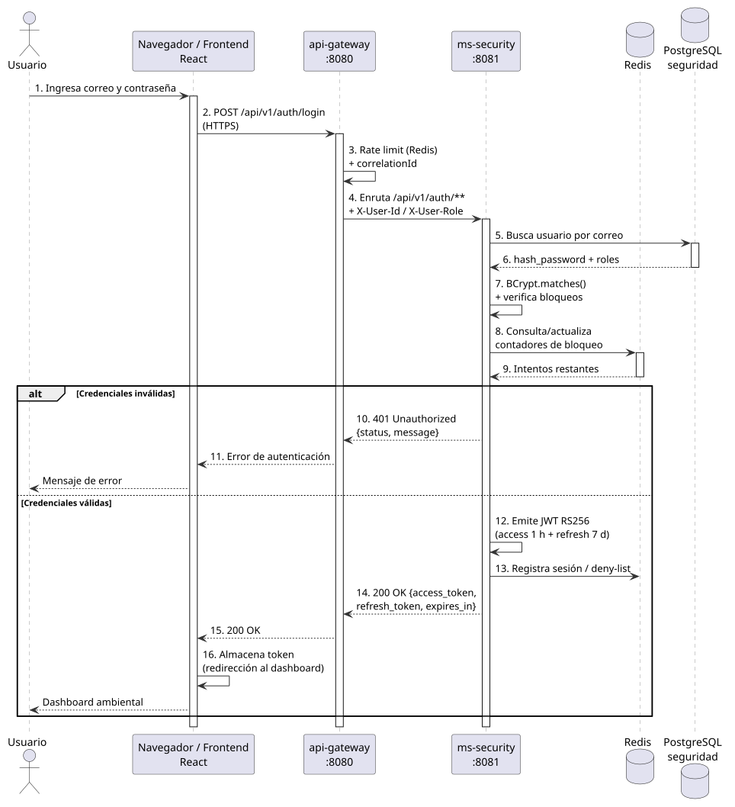
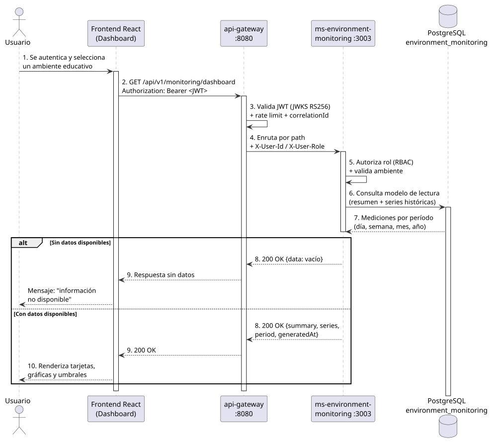
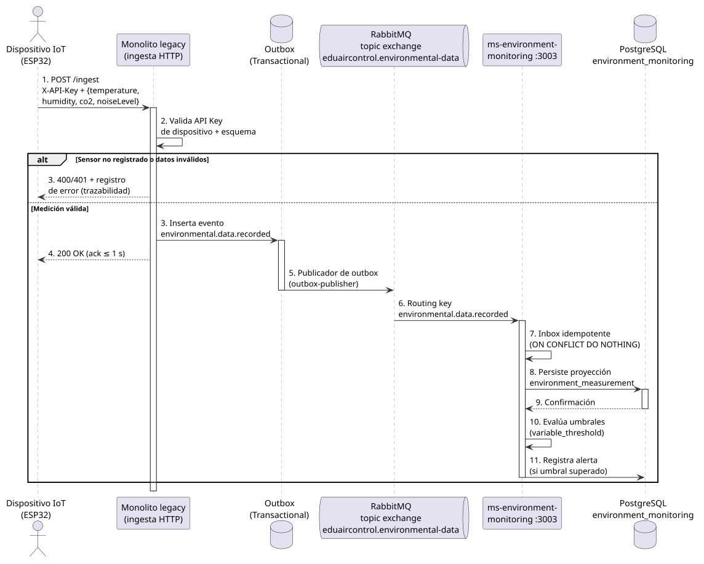

> **Análisis de Software de la Plataforma EduAirControl**  
> María de los Ángeles Olaya García; Jhon Jairo Cortez Vargas  
> Tecnólogo en Análisis y Desarrollo de Software – 3145556, Servicio Nacional de Aprendizaje (SENA)  
> Análisis y Desarrollo de Software – 3145556  
> Todos los instructores del programa  
> 9 de octubre de 2026 · 2025-2026

# Resumen

Este documento presenta el análisis de software de EduAirControl, una plataforma web de monitoreo y análisis ambiental para ambientes educativos. El análisis define el contexto del problema, el alcance del producto mínimo viable, los actores, los requisitos funcionales y no funcionales, y el modelamiento UML del sistema: casos de uso, diagramas de secuencia para los flujos críticos (autenticación, consulta del dashboard e ingesta de mediciones) y diagrama de clases del modelo de dominio. Adicionalmente, se describe la lógica de los algoritmos centrales mediante pseudocódigo, se evalúa la factibilidad técnica, económica y operativa, y se identifican los riesgos principales del proyecto. La información proviene de la documentación del proyecto, con la Especificación de Requisitos (Entregable 02) como fuente de la nomenclatura `RF`, `RNF` y `CU`, y se organiza de acuerdo con la fase de análisis del ciclo de vida del software. El documento funciona como referencia para las fases de planificación, diseño e implementación, y como evidencia del resultado de aprendizaje relacionado con la especificación y evaluación de requisitos de soluciones de software.

*Palabras clave:* análisis de software, requisitos funcionales, casos de uso, UML, monitoreo ambiental, microservicios.

# 1. Introducción

El presente documento constituye el análisis de software del proyecto EduAirControl, desarrollado en el marco del proceso formativo del programa de Análisis y Desarrollo de Software (ADSO). Su propósito es traducir la necesidad del cliente en una especificación analítica verificable: qué hace el sistema, con quién interactúa, qué requisitos debe satisfacer, cómo se comportan sus flujos principales y qué restricciones de factibilidad y riesgo acompañan la solución.

El análisis se elaboró sobre la documentación del proyecto, que funciona como fuente única de verdad. Su base normativa es la **Especificación de Requisitos de Software (Entregable 02)**, de la que se adoptan sin cambios los identificadores `RFx.y`, `RNFx` y `CU-xx`; a ella se suman la visión del producto y el enmarque del problema (Entregable 01), la Propuesta Técnica con las cifras de tiempo y presupuesto (Entregable 04), el modelo entidad-relación (Entregable 06) y la documentación de gobierno complementaria (historias de usuario, matriz de trazabilidad y decisiones arquitectónicas registradas como ADR). Cuando la documentación y el código difieren, se toma como referencia el estado ejecutable y la desviación se reporta como riesgo (Sección 11).

El documento está dirigido al equipo de desarrollo, al instructor evaluador y a los actores que participen en las fases de planificación y diseño. Se organiza como sigue: Sección 2 (descripción general), Sección 3 (alcance y objetivos), Sección 4 (actores), Sección 5 (requisitos), Sección 6 (casos de uso), Sección 7 (diagramas de secuencia), Sección 8 (diagrama de clases), Sección 9 (algoritmos y procesos lógicos), Sección 10 (factibilidad), Sección 11 (riesgos), Sección 12 (conclusiones), referencias y anexos.

**Tabla 1.** *Entregables del proyecto relacionados con este documento*

| Entregable | Contenido | Uso en este documento |
|------------|-----------|------------------------|
| `01_Documento_General_Proyecto` | Visión, alcance, arquitectura y estado del proyecto | Contexto (Sección 2), riesgos (Sección 11) |
| `02_Especificacion_Requisitos` | Requisitos `RFx.y`, `RNFx` y casos de uso `CU-xx` | Numeración íntegra de las Secciones 5 y 6, Anexo A |
| `04_Propuesta_Tecnica` | Arquitectura, tiempos y presupuesto | Factibilidad (Sección 10) |
| `06_Base_Datos` | Modelo entidad-relación y script SQL | Diagrama de clases (Sección 8) |
| `05_Diseno_Software` | Diseño detallado | Destino de este análisis (Sección 12) |
| `07_Pruebas` a `15_Enlace_Repositorio_GitHub` | Pruebas, calidad, implementación, manuales y anexos | Consumidores aguas abajo del análisis |

# 2. Descripción general del proyecto

## 2.1 Contexto y problema

Las instituciones educativas necesitan comprender las condiciones ambientales de aulas y otros espacios educativos (temperatura, humedad, CO₂ y nivel de ruido). Antes del sistema, la información de los sensores se consulta de forma fragmentada y dispersa, lo que impide centralizar las mediciones, compararlas en el tiempo y utilizarlas para tomar decisiones sobre los espacios monitoreados.

**Tabla 2.** *Dimensiones del problema y su implicación en el producto*

| Dimensión | Problema actual | Implicación en el producto |
|-----------|-----------------|----------------------------|
| Acceso | No existe un lugar claro para consultar la información ambiental | Acceso autenticado mediante dashboard |
| Centralización | Las mediciones permanecen aisladas del espacio al que pertenecen | Gestión de ambientes, sensores y referencias de medición |
| Comprensión | Los valores en bruto no muestran cómo cambian las condiciones | Análisis histórico por día, semana, mes y año |
| Trazabilidad | Una medición solo es útil si se conoce su origen, ambiente y momento | Relación sensor–ambiente–marca temporal preservada |
| Gobernanza | El acceso de usuarios y administradores debe controlarse | Roles IAM, permisos, sesiones e información de auditoría |

Con el sistema, la información ambiental se centraliza y se presenta en un dashboard controlado, de modo que usuarios y administradores puedan monitorear las condiciones y tomar decisiones informadas.

## 2.2 Solución propuesta

EduAirControl es una plataforma web de monitoreo y análisis ambiental basada en IoT que centraliza la información de temperatura, humedad, CO₂ y ruido, y la presenta mediante dashboards de condiciones actuales y análisis histórico por día, semana, mes y año (visión del producto).

La promesa del producto se resume en cuatro compromisos: (a) centralización de la información en un punto común, (b) contexto de cada medición asociada a un ambiente educativo, sensor y hora de registro, (c) comprensión mediante consulta actual y análisis de los períodos soportados, y (d) protección del acceso mediante registro, autenticación, permisos y auditoría.

## 2.3 Componentes y servicios del sistema

**Tabla 3.** *Componentes desplegables del sistema*

| Componente | Responsabilidad | Puerto |
|------------|-----------------|--------|
| api-gateway | Punto de entrada único: enrutamiento, validación de JWT, límite de peticiones e IDs de correlación | 8080 |
| ms-security | Registro, autenticación, servidor de autorización OAuth2/OIDC, emisión de JWT (RS256) y revocación de tokens | 8081 |
| ms-user-management | Gestión y consulta del perfil de usuario | 3007 |
| ms-classroom-management | Gestión de aulas, campus y tipos de ambiente educativo | 3002 |
| ms-sensor-management | Registro y configuración de sensores, variables e instalaciones | 3004 |
| ms-environment-monitoring | Recepción, persistencia, consulta, análisis de mediciones, dashboard y alertas | 3003 |
| ms-user-experience | Preferencias, favoritos y calificaciones de ambientes | 3006 |
| Frontend React / React Native | Interfaces web y móvil de autenticación, gestión, monitoreo y análisis | — |
| PostgreSQL 15 | Persistencia (una instancia por servicio en la pila `infra`) | 5433–5439 |
| RabbitMQ | Comunicación asíncrona de eventos (topic exchange + cola durable + DLQ) | 5672 |
| Redis | Límite de peticiones, sesiones, lista de denegación de tokens y contadores de bloqueo | 6379 |

La arquitectura adoptada es de microservicios con API Gateway y comunicación dirigida por eventos, aplicando el patrón strangler-fig sobre un monolito legado. Cada servicio posee sus datos (separación de dominio) y se comunica con los demás mediante APIs REST versionadas (`/api/v1`) o eventos asíncronos con outbox transaccional e inbox idempotente.

## 2.4 Estado actual del proyecto

El proyecto se encuentra en fase de desarrollo del MVP, sin versión publicada. Según el estado reportado en la Sección 6 del Entregable 02, de los 41 subrequisitos funcionales, 26 están implementados en la fuente, 12 están parciales y 2 están pendientes (RF1.2 segundo factor y RF6.5 notificación externa). La pila local de despliegue (`infra/docker-compose.yml`) levanta las siete aplicaciones con sus bases de datos, lo que confirma la viabilidad de ejecución del entorno completo.

# 3. Alcance y objetivos

## 3.1 Alcance del producto mínimo viable

**Tabla 4.** *Capacidades incluidas en el MVP*

| # | Capacidad | Descripción | Servicio responsable |
|---|-----------|-------------|----------------------|
| 1 | Autenticación y registro de usuarios | Registro y acceso seguro a la plataforma | ms-security |
| 2 | Gestión de ambientes educativos | Gestión y consulta de espacios educativos | ms-classroom-management |
| 3 | Gestión de sensores | Registro, configuración y estado de los sensores ambientales | ms-sensor-management |
| 4 | Monitoreo ambiental | Consulta de mediciones de temperatura, humedad, CO₂ y ruido | ms-environment-monitoring |
| 5 | Dashboard ambiental | Presentación visual de la información actual e histórica | ms-environment-monitoring y frontend |
| 6 | Análisis histórico | Consulta de datos por día, semana, mes y año | ms-environment-monitoring |
| 7 | Ambientes favoritos | Adición y eliminación de ambientes en una lista personal | ms-user-experience |
| 8 | Calificación de ambientes | Calificación de las condiciones de un ambiente educativo | ms-user-experience |
| 9 | Alertas y notificaciones | Evaluación de umbrales, alertas `WARNING`/`CRITICAL` y centro de notificaciones | ms-environment-monitoring |

## 3.2 Fuera del alcance

**Tabla 5.** *Capacidades excluidas del MVP*

| # | Capacidad excluida | Motivo |
|---|--------------------|--------|
| 1 | Ranking ambiental | El alcance actual se enfoca en monitoreo, visualización y análisis |
| 2 | Análisis predictivo avanzado | No forma parte del MVP; se evaluará en una versión futura |
| 3 | Control automático de equipos ambientales | El sistema monitorea y analiza, pero no controla equipos |
| 4 | Integración con sistemas externos de control ambiental | No se ha definido para la versión actual |

Adicionalmente, el desarrollo del hardware de los sensores y la infraestructura externa de servicios son responsabilidades de terceros: EduAirControl consume los datos, no fabrica los dispositivos físicos.

## 3.3 Objetivos

**Objetivo general:** analizar y especificar los requisitos y el modelamiento del software EduAirControl para monitorear y analizar las condiciones ambientales de los ambientes educativos de una institución.

**Objetivos específicos:**

1. Caracterizar el contexto del problema, los actores y el alcance del sistema.
2. Especificar los requisitos funcionales y no funcionales verificables del MVP.
3. Modelar los casos de uso, los flujos de interacción y la estructura estática del sistema mediante UML.
4. Describir la lógica de los algoritmos críticos del dominio mediante pseudocódigo.
5. Evaluar la factibilidad técnica, económica y operativa de la solución.
6. Identificar los riesgos del proyecto y sus estrategias de mitigación.

## 3.4 Supuestos y restricciones

**Tabla 6.** *Supuestos, restricciones y dependencias del alcance*

| Tipo | Condición | Consecuencia si no se cumple |
|------|-----------|------------------------------|
| Supuesto | Las mediciones ambientales están disponibles mediante los mecanismos de ingesta definidos | Se deben revisar requisitos de ingesta y monitoreo |
| Supuesto | Los usuarios acceden mediante interfaz web | Se deben revisar los requisitos de experiencia de usuario |
| Supuesto | PostgreSQL está disponible para la persistencia relacional | Se deben revisar datos y decisiones arquitectónicas |
| Supuesto | Los datos permiten análisis por día, semana, mes y año | Se deben ajustar las consultas del dashboard |
| Restricción (tiempo) | El trabajo se organiza en sprints de una semana | Se debe renegociar el alcance por sprint |
| Restricción (presupuesto) | No se ha definido presupuesto ni límite de costo | El costo se estima en esfuerzo/horas del equipo |
| Restricción (tecnología) | React, Spring Boot y PostgreSQL 15 con Docker, Jenkins y GitHub | Cambios de stack requieren ADR nuevo |
| Restricción (equipo) | Dos desarrolladores y una responsabilidad de Tech Lead | Priorización obligatoria (MoSCoW) |
| Dependencia | Repositorio en GitHub, entorno Docker y conectividad de sensores | Retraso en la integración continua y en la ingesta |

# 4. Actores del sistema

**Tabla 7.** *Actores del sistema EduAirControl*

| Actor | Tipo | Descripción | Interacción principal |
|-------|------|-------------|------------------------|
| Usuario | Principal | Persona que accede a la plataforma para consultar información ambiental | Autentica, consulta ambientes, condiciones actuales y análisis histórico |
| Administrador | Principal | Persona responsable de gestionar la información de la plataforma | Gestiona usuarios, ambientes educativos y sensores según permisos |
| Dispositivo IoT (ESP32) | Secundario | Dispositivo físico que envía mediciones ambientales | Envía temperatura, humedad, CO₂ y ruido por HTTP con `X-API-Key` |
| api-gateway | Secundario | Infraestructura de enrutamiento y validación de borde | Valida JWT, aplica límite de peticiones y propaga identidad |
| Sistema de mensajería (RabbitMQ) | Secundario | Infraestructura de eventos entre servicios | Publica y consume eventos de mediciones e instalaciones |

# 5. Requisitos del sistema

## 5.1 Requisitos funcionales

Los requisitos funcionales describen qué debe hacer el sistema. Los identificadores `RFx.y` son los de la **Especificación de Requisitos de Software (Entregable 02)**, de modo que ambos documentos comparten una única nomenclatura. Aquí se reúnen con el servicio responsable, la historia de usuario (HU) y la prioridad; la trazabilidad completa se encuentra en el Anexo A.

**Tabla 8.** *Requisitos funcionales del MVP (RF1.1–RF9.5)*

| ID | Requisito | Servicio responsable | HU | Prioridad |
|----|-----------|----------------------|----|-----------|
| RF1.1 | Iniciar sesión con correo y contraseña y emitir tokens de acceso (1 h) y renovación (7 d). | ms-security | HU-IAM-002 | Alta |
| RF1.2 | Ofrecer segundo factor de autenticación. | ms-security | — | Baja |
| RF1.3 | Registrarse con nombre, correo, contraseña, código de institución y sede opcional; rechazar correos duplicados. | ms-security | HU-IAM-001 | Alta |
| RF1.4 | Autenticarse con Google/Facebook (OAuth2) cuando esté configurado; vincular cuentas existentes o crear las nuevas. | ms-security | — | Media |
| RF1.5 | Aceptar términos y condiciones durante el registro. | ms-security | — | Media |
| RF1.6 | Recuperar la contraseña mediante código enviado por correo, validarlo y definir una nueva (con reenvío). | ms-security | — | Media |
| RF1.7 | Cambiar la contraseña y solicitar la eliminación de la cuenta con confirmación. | ms-security | — | Media |
| RF1.8 | Restringir rutas y operaciones por roles `USER`, `ADMIN` y `SUPER_ADMIN` (401 sin autenticación, 403 sin permiso). | ms-security | HU-IAM-003 | Alta |
| RF1.9 | Cerrar sesión y renovar el token; la revocación invalida el token según la estrategia configurada. | ms-security | HU-IAM-003 | Media |
| RF2.1 | Crear, consultar y editar instituciones con código único (superadministrador). | ms-user-management | — | Media |
| RF2.2 | Registrar, consultar, editar y eliminar sedes asociadas a una institución. | ms-user-management | — | Media |
| RF2.3 | Aislar los datos por institución y sede en tokens, gateway y consultas; ningún usuario accede a datos de otra institución. | api-gateway | HU-ARCH-001 | Alta |
| RF2.4 | Consultar usuarios y asignar roles desde las funciones de administración. | ms-user-management | HU-USER-001 | Media |
| RF3.1 | Mostrar ambientes autorizados con su estado ambiental y acceso al detalle. | ms-environment-monitoring | HU-ANA-005 | Alta |
| RF3.2 | Mostrar temperatura, humedad, CO₂ y ruido con valor, unidad y estado. | ms-environment-monitoring | HU-MON-004 | Alta |
| RF3.3 | Calcular puntaje de 0 a 100 y ranking de ambientes según cumplimiento de rangos. | ms-environment-monitoring | — | Baja |
| RF3.4 | Consultar datos actuales e históricos por día, semana, mes y año, seleccionando período y variable. | ms-environment-monitoring | HU-ANA-001 a HU-ANA-004 | Media |
| RF3.5 | Mostrar gráficos o indicadores que permitan comparar la evolución de las mediciones. | ms-environment-monitoring / frontend | HU-ANA-005 | Media |
| RF4.1 | Buscar ambientes por nombre y consultar, registrar o borrar el historial de búsqueda. | ms-classroom-management | — | Media |
| RF4.2 | Filtrar ambientes por bloque, piso, favoritos y estado ambiental. | ms-classroom-management | — | Media |
| RF5.1 | Mostrar ubicación, capacidad, tipo, calidad ambiental, métricas actuales, rangos de referencia y recomendaciones. | ms-classroom-management | HU-CLASS-001 | Media |
| RF5.2 | Calificar un ambiente de 1 a 5 y escribir un comentario de hasta 1.000 caracteres. | ms-user-experience | — | Media |
| RF5.3 | Consultar el detalle de una variable, su valor actual, estado e histórico. | ms-environment-monitoring | — | Media |
| RF6.1 | Comparar cada medición con los umbrales activos y clasificar desviaciones como `WARNING` o `CRITICAL`. | ms-environment-monitoring | HU-MON-001 | Alta |
| RF6.2 | Listar alertas y permitir reconocerlas (`acknowledge`). | ms-environment-monitoring | — | Media |
| RF6.3 | Mostrar notificaciones ordenadas por fecha, abrir el elemento relacionado y marcarlo como leído. | ms-environment-monitoring / ms-user-experience | — | Media |
| RF6.4 | Activar o desactivar alertas, advertencias, resumen diario y sonido según preferencias. | ms-user-experience | — | Media |
| RF6.5 | Enviar alertas fuera de la aplicación mediante notificación push o correo a responsables. | ms-user-experience | — | Baja |
| RF7.1 | Editar nombre, cargo, teléfono, ubicación y foto de perfil. | ms-user-management | — | Media |
| RF7.2 | Marcar o desmarcar ambientes favoritos y consultar la lista propia. | ms-user-experience | — | Media |
| RF7.3 | Ofrecer modo oscuro, tres opciones para daltonismo y tres tamaños de fuente. | frontend | — | Baja |
| RF7.4 | Ofrecer español, inglés, francés y portugués. | frontend | — | Baja |
| RF7.5 | Guardar preferencias de formato de fecha, zona horaria y recordatorios; almacenamiento local cuando no haya conexión. | ms-user-experience | — | Baja |
| RF8.1 | Crear, editar y eliminar ambientes con nombre, ubicación, piso, capacidad y tipo (administrador). | ms-classroom-management | HU-CLASS-001 | Media |
| RF8.2 | Registrar, editar, activar o desactivar y retirar sensores; asociar variables e instalarlos o retirarlos de ambientes. | ms-sensor-management | HU-SENS-001 | Alta |
| RF8.3 | Configurar umbrales normales, de advertencia y críticos por variable y tipo de ambiente, con vigencia temporal. | ms-environment-monitoring | — | Media |
| RF9.1 | Recibir, validar y persistir mediciones evitando duplicados ante reintentos (canal base HTTP/HTTPS). | ms-environment-monitoring | HU-MON-001, HU-SENS-002 | Alta |
| RF9.2 | Conservar mediciones para la consulta histórica por día, semana, mes y año. | ms-environment-monitoring | HU-ANA-001 a HU-ANA-004 | Media |
| RF9.3 | Consultar el valor más reciente de cada variable por ambiente. | ms-environment-monitoring | HU-MON-003 | Media |
| RF9.4 | Configurar un dispositivo ESP32 desde la aplicación móvil por BLE, con permisos y envío de red. | frontend móvil | — | Baja |
| RF9.5 | Registrar dispositivos con MAC, nombre, tipo, firmware, red y estado, y asignarlos a ambientes. | ms-sensor-management | — | Media |

Nota de trazabilidad: los identificadores `FR-001` a `FR-017` usados en versiones previas de este documento y en la matriz local de gobernanza se corresponden con los `RFx.y` anteriores (ver Anexo A, columna «FR (versión previa)»).

## 5.2 Requisitos no funcionales

Los requisitos no funcionales definen las cualidades medibles del sistema; toda meta debe ser verificable. Los identificadores `RNF1`–`RNF10` son los de la Especificación de Requisitos de Software (Entregable 02); se conserva aquí la columna de verificación, que fija cómo se demuestra cada meta.

**Tabla 9.** *Requisitos no funcionales y sus metas de aceptación*

| ID | Categoría | Meta de aceptación | Verificación |
|----|-----------|--------------------|--------------|
| RNF1 | Rendimiento | Latencia P95 ≤ 500 ms en endpoints críticos; análisis histórico P95 ≤ 2 s; dashboard P95 ≤ 3 s; ack de ingesta P95 ≤ 1 s; tasa de error < 1 % | Pruebas de carga (k6/JMeter) en staging |
| RNF2 | Disponibilidad y resiliencia | Disponibilidad mensual ≥ 99,5 %; reinicio sin pérdida de estado; reintentos sin duplicar mediciones | Health checks (`/health`, `/health/ready`) y pruebas de inyección de fallas |
| RNF3 | Escalabilidad | Escalado horizontal hasta 5 instancias por servicio; nuevas instancias si CPU > 70 %; recuperación ≤ 2 min | Pruebas de carga y escalado |
| RNF4 | Seguridad y privacidad | JWT obligatorio en endpoints privados (expiración 1 h, refresh 7 d); HTTPS/TLS 1.2+ en producción; contraseñas con BCrypt; revisión OWASP Top 10; secretos fuera del código y sin tokens completos en logs | Análisis estático (SonarQube), escaneo de dependencias y pruebas DAST |
| RNF5 | Observabilidad | Logs estructurados con correlationId, métricas (Prometheus/Grafana), trazas (OpenTelemetry) y alertas operativas | Pruebas de humo de logging y monitoreo |
| RNF6 | Mantenibilidad y documentación | Cobertura ≥ 80 % de líneas (≥ 90 % en lógica de negocio); complejidad ciclomática ≤ 10; build < 5 min; contrato OpenAPI actualizado por API expuesta | JaCoCo / SonarQube en CI |
| RNF7 | Portabilidad y despliegue | Despliegue de todos los servicios como imágenes Docker; configuración por variables de entorno; Compose como destino mínimo documentado | Build y ejecución de imágenes en CI |
| RNF8 | Recuperación | RTO < 5 min (servicio), < 30 min (base primaria); RPO ≤ 24 h con respaldos diarios verificados | Pruebas de respaldo y restauración |
| RNF9 | Usabilidad, accesibilidad e idiomas | Flujos principales comprensibles; español, inglés, francés y portugués; modo claro/oscuro y opciones para daltonismo; navegación por teclado y objetivo WCAG 2.1 AA en flujos principales | Revisión de usabilidad y auditoría accesibilidad (Lighthouse/WAVE) |
| RNF10 | Compatibilidad y adaptación | Navegadores Chrome, Firefox, Edge y Safari; Android/iOS según Expo SDK del proyecto; diseño adaptable desde 360×640 px hasta 1280×720 px sin desbordamiento horizontal | Pruebas multiplataforma (BrowserStack/dispositivos reales) |

## 5.3 Reglas de negocio (invariantes)

Las reglas de negocio se validan en cada operación y no pueden violarse bajo ninguna circunstancia. Los identificadores `INV-xxx` provienen del modelo de dominio; la última columna vincula cada invariante con la regla equivalente de la Sección 10 del Entregable 02 (Especificación de Requisitos), que no define identificadores propios.

**Tabla 10.** *Invariantes del dominio (reglas de negocio)*

| ID | Regla | Viola si... | Regla asociada (Doc. 02 §10) | Implementación |
|----|-------|-------------|------------------------------|----------------|
| INV-001 | El correo de un usuario debe tener formato válido | Se registra un usuario con correo inválido | Validación de entradas en RF1.3 | Validación en la creación del usuario |
| INV-003 | Todo ambiente educativo tiene identificador único | Se crea un ambiente sin ID | Campos obligatorios validados en RF8.1 | Generación automática al crear |
| INV-004 | Todo ambiente educativo debe tener nombre | Se crea un ambiente sin nombre | Campos obligatorios validados en RF8.1 | Validación en la creación |
| INV-005 | Toda medición pertenece a un ambiente educativo | Se registra una medición sin ambiente | Las mediciones deben identificar sensor, variable y ambiente | Validación de `environmentId` |
| INV-006 | La medición debe incluir temperatura, humedad, CO₂ y ruido | Falta una variable requerida | Los datos fuera de rango se rechazan o marcan como inválidos | Validación de esquema |
| INV-007 | El análisis debe usar un período soportado: día, semana, mes o año | Se envía un período no soportado | Validación de parámetros de consulta | Validación de `AnalysisPeriod` |
| INV-009 | Todo sensor tiene identificador único | Se crea un sensor sin ID | Las mediciones deben identificar sensor, variable y ambiente | Generación automática al crear |
| INV-010 | Todo sensor tiene número de serie único | Se duplica un número de serie | Las mediciones deben identificar sensor, variable y ambiente | Validación de unicidad |
| INV-013 | `validFrom` debe ser anterior a `validTo` | Umbral con rango de fechas invertido | Los umbrales tienen vigencia temporal y conservan historial | Validación del rango |
| INV-014 | `minValue` debe ser menor que `maxValue` | Umbral con rango de valores invertido | `WARNING` en la banda de advertencia; `CRITICAL` en los límites críticos | Validación del rango |

Las restantes reglas del Doc. 02 §10 —identidad y autorización en toda operación protegida, ámbito institucional y de sede, no duplicados ante reintentos, diferenciación de `401` y `403`, ausencia de credenciales y secretos en logs, y tratamiento consistente de fecha/hora y zona horaria— se verifican en los algoritmos de la Sección 9 y en los requisitos RNF2, RNF4 y RNF5.

# 6. Modelamiento de casos de uso

## 6.1 Diagrama de casos de uso

El Diagrama 1 (Figura 1) muestra los actores principales del sistema y los casos de uso `CU-xx` definidos en la Sección 9 del Entregable 02 (Especificación de Requisitos). Los casos de uso de consulta incluyen (`<<include>>`) el control de acceso interno —validación de credenciales y emisión de JWT, y autorización por roles (`RBAC`)—, mientras que las operaciones de gestión extienden (`<<extend>>`) dicho control según el rol.

**Figura 1.** *Diagrama de casos de uso del sistema EduAirControl*



*Nota.* Elaboración propia a partir del catálogo CU-01–CU-17 del Entregable 02 y de los requisitos RF de la Sección 5.

## 6.2 Catálogo de casos de uso

**Tabla 11.** *Catálogo de casos de uso (CU-01–CU-17)*

| ID | Caso de uso | Actor principal | RF asociados | Servicio focal |
|----|-------------|-----------------|--------------|----------------|
| CU-01 | Registrarse | Usuario | RF1.3, RF1.5 | ms-security |
| CU-02 | Iniciar sesión con correo y contraseña | Usuario, Administrador, Superadministrador | RF1.1, RF1.8 | ms-security |
| CU-03 | Iniciar sesión con Google o Facebook | Usuario | RF1.4 | ms-security |
| CU-04 | Recuperar o cambiar contraseña | Usuario | RF1.6, RF1.7 | ms-security |
| CU-05 | Consultar panel y ranking de ambientes | Usuario | RF3.1–RF3.3 | ms-environment-monitoring |
| CU-06 | Buscar y filtrar ambientes | Usuario | RF4.1, RF4.2 | ms-classroom-management |
| CU-07 | Ver detalle del ambiente y sus variables | Usuario | RF5.1, RF5.3 | ms-classroom-management |
| CU-08 | Consultar análisis histórico | Usuario | RF3.4, RF9.2 | ms-environment-monitoring |
| CU-09 | Calificar un ambiente | Usuario | RF5.2 | ms-user-experience |
| CU-10 | Gestionar favoritos | Usuario | RF7.2 | ms-user-experience |
| CU-11 | Revisar alertas y notificaciones | Usuario | RF6.1–RF6.4 | ms-environment-monitoring |
| CU-12 | Gestionar perfil y preferencias | Usuario | RF7.1, RF7.3–RF7.5 | ms-user-management |
| CU-13 | Administrar ambientes | Administrador | RF8.1 | ms-classroom-management |
| CU-14 | Administrar sensores y umbrales | Administrador | RF8.2, RF8.3 | ms-sensor-management |
| CU-15 | Configurar un dispositivo por Bluetooth | Administrador | RF9.4, RF9.5 | frontend móvil |
| CU-16 | Administrar instituciones, sedes y usuarios | Superadministrador | RF2.1–RF2.4 | ms-user-management |
| CU-17 | Enviar mediciones | Dispositivo IoT | RF9.1 | ms-environment-monitoring |

Dos casos de uso internos no aparecen en la tabla porque los realiza el propio sistema dentro de otros casos: *Validar credenciales y emitir JWT* (ejecutado por `ms-security` durante CU-02, CU-03 y CU-04) y *Controlar el acceso según roles (RBAC)* (ejecutado por `api-gateway` y `ms-security` en toda operación protegida, RF1.8). En el diagrama se representan con `<<include>>`.

## 6.3 Descripción detallada de casos de uso

### 6.3.1 CU-02: Iniciar sesión con correo y contraseña

**Actores principales:** Usuario, Administrador, Superadministrador.

**Precondiciones:** el usuario dispone de una cuenta registrada (CU-01) y no está bloqueado.

**Postcondiciones exitosa:** se emite un token de acceso JWT con vigencia de 1 hora y un refresh token con vigencia de 7 días; la sesión queda registrada.

**Postcondiciones fallida:** no se emite token; se incrementa el contador de intentos y, al superar el límite, la cuenta se bloquea temporalmente.

*Flujo principal:*

1. El actor abre el formulario de inicio de sesión e ingresa correo y contraseña.
2. El frontend envía `POST /api/v1/auth/login` mediante HTTPS al API Gateway.
3. El gateway aplica el límite de peticiones, genera un `correlationId` y enruta a `ms-security`.
4. El servicio busca el usuario por correo y verifica la contraseña con BCrypt.
5. El servicio consulta y actualiza los contadores de bloqueo en Redis.
6. Se emiten los tokens y se devuelve `200 OK` con la información de sesión.
7. El frontend almacena el token y redirige al dashboard ambiental.

*Flujo alternativo 5a – credenciales inválidas:* el servicio devuelve `401 Unauthorized` con el formato `{status, message}` y el frontend muestra un mensaje de error sin revelar cuál campo falló.

*Flujo de excepción – cuenta bloqueada:* la autenticación se rechaza aunque las credenciales sean correctas, hasta que expire el tiempo de bloqueo.

### 6.3.2 CU-08: Consultar análisis histórico

**Actores principales:** Usuario.

**Precondiciones:** el usuario está autenticado y cuenta con permisos de consulta; existen mediciones registradas para el ambiente.

**Postcondiciones exitosa:** se muestra la serie histórica y el resumen (mínimo, máximo y promedio) de las variables ambientales para el período solicitado.

**Postcondiciones parciales:** si no hay datos, se muestra el mensaje "información no disponible" (HU-ANA-005).

*Flujo principal:*

1. El usuario selecciona un ambiente educativo y un período (día, semana, mes o año).
2. El frontend solicita `GET /api/v1/monitoring/dashboard?period=...` con el encabezado `Authorization: Bearer <token>`.
3. El API Gateway valida el JWT contra el JWKS de `ms-security` y enruta la petición.
4. `ms-environment-monitoring` autoriza el rol, valida el ambiente (INV-005) y consulta el modelo de lectura.
5. El sistema devuelve el resumen y las series; el frontend las grafica e indica los umbrales superados.

*Flujo alternativo – período no soportado:* si el período no pertenece a `{día, semana, mes, año}`, la petición se rechaza con `400 Bad Request` (INV-007).

### 6.3.3 CU-17: Enviar mediciones

**Actores principales:** Dispositivo IoT (ESP32).

**Precondiciones:** el sensor está registrado, tiene instalación activa y posee una API Key válida.

**Postcondiciones exitosa:** la medición se registra en outbox y, tras el procesamiento asíncrono, persiste en `environment_measurement`; el dispositivo recibe `200 OK` dentro de la meta de 1 s (RNF1).

**Postcondiciones fallida:** se devuelve `400` o `401` y el evento de error queda registrado para trazabilidad.

*Flujo principal:*

1. El dispositivo envía `POST /ingest` con `X-API-Key` y el payload `{temperature, humidity, co2, noiseLevel, recordedAt}`.
2. El servicio de ingesta valida la API Key del dispositivo y el esquema de la medición (INV-006).
3. Se inserta el evento `environmental.data.recorded` en la tabla outbox dentro de la misma transacción.
4. Se responde `200 OK` al dispositivo (acknowledgment).
5. El publicador de outbox entrega el evento a RabbitMQ; `ms-environment-monitoring` lo consume con inbox idempotente y persiste la proyección.
6. Se evalúan los umbrales y, si corresponde, se genera la alerta.

*Flujo alternativo – sensor no registrado:* la medición se rechaza y el intento queda registrado (HU-SENS-002).

### 6.3.4 CU-11: Revisar alertas y notificaciones

**Actores principales:** Usuario.

**Precondiciones:** el usuario está autenticado y existe al menos una medición evaluada contra umbrales activos (RF8.3).

**Postcondiciones exitosa:** se listan las alertas del ámbito autorizado; el usuario puede reconocerlas (`acknowledge`), abrirlas y marcarlas como leídas (RF6.2, RF6.3).

**Postcondiciones parciales:** si no hay alertas activas, se muestra la lista vacía; las preferencias de aviso (alertas, advertencias, resumen diario y sonido) se aplican según la configuración del usuario (RF6.4).

*Flujo principal:*

1. `ms-environment-monitoring` evalúa cada medición entrante con el algoritmo `EvaluarUmbrales` (Sección 9.3) y crea la alerta `WARNING` o `CRITICAL` cuando el valor sale del rango normal.
2. El usuario abre el centro de notificaciones; el frontend solicita `GET /api/v1/monitoring/alerts?status=active` con `Authorization: Bearer <token>`.
3. El API Gateway valida el JWT y enruta la petición; el servicio devuelve las alertas ordenadas por fecha con valor, variable, ambiente y severidad.
4. El usuario selecciona una alerta, revisa el detalle y, si corresponde, la reconoce (`POST .../alerts/{id}/acknowledge`).
5. El estado de la alerta se actualiza y la notificación se marca como leída para ese usuario.

*Flujo alternativo – sin alertas:* se devuelve `200 OK` con colección vacía y el frontend muestra el estado "sin novedades".

*Flujo de excepción – sin permiso:* un usuario sin acceso al ambiente recibe `403 Forbidden` (RF1.8).

# 7. Diagramas de secuencia

## 7.1 Autenticación de usuario

El Diagrama 2 (Figura 2) describe el flujo de autenticación completo, incluyendo la validación de límite de peticiones en el gateway, la verificación de credenciales, el control de bloqueos en Redis y la emisión de los tokens.

**Figura 2.** *Secuencia de autenticación de usuario*



*Nota.* Elaboración propia a partir de CU-02 y RF1.1 (Entregable 02), HU-IAM-002 y RNF4.

Nota de elaboración: los caminos alternativos de credenciales inválidas y cuenta bloqueada están incluidos en el diagrama mediante la construcción `alt`.

## 7.2 Consulta del dashboard ambiental

El Diagrama 3 (Figura 3) describe la consulta del dashboard: validación de JWT en el borde, autorización por rol, consulta al modelo de lectura y presentación de la información, incluyendo el caso sin datos.

**Figura 3.** *Secuencia de consulta del dashboard ambiental*



*Nota.* Elaboración propia a partir de CU-05 y CU-08, RF3.1, RF3.4 y RF9.3 (Entregable 02), HU-ANA-005 y RNF1.

## 7.3 Ingesta de mediciones desde el sensor

El Diagrama 4 (Figura 4) describe la ruta de datos ambientales: ingesta HTTP con `X-API-Key`, escritura transaccional en outbox, publicación en RabbitMQ, consumo idempotente, persistencia y evaluación de umbrales.

**Figura 4.** *Secuencia de ingesta de mediciones ambientales*



*Nota.* Elaboración propia a partir de CU-17 y RF9.1 (Entregable 02), HU-SENS-002, HU-MON-001 y los ADR-004 y ADR-007.

# 8. Diagrama de clases

## 8.1 Entidades y agregados

El Diagrama 5 (Figura 5) modela la estructura estática del dominio según el modelo táctico de DDD: entidades identificadas por su ID, objetos de valor inmutables y agregados con raíz propia.

**Figura 5.** *Diagrama de clases del modelo de dominio de EduAirControl*


*Nota.* Elaboración propia a partir de la documentación de dominio del proyecto y del modelo entidad-relación del Entregable 06.

**Tabla 12.** *Bloques de construcción tácticos del dominio*

| Nombre | Tipo | Contexto acotado | Raíz de agregado | Tabla equivalente (Doc. 06) |
|--------|------|------------------|------------------|-----------------------------|
| User | Entidad | Gestión de usuarios | Sí | `seguridad.users` (+ `user_management.user_profiles`) |
| Email | Objeto de valor | Compartido | — (pertenece a User) | Atributo de `seguridad.users.email` |
| EducationalEnvironment | Entidad | Monitoreo ambiental | Sí | `classrooms.educational_environment` (proyección en `environment_monitoring.educational_environment`) |
| EnvironmentalData | Entidad | Monitoreo ambiental | No (interna del agregado) | `environment_monitoring.environment_measurement` |
| EnvironmentalDataAnalysis | Entidad | Análisis de datos ambientales | Sí | `environment_monitoring.environmental_analysis` |
| AnalysisPeriod | Objeto de valor | Análisis de datos ambientales | — (pertenece al agregado) | Parámetro de `environmental_analysis` / `analysis_result` |
| Sensor | Entidad | Monitoreo ambiental | No | `sensors.sensor` (+ `sensors.sensor_installation`) |
| Variable | Entidad | Monitoreo ambiental | No | `sensors.variable` / `environment_monitoring.variable` |
| VariableThreshold | Entidad | Monitoreo ambiental | No | `environment_monitoring.variable_threshold` |

## 8.2 Relaciones y reglas

Las relaciones principales del modelo son: (a) `User` compone un `Email` validado; (b) `EducationalEnvironment` tiene una colección de `EnvironmentalData` (mediciones asociadas, INV-005); (c) `EnvironmentalDataAnalysis` analiza un ambiente en un `AnalysisPeriod` (INV-007); (d) `Sensor` entrega las mediciones y lee las `Variable` soportadas; y (e) `VariableThreshold` define el rango aceptable de una `Variable` con vigencia temporal (INV-013, INV-014).

La regla de oro aplicable es que las transacciones no cruzan los límites de agregados: cuando una operación deba modificar dos agregados, se coordina mediante un evento de dominio, lo que en la implementación se materializa en el patrón outbox/inbox (ADR-007).

Las relaciones del diagrama coinciden con las del modelo entidad-relación del Entregable 06: `seguridad.users` 1:N `user_roles` y `refresh_tokens`, `classrooms.campuses` 1:N `educational_environment`, `sensors.sensor` 1:N `sensor_installation` y `sensor_variable`, y `environment_monitoring.variable` 1:N `variable_threshold`. Las alertas generadas por la evaluación de umbrales (RF6.1, Sección 9.3) persisten en `environment_monitoring.environment_alert`, tabla no modelada como agregado propio porque es un subproducto del agregado de monitoreo.

# 9. Análisis de algoritmos y procesos lógicos

Esta sección describe, en pseudocódigo, los procesos lógicos centrales del software. Cada algoritmo indica entradas, salidas, precondiciones derivadas de los invariantes y su complejidad estimada.

## 9.1 Validación e ingesta de mediciones

El siguiente algoritmo corresponde al flujo de CU-17 y soporta los requisitos RF9.1 con la meta de acknowledgment ≤ 1 s (RNF1).

```text
ALGORITMO ProcesarMedicion(entrada)
  ENTRADA : entrada = { apiKey, sensorSerial, temperature, humidity,
                        co2, noiseLevel, recordedAt }
  SALIDA  : 200 OK | 400 Bad Request | 401 Unauthorized
  PRE     : dispositivo físico encendido y con conectividad

  1. si apiKey no corresponde a un dispositivo registrado entonces
  2.       registrarEvento(NIVEL=ERROR, causa="api_key_invalida")
  3.       devolver 401 Unauthorized
  4. fin si

  5. si sensorSerial no existe en la base  o  falta alguna variable
        requerida (temperature, humidity, co2, noiseLevel) entonces
  6.       registrarEvento(NIVEL=ERROR, causa="esquema_invalido")   // INV-006
  7.       devolver 400 Bad Request
  8. fin si

  9. iniciarTransaccion()
 10.       insertarEnOutbox(tipo="environmental.data.recorded",
                             claveNatural = (sensorSerial, recordedAt))
 11. confirmarTransaccion()              // commit atómico medición + evento
 12. devolver 200 OK                     // ack al dispositivo
FIN ALGORITMO

Complejidad : O(1) por medición (2 búsquedas por índice).
Nota        : la latencia está dominada por la escritura en outbox;
              el publicador asíncrono entrega el evento a RabbitMQ
              fuera de la ruta crítica de respuesta.
```

## 9.2 Análisis histórico por período

Algoritmo de CU-08 (RF3.4 y RF9.2), con meta P95 ≤ 2 s para el análisis histórico (RNF1).

```text
ALGORITMO ConsultarAnalisis(environmentId, period, fechaActual)
  ENTRADA : environmentId (UUID), period ∈ {day, week, month, year}
  SALIDA  : { summary{avg,min,max por variable}, series[] } | 400

  1. si period ∉ {day, week, month, year} entonces
  2.       devolver 400 Bad Request                     // INV-007
  3. fin si

  4. rango ← calcularRango(period, fechaActual)
  5.         day   : [fechaActual - 24 h,  fechaActual]
  6.         week  : [inicio semana ISO-8601, +7 días]
  7.         month : [primer día del mes, último día del mes]
  8.         year  : [1 enero, 31 diciembre]

  9. filas ← SELECT bucket(recorded_at, period) AS t,
                    AVG/MIN/MAX(temperature | humidity | co2 | noiseLevel)
               FROM environment_measurement
              WHERE environment_id = environmentId
                AND recorded_at BETWEEN rango.inicio Y rango.fin
              GROUP BY t
              ORDER BY t                                      // índice compuesto

 10. si filas = vacío entonces
 11.       devolver 200 OK con data = []               // "información no disponible"
 12. fin si

 13. devolver 200 OK con { summary, series }
FIN ALGORITMO

Complejidad : O(n log n) por la agrupación y ordenación de n mediciones.
Meta        : P95 ≤ 2 s para el período y rango de datos soportados.
```

## 9.3 Evaluación de umbrales y generación de alertas

Algoritmo asociado al dominio de monitoreo: implementa la evaluación de umbrales de RF6.1 con los umbrales configurados en RF8.3, y está regido por el ADR-014 (variables y umbrales ambientales).

```text
ALGORITMO EvaluarUmbrales(medicion)
  ENTRADA : medicion = { environmentId, temperature, humidity,
                         co2, noiseLevel, recordedAt }
  SALIDA  : 0..n alertas creadas

  1. tipoAmbiente ← tipoDe(medicion.environmentId)
  2. umbrales ← SELECT * FROM variable_threshold
                 WHERE environment_type_id = tipoAmbiente
                   AND valid_from <= medicion.recordedAt
                   AND (valid_to IS NULL OR valid_to >= medicion.recordedAt)
                                                                       // INV-013
  3. para cada variable v ∈ {temperature, humidity, co2, noiseLevel} hacer
  4.       t ← umbrales[v]
  5.       si t ≠ ∅ y (medicion[v] < t.minValue  o  medicion[v] > t.maxValue)
              entonces                                               // INV-014
  6.             si NO existe alertaActiva(v, medicion.environmentId) entonces
  7.                   crearAlerta(v, severidad = t.severity,
                                      valor = medicion[v])   // raiseIfAbsent
  8.             fin si
  9.       fin si
 10. fin para
FIN ALGORITMO

Complejidad : O(v) con v = 4 variables (número fijo y pequeño).
Invariantes: INV-013 (rango de vigencia) e INV-014 (rango de valores).
```

## 9.4 Autenticación y control de acceso

Algoritmo del caso CU-02 y del caso interno de validación de credenciales (RF1.1 y RF1.8), soportado por RNF4.

```text
ALGORITMO Autenticar(correo, contrasena)
  ENTRADA : credenciales del usuario
  SALIDA  : 200 OK {access, refresh} | 401 Unauthorized | 423 Locked

  1. usuario ← buscarPorCorreo(correo)                    // índice unique
  2. si usuario = NULO o cuentaBloqueada(usuario) entonces
  3.       devolver 401 Unauthorized            // bloqueo consultado en Redis
  4. fin si

  5. si NO BCrypt.matches(contrasena, usuario.passwordHash) entonces
  6.       intentos ← INCR login_attempts:{correo}         // TTL = 15 min
  7.       si intentos >= MAX_INTENTOS entonces
  8.             bloquear(cuenta, TTL = 15 min)   // lockout policy (app.security)
  9.             devolver 423 Locked
 10.       fin si
 11.       devolver 401 Unauthorized
 12. fin si

 13. DEL login_attempts:{correo}                  // reinicia el contador
 14. emitir JWT RS256  { sub, roles, jti } con exp = 1 h     // RNF4
 15. emitir refresh token con exp = 7 d (rotación obligatoria)
 16. registrar sesionEnRedis(jti, exp)
 17. devolver 200 OK { access_token, refresh_token, expires_in }
FIN ALGORITMO

Complejidad : O(1) en tiempo de respuesta (operaciones por índice y Redis).
Seguridad   : nunca se registran contraseñas ni secretos en logs (RNF5).
```

# 10. Análisis de factibilidad

## 10.1 Factibilidad técnica

La solución se apoya en tecnologías consolidadas de código abierto: Java 17 con Spring Boot para los servicios, Spring Cloud Gateway para el borde, React y React Native para las interfaces, PostgreSQL 15 para la persistencia, RabbitMQ para eventos y Redis para estados transitorios. La arquitectura hexagonal con puertos y adaptadores (ADR-009) aísla la lógica de dominio de las tecnologías de infraestructura, lo que reduce el acoplamiento y facilita las pruebas unitarias.

Evidencia técnica disponible: la pila de despliegue local levanta las siete aplicaciones con sus bases de datos; los servicios exponen health checks públicos y documentación OpenAPI/Swagger; y existe una estrategia de pruebas definida (H2 para pruebas rápidas y Testcontainers para integración con PostgreSQL y RabbitMQ). Como riesgo técnico documentado, existen desviaciones entre ADR y código (esquema de base de datos, esquema de JWT dual) que deben reconciliarse (Sección 11).

Con base en lo anterior, la solución es técnicamente factible.

## 10.2 Factibilidad económica

La Propuesta Técnica (Entregable 04) estima el costo del proyecto con cifras de referencia documentadas en ese entregable: el desarrollo del software equivale a **$20.000.000 COP** en esfuerzo del equipo; el hardware de desarrollo y pruebas (dos computadores, ESP32, DHT11, KY-038 y MQ-135) asciende a **$11.390.000 COP**; y los servicios de electricidad e internet durante los 18 meses del proyecto se estiman en **$3.600.000 COP**, para un **presupuesto total estimado de $34.990.000 COP** (Entregable 04, Secciones 15 a 19).

En cuanto al tiempo, el proyecto se elaboró en un periodo transcurrido de 18 meses, pero puede desarrollarse en **4 a 5 meses de trabajo intensivo** (8 horas diarias). Dentro del marco formativo actual, el plan se organiza en cuatro sprints de una semana con dos desarrolladores y una responsabilidad de Tech Lead (aproximadamente 120 horas-persona). La plataforma usa exclusivamente herramientas de código abierto (IDE, Docker, Jenkins, GitHub, SonarQube), por lo que no hay costos de licenciamiento, y los valores monetarios se presentan como estimación, no como desembolso comprobado.

Conclusión: la solución es económicamente factible: no requiere licencias, su hardware es asequible y su costo de desarrollo está dentro del orden de magnitud de un proyecto formativo de este alcance.

## 10.3 Factibilidad operativa

El equipo conformado por dos desarrolladores y una responsabilidad de Tech Lead cubre perfiles de desarrollo backend, frontend y operación. El despliegue se realiza con Docker Compose, lo que permite reproducir el entorno completo en cualquier máquina con Docker instalado, y la integración continua se automatiza con Jenkins. La operación del sistema requiere monitoreo de health checks, respaldos periódicos de PostgreSQL y revisión de logs estructurados, tareas ya contempladas en los RNF2, RNF5 y RNF8. La documentación de instalación y los manuales del producto (Entregables 10, 11 y 12) cubren la puesta en marcha por parte de un tercero.

Conclusión: la solución es operativamente factible, sujeta a la validación de los procedimientos de respaldo y restauración.

## 10.4 Cronograma de entrega

**Tabla 13.** *Plan de sprints derivado de la matriz de trazabilidad*

| Sprint | HU entregadas | Requisitos cubiertos | Foco |
|--------|---------------|----------------------|------|
| Sprint 1 | HU-IAM-001, HU-IAM-002, HU-IAM-003 | RF1.1, RF1.3, RF1.8 | Identidad y acceso |
| Sprint 2 | HU-USER-001, HU-CLASS-001, HU-SENS-001, HU-ARCH-001 | RF2.3, RF2.4, RF8.1, RF8.2 | Gestión y enrutamiento |
| Sprint 3 | HU-SENS-002, HU-MON-001 a HU-MON-004 | RF9.1, RF9.3, RF6.1, RF3.2 | Ingesta y monitoreo |
| Sprint 4 | HU-ANA-001 a HU-ANA-005 | RF3.1, RF3.4, RF3.5, RF9.2 | Análisis y dashboard |

# 11. Análisis de riesgos

**Tabla 14.** *Registro de riesgos del proyecto*

| # | Riesgo | Probabilidad | Impacto | Estrategia de mitigación | Fuente |
|---|--------|--------------|---------|--------------------------|--------|
| 1 | Deriva entre los ADR y el código (estrategia de base de datos, JWT dual RS256/HS256) | Alta | Alto | Reconciliar decisiones en cada revisión; completar ADR-017 y cerrar las desviaciones D-002 y D-003 | Doc. 01 §11 |
| 2 | Ingesta dependiente del monolito legado (cuello de botella y acoplamiento) | Media | Alto | Continuar la migración strangler: extraer la ingesta a `ms-sensor-management` | Análisis |
| 3 | Indisponibilidad de datos reales de los sensores ESP32 (firmware pendiente; MQ-135 sin cerrar) | Media | Alto | Simulador de ingesta en CI y validación con datos de prueba trazables | Doc. 01 §7 |
| 4 | RNF1–RNF10 sin validación automatizada (rendimiento, cobertura, recuperación) | Alta | Medio | Agregar gates de calidad en CI (k6, JaCoCo, pruebas de respaldo) | Doc. 02 §8 |
| 5 | Pruebas que requieren Docker (Testcontainers) en todos los entornos | Media | Medio | Pruebas rápidas en H2 y suite de integración en el pipeline con Docker | Análisis |
| 6 | Capacidad limitada del equipo (2 desarrolladores, 4 sprints) | Media | Alto | Priorización MoSCoW por historia y recorte de alcance mediante el proceso de cambio definido | Análisis |
| 7 | Documentación desactualizada respecto del código (p. ej., README de `ms-security`) | Baja | Medio | Checklist de documentación en la Definition of Done | Análisis |
| 8 | Pérdida de datos por falla de la base primaria | Baja | Alto | Respaldos diarios con verificación periódica de restauración (RNF8) | Doc. 02 §8 |
| 9 | CORS abierto con credenciales en el gateway (`R-003`) | Media | Alto | Revisar la política de origen en el gateway antes de desplegar; prueba automatizada de CORS | Doc. 01 §11 |
| 10 | Diferencia entre ADR-003 (base de datos por servicio) y el despliegue real (`R-007`) | Media | Medio | Verificar el número real de instancias de PostgreSQL en `infra` y alinear el ADR | Doc. 01 §11 |
| 11 | Requisitos del Doc. 02 marcados como «Pendiente» (RF1.2 segundo factor y RF6.5 notificación externa) | Alta | Medio | Confirmar el alcance con el cliente y dejarlos explícitamente fuera de esta versión o planificarlos | Doc. 02 §6 |

# 12. Conclusiones

1. El análisis permite especificar de forma verificable qué hace EduAirControl: 41 subrequisitos funcionales (RF1.1–RF9.5) y diez requisitos no funcionales medibles (RNF1–RNF10), todos con servicio responsable y trazables a historias de usuario; la numeración es la misma de la Especificación de Requisitos (Entregable 02), lo que elimina la ambigüedad entre documentos.
2. El modelamiento UML (17 casos de uso `CU-xx`, secuencias de autenticación, dashboard e ingesta, y diagrama de clases) traduce los requisitos en estructuras comprensibles para el equipo y para el evaluador, y deja documentados los flujos críticos del sistema.
3. La descripción en pseudocódigo de los algoritmos de ingesta, análisis histórico, evaluación de umbrales y autenticación cierra el vacío entre la especificación y la implementación, al fijar entradas, salidas, invariantes y complejidad.
4. La solución es factible en los tres planos evaluados: técnica (stack consolidado y entorno ejecutable), económica (presupuesto total estimado de $34.990.000 COP y desarrollo intensivo de 4 a 5 meses, Entregable 04) y operativa (despliegue containerizado y monitoreo definido).
5. El riesgo dominante es la deriva documental entre decisiones arquitectónicas y código; su mitigación debe ser un ritual recurrente del equipo, no una actividad puntual.
6. El documento queda como insumo directo para el `05_Diseno_Software` y para el plan de pruebas de la fase de evaluación.

# Referencias

- Docker. (n.d.). *Docker documentation*. https://docs.docker.com
- EduAirControl. (2026). *Documento general del proyecto EduAirControl* (Entregable 01) [Documento interno del proyecto].
- EduAirControl. (2026). *Especificación de requisitos de software de EduAirControl* (Entregable 02) [Documento interno del proyecto].
- EduAirControl. (2026). *Modelo entidad-relación y script de base de datos de EduAirControl* (Entregable 06) [Documento interno del proyecto].
- EduAirControl. (2026). *Propuesta técnica de EduAirControl* (Entregable 04) [Documento interno del proyecto].
- Hohpe, G., & Woolf, B. (2003). *Enterprise integration patterns: Designing, building, and deploying messaging solutions*. Addison-Wesley.
- IEEE. (2018). *Systems and software engineering—Life cycle processes—Requirements engineering* (IEEE Std 29148-2018). IEEE.
- ISO. (2011). *ISO/IEC 25010:2011—Systems and software engineering—Systems and software Quality Requirements and Evaluation (SQuaRE)—System and software quality models*. ISO.
- OWASP. (n.d.). *OWASP Top Ten*. https://owasp.org/www-project-top-ten/
- PlantUML. (n.d.). *PlantUML*. https://plantuml.com
- PostgreSQL. (n.d.). *PostgreSQL 15 documentation*. https://www.postgresql.org/docs/15/
- RabbitMQ. (n.d.). *RabbitMQ tutorials*. https://www.rabbitmq.com/tutorials
- React. (n.d.). *React*. https://react.dev
- Sena. (n.d.). *Servicio Nacional de Aprendizaje*. https://www.sena.edu.co
- Sommerville, I. (2016). *Software engineering* (10th ed.). Pearson.
- Spring. (n.d.). *Spring Boot reference documentation*. https://docs.spring.io/spring-boot/reference/
- Spring. (n.d.). *Spring Cloud Gateway*. https://spring.io/projects/spring-cloud-gateway
- WeasyPrint. (n.d.). *WeasyPrint*. https://weasyprint.org
# Anexo A. Matriz de trazabilidad requisito–historia–servicio

La matriz vincula cada requisito `RFx.y` del Entregable 02 con su identificador en la versión previa de este documento (`FR-xxx`), la historia de usuario, la prueba de verificación, el servicio responsable y el estado reportado en la Sección 6 del Entregable 02.

**Tabla 15.** *Matriz de trazabilidad RF → HU → servicio → prueba*

| RF | Descripción abreviada | FR (previa) | HU | Prueba de verificación | Servicio | Estado (Doc. 02) |
|----|-----------------------|-------------|----|------------------------|----------|------------------|
| RF1.1 | Inicio de sesión y tokens | FR-002 | HU-IAM-002 | `auth.login.test` | ms-security | Implementado |
| RF1.2 | Segundo factor | — | — | `auth.2fa.test` | ms-security | Pendiente |
| RF1.3 | Registro de usuarios | FR-001 | HU-IAM-001 | `auth.register.test` | ms-security | Implementado |
| RF1.4 | Acceso con Google/Facebook | — | — | `auth.oauth2.test` | ms-security | Implementado |
| RF1.5 | Aceptación de términos | — | — | `auth.terms.test` | ms-security | Implementado |
| RF1.6 | Recuperación de contraseña | — | — | `auth.password.reset.test` | ms-security | Implementado |
| RF1.7 | Cambio de contraseña y baja | — | — | `auth.password.change.test` | ms-security | Implementado |
| RF1.8 | Control de acceso por roles | FR-015 | HU-IAM-003 | `authorization.roles.test` | ms-security | Implementado |
| RF1.9 | Cierre de sesión y renovación | FR-002 | HU-IAM-003 | `auth.refresh.test` | ms-security | Implementado |
| RF2.1 | Gestión de instituciones | — | — | `institutions.management.test` | ms-user-management | Implementado |
| RF2.2 | Gestión de sedes | — | — | `campuses.management.test` | ms-user-management | Parcial |
| RF2.3 | Aislamiento por institución/sede | FR-016 | HU-ARCH-001 | `tenant.isolation.test` | api-gateway | Parcial |
| RF2.4 | Usuarios y roles | FR-003 | HU-USER-001 | `users.management.test` | ms-user-management | Implementado |
| RF3.1 | Panel de ambientes | FR-013 | HU-ANA-005 | `dashboard.environmental.test` | ms-environment-monitoring | Implementado |
| RF3.2 | Variables en el panel | FR-014 | HU-MON-004 | `environmental.variables.test` | ms-environment-monitoring | Implementado |
| RF3.3 | Puntaje y ranking | — | — | `dashboard.ranking.test` | ms-environment-monitoring | Parcial |
| RF3.4 | Datos por día/semana/mes/año | FR-009 a FR-012 | HU-ANA-001 a HU-ANA-004 | `analysis.period.test` | ms-environment-monitoring | Parcial |
| RF3.5 | Gráficos de evolución | FR-013 | HU-ANA-005 | `dashboard.charts.test` | ms-environment-monitoring | Por verificar |
| RF4.1 | Búsqueda de ambientes | — | — | `search.environments.test` | ms-classroom-management | Parcial |
| RF4.2 | Filtros del panel | — | — | `search.filters.test` | ms-classroom-management | Parcial |
| RF5.1 | Detalle del ambiente | FR-004 | HU-CLASS-001 | `environment.detail.test` | ms-classroom-management | Implementado |
| RF5.2 | Calificación de ambientes | — | — | `ratings.test` | ms-user-experience | Parcial |
| RF5.3 | Detalle de una variable | FR-008 | — | `variable.detail.test` | ms-environment-monitoring | Parcial |
| RF6.1 | Evaluación de umbrales | — | HU-MON-001 | `alerts.threshold.test` | ms-environment-monitoring | Implementado |
| RF6.2 | Listado y reconocimiento de alertas | — | — | `alerts.ack.test` | ms-environment-monitoring | Implementado |
| RF6.3 | Centro de notificaciones | — | — | `notifications.test` | ms-environment-monitoring | Parcial |
| RF6.4 | Preferencias de aviso | — | — | `notification.preferences.test` | ms-user-experience | Implementado |
| RF6.5 | Notificación externa (push/correo) | — | — | `notifications.external.test` | ms-user-experience | Pendiente |
| RF7.1 | Edición de perfil | — | — | `profile.test` | ms-user-management | Implementado |
| RF7.2 | Ambientes favoritos | — | — | `favorites.test` | ms-user-experience | Implementado |
| RF7.3 | Modo oscuro, daltonismo y fuente | — | — | `accessibility.preferences.test` | frontend | Implementado |
| RF7.4 | Cuatro idiomas | — | — | `i18n.test` | frontend | Implementado |
| RF7.5 | Formato de fecha y recordatorios | — | — | `preferences.format.test` | ms-user-experience | Implementado |
| RF8.1 | Administración de ambientes | FR-004 | HU-CLASS-001 | `classroom.management.test` | ms-classroom-management | Implementado |
| RF8.2 | Administración de sensores | FR-005 | HU-SENS-001 | `sensor.management.test` | ms-sensor-management | Parcial |
| RF8.3 | Umbrales por variable y ambiente | — | — | `thresholds.management.test` | ms-environment-monitoring | Parcial |
| RF9.1 | Recepción de mediciones | FR-006, FR-017 | HU-MON-001, HU-SENS-002 | `environmental.data.test` | ms-environment-monitoring | Implementado |
| RF9.2 | Conservación histórica | FR-007 | HU-ANA-001 a HU-ANA-004 | `environmental.history.test` | ms-environment-monitoring | Implementado |
| RF9.3 | Valor más reciente por ambiente | FR-008 | HU-MON-003 | `environmental.current.test` | ms-environment-monitoring | Implementado |
| RF9.4 | Configuración BLE del dispositivo | FR-017 | — | `device.ble.test` | frontend móvil | Implementado |
| RF9.5 | Registro de dispositivos | FR-005 | — | `devices.management.test` | ms-sensor-management | Parcial |
