# 06. Database — EduAirControl

**Project:** EduAirControl  
**Program:** Software Analysis and Development Technologist (ADSO)  
**Cohort:** ADSO-3145556  
**Institution:** SENA — Industry  
**Location:** Neiva, Huila, Colombia  
**Version:** 1.0  
**Source:** Liquibase migrations and SQL scripts found in `proyecto.zip`.

## Scope and caveats

This model is documented from the database structures present in project migration files. Technical table and column names remain in English to match the code. Data is separated by domain and microservice. Some cross-domain references are logical and are not necessarily physical foreign keys.

Original per-microservice Liquibase migrations are the source of truth for deployment, including execution order, seed data, indexes, and constraints. The consolidated SQL script included here is a documentation reference and must be tested before use in a live environment.
## Entity–relationship model (summary view)

```mermaid
erDiagram
  seguridad_users ||--o{ seguridad_user_roles : assigns
  seguridad_roles ||--o{ seguridad_user_roles : contains
  seguridad_users ||--o{ seguridad_refresh_tokens : owns
  classrooms_campuses ||--o{ classrooms_educational_environment : contains
  classrooms_environment_types ||--o{ classrooms_educational_environment : classifies
  sensors_sensor ||--o{ sensors_sensor_installation : records
  sensors_sensor ||--o{ sensors_sensor_variable : measures
  sensors_variable ||--o{ sensors_sensor_variable : enables
  environment_monitoring_variable ||--o{ environment_monitoring_variable_threshold : configures
  environment_monitoring_severity ||--o{ environment_monitoring_variable_threshold : classifies
  environment_monitoring_environmental_analysis ||--o{ environment_monitoring_analysis_result : produces
```

In the diagram, names are shown as `esquema_tabla` to avoid ambiguity. This is a summary view and does not replace the full migration constraints.

## Identified domains and tables

- **classrooms:** `campuses`, `educational_environment`, `environment_types`, `outbox_event`.
- **environment_monitoring:** `analysis_result`, `analysis_statuses`, `educational_environment`, `environment_alert`, `environment_measurement`, `environmental_analysis`, `inbox_message`, `installation_projection`, `quality_flag`, `severity`, `variable`, `variable_threshold`.
- **seguridad:** `institution`, `password_reset_tokens`, `refresh_tokens`, `roles`, `user_identity`, `user_roles`, `users`.
- **sensors:** `measurement_unit`, `outbox_event`, `sensor`, `sensor_installation`, `sensor_model`, `sensor_status`, `sensor_variable`, `variable`.
- **user_experience:** `classroom_ratings`, `favorites`, `notification_state`, `searches`, `user_preferences`.
- **user_management:** `user_profiles`.

## Identified relationships

- `seguridad.users` (`id`) → `seguridad.user_roles` (`user_id`): 1:N.
- `seguridad.roles` (`id`) → `seguridad.user_roles` (`role_id`): 1:N.
- `seguridad.users` (`id`) → `seguridad.refresh_tokens` (`user_id`): 1:N.
- `seguridad.users` (`id`) → `seguridad.password_reset_tokens` (`user_id`): 1:N.
- `classrooms.campuses` (`campus_id`) → `classrooms.educational_environment` (`campus_id`): 1:N.
- `classrooms.environment_types` (`environment_type_id`) → `classrooms.educational_environment` (`environment_type_id`): 1:N.
- `sensors.sensor` (`sensor_id`) → `sensors.sensor_installation` (`sensor_id`): 1:N.
- `sensors.sensor` (`sensor_id`) → `sensors.sensor_variable` (`sensor_id`): 1:N.
- `sensors.variable` (`variable_id`) → `sensors.sensor_variable` (`variable_id`): 1:N.
- `sensors.measurement_unit` (`measurement_unit_id`) → `sensors.variable` (`measurement_unit_id`): 1:N.
- `sensors.sensor_model` (`sensor_model_id`) → `sensors.sensor` (`sensor_model_id`): 1:N.
- `sensors.sensor_status` (`sensor_status_id`) → `sensors.sensor` (`sensor_status_id`): 1:N.
- `environment_monitoring.variable` (`variable_id`) → `environment_monitoring.variable_threshold` (`variable_id`): 1:N.
- `environment_monitoring.severity` (`severity_id`) → `environment_monitoring.variable_threshold` (`severity_id`): 1:N.
- `environment_monitoring.quality_flag` (`quality_flag_id`) → `environment_monitoring.environment_measurement` (`quality_flag_id`): 1:N.
- `environment_monitoring.analysis_statuses` (`analysis_status_id`) → `environment_monitoring.environmental_analysis` (`analysis_status_id`): 1:N.
- `environment_monitoring.environmental_analysis` (`environmental_analysis_id`) → `environment_monitoring.analysis_result` (`environmental_analysis_id`): 1:N.

**Nota:** confirmar en los archivos de migración si cada relación es una FK física o una referencia lógica entre servicios.
