# 06. Base de Datos — EduAirControl

**María de los Ángeles Olaya García; Jhon Jairo Cortez Vargas**

Servicio Nacional de Aprendizaje (SENA), Programa ADSO-3145556

Instructora: Karol Daniela Correa

12 de octubre de 2026

---

# 06. Base de Datos — EduAirControl

**Proyecto:** EduAirControl  
**Programa:** Tecnólogo en Análisis y Desarrollo de Software (ADSO)  
**Ficha:** ADSO-3145556  
**Institución:** SENA — Industria  
**Ubicación:** Neiva, Huila, Colombia  
**Versión:** 1.0  
**Fuente:** migraciones Liquibase y scripts SQL encontrados en `proyecto.zip`.

## Alcance y advertencias

El modelo se documenta a partir de las estructuras presentes en los archivos de migración del proyecto. Los nombres técnicos de tablas y columnas se conservan en inglés para coincidir con el código. El diseño separa datos por dominios y microservicios. Algunas referencias entre dominios son lógicas y no necesariamente claves foráneas físicas.

Las migraciones Liquibase originales por microservicio son la fuente de verdad para desplegar el esquema, incluyendo el orden de ejecución, datos iniciales, índices y restricciones. El script consolidado incluido aquí es una referencia documental y debe probarse antes de usarlo en un entorno real.
## Modelo entidad-relación (vista resumida)

```mermaid
erDiagram
  seguridad_users ||--o{ seguridad_user_roles : asigna
  seguridad_roles ||--o{ seguridad_user_roles : contiene
  seguridad_users ||--o{ seguridad_refresh_tokens : tiene
  classrooms_campuses ||--o{ classrooms_educational_environment : contiene
  classrooms_environment_types ||--o{ classrooms_educational_environment : clasifica
  sensors_sensor ||--o{ sensors_sensor_installation : registra
  sensors_sensor ||--o{ sensors_sensor_variable : mide
  sensors_variable ||--o{ sensors_sensor_variable : habilita
  environment_monitoring_variable ||--o{ environment_monitoring_variable_threshold : configura
  environment_monitoring_severity ||--o{ environment_monitoring_variable_threshold : clasifica
  environment_monitoring_environmental_analysis ||--o{ environment_monitoring_analysis_result : produce
```

En el diagrama, los nombres se representan como `esquema_tabla` para evitar ambigüedad. Es una vista resumida, no sustituye las restricciones completas de las migraciones.

## Dominios y tablas identificados

- **classrooms:** `campuses`, `educational_environment`, `environment_types`, `outbox_event`.
- **environment_monitoring:** `analysis_result`, `analysis_statuses`, `educational_environment`, `environment_alert`, `environment_measurement`, `environmental_analysis`, `inbox_message`, `installation_projection`, `quality_flag`, `severity`, `variable`, `variable_threshold`.
- **seguridad:** `institution`, `password_reset_tokens`, `refresh_tokens`, `roles`, `user_identity`, `user_roles`, `users`.
- **sensors:** `measurement_unit`, `outbox_event`, `sensor`, `sensor_installation`, `sensor_model`, `sensor_status`, `sensor_variable`, `variable`.
- **user_experience:** `classroom_ratings`, `favorites`, `notification_state`, `searches`, `user_preferences`.
- **user_management:** `user_profiles`.

## Relaciones identificadas

- `seguridad.users` (`id`) → `seguridad.user_roles` (`user_id`): 1:N.
- `seguridad.roles` (`id`) → `seguridad.user_roles` (`role_id`): 1:N.
- `seguridad.users` (`id`) → `seguridad.refresh_tokens` (`user_id`): 1:N.
- `seguridad.users` (`id`) → `seguridad.password_reset_tokens` (`user_id`): 1:N.
- `classrooms.campuses` (`campus_id`) → `classrooms.educational_environment` (`campus_id`): 1:N.
- `classrooms.environment_types` (`environment_type_id`) → `classrooms.educational_environment` (`environment_type_id`): 1:N.
- `sensors.sensor` (`sensor_id`) → `sensors.sensor_installation` (`sensor_id`): 1:N.
- `sensors.sensor` (`sensor_id`) → `sensors.sensor_variable` (`sensor_id`): 1:N.
- `sensors.variable` (`variable_id`) → `sensors.sensor_variable` (`variable_id`): 1:N.
- `sensors.measurement_unit` (`measurement_unit_id`) → `sensors.variable` (`measurement_unit_id`): 1:N.
- `sensors.sensor_model` (`sensor_model_id`) → `sensors.sensor` (`sensor_model_id`): 1:N.
- `sensors.sensor_status` (`sensor_status_id`) → `sensors.sensor` (`sensor_status_id`): 1:N.
- `environment_monitoring.variable` (`variable_id`) → `environment_monitoring.variable_threshold` (`variable_id`): 1:N.
- `environment_monitoring.severity` (`severity_id`) → `environment_monitoring.variable_threshold` (`severity_id`): 1:N.
- `environment_monitoring.quality_flag` (`quality_flag_id`) → `environment_monitoring.environment_measurement` (`quality_flag_id`): 1:N.
- `environment_monitoring.analysis_statuses` (`analysis_status_id`) → `environment_monitoring.environmental_analysis` (`analysis_status_id`): 1:N.
- `environment_monitoring.environmental_analysis` (`environmental_analysis_id`) → `environment_monitoring.analysis_result` (`environmental_analysis_id`): 1:N.

**Nota:** confirmar en los archivos de migración si cada relación es una FK física o una referencia lógica entre servicios.
