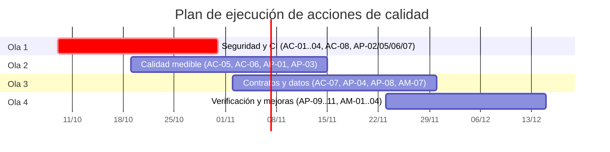

# EduAirControl — Calidad y Mejoras

> Acciones correctivas, preventivas y de mejoramiento del software

**Servicio Nacional de Aprendizaje** · Análisis y Desarrollo de Software – 3145556  
**Integrantes:** María de los Ángeles Olaya García; Jhon Jairo Cortez Vargas  
**Instructores:** Todos los instructores del programa  
**Versión 1.0** · 9 de octubre de 2026 · 2025-2026

---

## Tabla de contenido

- [1. Introducción y objetivo](#1-introducción-y-objetivo)
- [2. Marco de gestión de calidad](#2-marco-de-gestión-de-calidad)
  - [2.1 Tipos de acción](#21-tipos-de-acción)
  - [2.2 Prioridad y plazos](#22-prioridad-y-plazos)
  - [2.3 Ciclo de vida de una acción](#23-ciclo-de-vida-de-una-acción)
  - [2.4 Fuentes de información](#24-fuentes-de-información)
- [3. Línea base de calidad](#3-línea-base-de-calidad)
  - [3.1 Pruebas por servicio](#31-pruebas-por-servicio)
  - [3.2 Prácticas de calidad verificadas](#32-prácticas-de-calidad-verificadas)
  - [3.3 Estado frente a los requisitos no funcionales](#33-estado-frente-a-los-requisitos-no-funcionales)
- [4. Acciones correctivas](#4-acciones-correctivas)
  - [4.1 Análisis de causa raíz](#41-análisis-de-causa-raíz)
- [5. Acciones preventivas](#5-acciones-preventivas)
- [6. Acciones de mejoramiento](#6-acciones-de-mejoramiento)
- [7. Lecciones aprendidas](#7-lecciones-aprendidas)
- [8. Plan de ejecución](#8-plan-de-ejecución)
- [9. Indicadores y seguimiento](#9-indicadores-y-seguimiento)
- [10. Procedimiento de registro y cierre](#10-procedimiento-de-registro-y-cierre)
- [11. Trazabilidad acciones, riesgos y requisitos](#11-trazabilidad-acciones-riesgos-y-requisitos)
- [12. Referencias](#12-referencias)

---

## 1. Introducción y objetivo

Este documento reúne las **acciones correctivas, preventivas y de mejoramiento** de EduAirControl. Parte de lo que se encontró en la auditoría del código fuente del 8 de octubre de 2026 y de la revisión de la documentación del 9 de octubre, y convierte cada hallazgo y cada riesgo del registro (`risks.md`) en una acción concreta, con responsable, fecha objetivo y criterio de verificación.

El documento no reemplaza al registro de riesgos: lo complementa. El registro responde «qué puede salir mal»; este documento responde «qué vamos a hacer, quién y cómo sabremos que quedó resuelto».

> **Alcance de las mediciones.** Las cifras de la sección 3 provienen de una inspección estática del código (conteo de archivos y de anotaciones `@Test`, revisión de `pom.xml`, Dockerfiles y flujos de CI). No equivalen a pruebas ejecutadas ni a porcentaje de cobertura: ese dato no existe todavía porque el proyecto no mide cobertura. Todas las acciones están en estado **Abierta** al 9 de octubre de 2026.

## 2. Marco de gestión de calidad

### 2.1 Tipos de acción

| Tipo | Definición | Ejemplo en el proyecto |
|---|---|---|
| Correctiva (AC) | Elimina la causa de un defecto o no conformidad ya detectado, para que no se repita (ISO 9001:2015, cláusula 10.2). | Retirar la clave privada RSA que quedó versionada en el repositorio. |
| Preventiva (AP) | Elimina la causa de un problema potencial antes de que ocurra; se gestiona con pensamiento basado en riesgos (ISO 9001:2015, cláusula 6.1). | Escanear secretos en cada commit para que ninguna clave vuelva a versionarse. |
| Mejoramiento (AM) | Aumenta la calidad o el desempeño más allá de lo exigido hoy (ISO 9001:2015, cláusula 10.3). | Automatizar el recorrido crítico con pruebas de extremo a extremo. |

### 2.2 Prioridad y plazos

| Prioridad | Criterio | Plazo objetivo |
|---|---|---|
| P1 – Crítica | Riesgo crítico o brecha de seguridad explotable. | Hasta 3 semanas |
| P2 – Alta | Riesgo alto o requisito no funcional de prioridad alta sin cumplir. | Hasta 6 semanas |
| P3 – Media | Riesgo medio o brecha de verificación. | Hasta 10 semanas |
| P4 – Baja / mejora | Mejora deseable sin riesgo asociado. | Próxima iteración o backlog |

### 2.3 Ciclo de vida de una acción

| Paso | Qué se hace | Evidencia |
|---|---|---|
| 1. Detectar y registrar | Se registra el hallazgo con su fuente (auditoría, riesgo, retrospectiva o revisión). | Entrada en el registro de acciones |
| 2. Analizar la causa | Se pregunta por qué ocurrió hasta llegar a una causa que se pueda corregir. | Causa raíz documentada |
| 3. Clasificar y priorizar | Se define si es correctiva, preventiva o de mejora y se asigna prioridad P1–P4. | Tipo y prioridad |
| 4. Planificar | Se fija responsable, fecha objetivo y criterio de verificación antes de empezar. | Ficha completa |
| 5. Ejecutar | Se trabaja en una rama (fix/ o chore/) y se integra con pull request revisado. | Pull request |
| 6. Verificar | Se comprueba el criterio de verificación con una prueba o una evidencia objetiva. | Prueba, captura o informe |
| 7. Cerrar y aprender | Se actualizan el riesgo, el SRS y la documentación; se anota la lección aprendida. | Riesgo cerrado y lección |

### 2.4 Fuentes de información

- Auditoría del código fuente del 8 de octubre de 2026 y registro de riesgos R-001 a R-011 (más R-012 a R-015, ya cerrados).
- SRS v1.1: los diez requisitos no funcionales (RNF1–RNF10) figuran como «por verificar».
- Verificación directa en el código el 9 de octubre de 2026 (claves, CORS, CI, dependencias, Dockerfiles y pruebas).
- Retrospectivas de cada sprint semanal, donde se revisan y reprograman las acciones abiertas.

## 3. Línea base de calidad

### 3.1 Pruebas por servicio

La tabla muestra el punto de partida de las pruebas automatizadas en los siete módulos Spring Boot. La última columna es solo un indicador aproximado de densidad de pruebas; no sustituye a la cobertura real.

| Servicio | Archivos de producción | Archivos de prueba | Pruebas (@Test) | Pruebas por archivo de producción |
|---|---|---|---|---|
| api-gateway | 21 | 7 | 27 | 1,29 |
| ms-security | 80 | 8 | 57 | 0,71 |
| ms-classroom-management | 55 | 5 | 33 | 0,60 |
| ms-sensor-management | 83 | 8 | 55 | 0,66 |
| ms-environment-monitoring | 72 | 14 | 82 | 1,14 |
| ms-user-experience | 35 | 4 | 10 | 0,29 |
| ms-user-management | 27 | 3 | 20 | 0,74 |
| **Total** | **373** | **49** | **284** | **0,76** |

Dos lecturas importantes: **ms-user-experience** es el servicio con menor densidad de pruebas y, además, es el único que no está en el pipeline de integración continua (R-005); y el **frontend web y móvil no tiene ninguna prueba automatizada** (R-010).

### 3.2 Prácticas de calidad verificadas

| Práctica | Estado verificado el 09/10/2026 | Resultado |
|---|---|---|
| Medición de cobertura (JaCoCo) | Ningún `pom.xml` la incluye (0 de 7). | Incumple RNF6 |
| Métricas de aplicación (actuator y micrometer) | Ningún módulo las incluye (0 de 7). | Incumple RNF5 |
| Integración continua | GitHub Actions ejecuta `./mvnw verify` para 6 de los 7 servicios y publica imágenes en GHCR; no hay Jenkinsfile. | Parcial |
| Comprobación de salud en contenedores | Ningún Dockerfile declara `HEALTHCHECK`. | Incumple RNF2 |
| Pruebas del frontend | No existen archivos `*.test.*` ni `*.spec.*`. | Sin cobertura |
| Gestión de secretos | Clave privada RSA versionada y contraseña de superadmin con valor por defecto en `application.properties`. | Incumple RNF4 y RNF7 |
| CORS del gateway | `BffSecurityConfig` permite cualquier origen con credenciales. | Incumple RNF4 |
| Identidad entre servicios | Los servicios aceptan cabeceras `X-User-*` sin verificar su origen. | Incumple RNF4 |

### 3.3 Estado frente a los requisitos no funcionales

El SRS declara los diez RNF como «por verificar». La tabla relaciona cada uno con la característica de calidad de ISO/IEC 25010, con la evidencia disponible y con las acciones que cierran la brecha.

| RNF | Característica ISO/IEC 25010 | Evidencia actual | Acciones |
|---|---|---|---|
| RNF1 Rendimiento | Eficiencia de desempeño | Sin pruebas de carga ni resultados. | AP-09 |
| RNF2 Disponibilidad | Fiabilidad | Sin HEALTHCHECK ni pruebas de resiliencia; circuit breaker no implementado. | AP-05, AP-11, AM-02 |
| RNF3 Escalabilidad | Eficiencia de desempeño | Despliegue en Kubernetes sin ms-user-experience; sin pruebas de escalado. | AC-04, AP-09 |
| RNF4 Seguridad | Seguridad | Tres hallazgos críticos o altos (R-001, R-002, R-003). | AC-01, AC-02, AC-03, AP-02, AP-03 |
| RNF5 Observabilidad | Mantenibilidad (analizabilidad) | Infraestructura declarada, pero ningún servicio emite métricas. | AC-05, AM-02 |
| RNF6 Mantenibilidad | Mantenibilidad (verificabilidad) | 284 pruebas contadas, cobertura sin medir, frontend sin pruebas. | AP-01, AP-04, AM-07 |
| RNF7 Portabilidad | Portabilidad | Imágenes Docker y compose existen; hay secretos por defecto en el repositorio. | AC-01 |
| RNF8 Recuperación | Fiabilidad (recuperabilidad) | Sin evidencia de pruebas de recuperación ni de restauración de copias. | AP-10 |
| RNF9 Usabilidad | Usabilidad (accesibilidad) | Sin auditoría formal de accesibilidad. | AM-04 |
| RNF10 Compatibilidad | Compatibilidad | Sin pruebas automatizadas en navegadores ni dispositivos. | AM-01 |

## 4. Acciones correctivas

Las acciones correctivas corrigen defectos y no conformidades que ya existen en el código o en la documentación. Las dos primeras (AC-01 y AC-02) atienden los riesgos críticos y deben cerrarse antes de exponer el sistema fuera del equipo.

| ID | Acción | Prioridad · Meta Responsable · Origen | Verificación |
|---|---|---|---|
| AC-01 | Retirar `dev-private.pem` del repositorio y del classpath; cargar la clave desde una variable de entorno o gestor de secretos; rotar la clave y la contraseña de superadmin; exigir `SUPERADMIN_PASSWORD` y `JWT_SECRET` sin valor por defecto. | **P1** · 2026-10-15 Backend · R-002 | No quedan claves .pem privadas en el repositorio; el servicio no arranca sin las variables; los tokens firmados con la clave anterior se rechazan. |
| AC-02 | Impedir la suplantación por cabeceras `X-User-*`: cada servicio valida el JWT real (JWKS de ms-security) y usa las cabeceras del gateway solo como respaldo; restringir el acceso directo a los puertos internos. | **P1** · 2026-10-31 Backend · R-001 | Una petición directa con `X-User-Role: ADMIN` y sin token válido recibe 401 o 403 (prueba negativa automatizada). |
| AC-03 | Restringir el CORS del gateway a los orígenes reales leyendo `CORS_ALLOWED_ORIGINS`; eliminar la variable si finalmente no se usa. | **P1** · 2026-10-31 Backend · R-003 | Una petición con un `Origin` no listado no recibe cabeceras CORS (prueba en el gateway). |
| AC-04 | Incluir ms-user-experience en la matriz de CI, en los manifiestos de Kubernetes (Deployment y PostgreSQL) y en `wait-for-services.sh`. | **P2** · 2026-10-31 DevOps · R-005 | El CI ejecuta 7 de 7 servicios; un despliegue en Kubernetes levanta favoritos y preferencias. |
| AC-05 | Añadir `spring-boot-starter-actuator` y `micrometer-registry-prometheus` a los 7 módulos; completar la lista de scrape; dar al colector OpenTelemetry un destino real y crear los datasources de Grafana. | **P2** · 2026-11-15 DevOps · R-006 | Prometheus muestra los 7 objetivos en estado UP. |
| AC-06 | Consolidar un único firmware ESP32 que use una credencial de dispositivo (no cabeceras forjadas) contra el contrato real de ingesta y documentar el canal elegido en ADR-004. | **P2** · 2026-11-15 IoT · R-009 | Un dispositivo real envía una medición y esta aparece en el dashboard. |
| AC-07 | Definir la topología definitiva de bases de datos, actualizar ADR-003 y corregir o retirar `HistoricalBackfillService`. | **P3** · 2026-11-30 Backend · R-007 | ADR-003 coincide con compose y Kubernetes; el backfill corre sin errores o se elimina. |
| AC-08 | Alinear la documentación con el código: CI real (GitHub Actions, no Jenkins) en SRS y documentos, puerto de ms-security (8081) en la guía local, unas 18 referencias a archivos inexistentes, carpeta UX duplicada y diagramas UML sin fuente. | **P2** · 2026-10-31 Equipo · R-011 | Revisión cruzada sin referencias rotas; documentos y SRS describen los mismos servicios, puertos y herramientas que el código. |

### 4.1 Análisis de causa raíz

Para las acciones correctivas más relevantes se identificó la causa raíz probable. Corregir solo el síntoma dejaría abierta la puerta a que el problema reaparezca, por eso cada fila enlaza con una acción preventiva.

| Hallazgo | Causa raíz probable | Acción de fondo |
|---|---|---|
| AC-01 – Clave y contraseña por defecto | Se priorizó arrancar rápido en desarrollo con valores por defecto, y no existía un control automático que impidiera versionar secretos. | AP-02, AP-03 |
| AC-02 – Cabeceras X-User-* | El diseño supone que solo el gateway llega a los servicios, pero esa suposición no se reforzó con controles de red ni con validación en cada servicio; además el firmware de prueba depende de ello. | AC-06, AP-04 |
| AC-03 – CORS abierto | La configuración se escribió para desarrollo y la variable `CORS_ALLOWED_ORIGINS` nunca se conectó al código. | AP-03, AP-07 |
| AC-05 – Observabilidad decorativa | ADR-012 se aceptó y se montó la infraestructura, pero las dependencias no se agregaron a los servicios: un ADR aceptado no equivale a implementado. | AP-07 |
| AC-08 – Documentación desalineada | La documentación se escribió antes o en paralelo al código y no hay una revisión cruzada contra él en cada entrega. | AP-06 |

## 5. Acciones preventivas

Las acciones preventivas evitan que los problemas de la sección anterior reaparezcan y cierran brechas de verificación de los requisitos no funcionales antes de que se conviertan en fallos.

| ID | Acción | Prioridad · Meta Responsable · Origen | Verificación |
|---|---|---|---|
| AP-01 | Configurar JaCoCo con umbral (≥ 80 % de líneas y ≥ 90 % en dominio) en los 7 módulos y hacer que el pipeline falle si la cobertura baja. | **P2** · 2026-11-15 QA · R-004 | El CI publica el informe JaCoCo y falla con cobertura inferior al umbral. |
| AP-02 | Escanear secretos (por ejemplo, gitleaks) en pre-commit y en CI para que no vuelva a versionarse una clave o contraseña. | **P1** · 2026-10-23 DevOps · R-002 | Un commit con una clave de prueba es rechazado. |
| AP-03 | Añadir análisis estático de seguridad (CodeQL) y de dependencias (Dependabot u OWASP Dependency-Check) al CI. | **P2** · 2026-11-15 DevOps · RNF4 | Cada pull request genera un reporte; las vulnerabilidades altas bloquean la integración. |
| AP-04 | Generar los tipos y clientes de las APIs desde los contratos OpenAPI, compartirlos entre web y móvil y añadir pruebas de contrato en el backend. | **P3** · 2026-11-30 Frontend · R-010 | Un cambio de contrato que rompe al frontend hace fallar el CI. |
| AP-05 | Exponer `/health` y `/health/ready` en cada servicio y declarar `HEALTHCHECK` en los Dockerfiles. | **P2** · 2026-10-31 Backend · RNF2 | `docker compose` reporta cada servicio como healthy; uno con una dependencia caída se reporta como no listo. |
| AP-06 | Verificar enlaces y referencias cruzadas de la documentación de forma automática (por ejemplo, markdown-link-check) y en cada entrega. | **P3** · 2026-10-31 Equipo · R-011 | El CI falla ante enlaces o referencias a archivos inexistentes. |
| AP-07 | Actualizar la Definition of Done: referenciar el ADR que se implementa, exigir una prueba de integración contra el broker real y registrar la cobertura. | **P2** · 2026-10-23 Equipo · Lecc. R-012, R-013 | `definition-of-done.md` actualizado y usado en la revisión de pull requests. |
| AP-08 | Pruebas de integración con Testcontainers (PostgreSQL y RabbitMQ) para el outbox y los consumidores de eventos. | **P3** · 2026-11-30 QA · Lecc. R-013, R-014 | Un evento publicado por un servicio es consumido en la prueba; la prueba falla si el outbox no publica. |
| AP-09 | Pruebas de carga repetibles (k6, JMeter o Locust) con el perfil de referencia del SRS: 50 usuarios concurrentes y 5 mediciones por segundo durante 15 minutos. | **P3** · 2026-12-15 QA · RNF1, RNF3 | Informe con P95 y tasa de error; RNF1 pasa de «por verificar» a verificado. |
| AP-10 | Definir la copia de seguridad de las bases de datos y probar la restauración. | **P3** · 2026-12-15 DevOps · RNF8 | Restauración exitosa, cronometrada (meta < 30 min) y documentada. |
| AP-11 | Timeouts y reintentos acotados en los clientes HTTP; implementar circuit breaker cuando existan llamadas sincrónicas entre servicios. | **P4** · 2026-12-15 Backend · R-008 | Con inyección de fallos, la dependencia caída produce un error controlado sin bloqueo indefinido. |

## 6. Acciones de mejoramiento

Las acciones de mejoramiento no corrigen un incumplimiento: elevan la calidad del producto y del proceso por encima del mínimo exigido. Se planifican después de cerrar las acciones P1 y P2.

| ID | Acción | Prioridad · Meta Responsable · Origen | Verificación |
|---|---|---|---|
| AM-01 | Pruebas de extremo a extremo del recorrido crítico («consulta autorizada») en la web (Playwright o Cypress) y pruebas de humo en el móvil. | **P3** · 2026-12-15 QA · R-004, R-010 | El recorrido registrarse → ver ambiente → ver histórico se ejecuta solo en CI. |
| AM-02 | Paneles de Grafana por servicio y alertas basadas en el objetivo de disponibilidad (99,5 %). | **P3** · 2026-12-15 DevOps · RNF2, RNF5 | Una alerta de prueba se dispara cuando un servicio crítico incumple el objetivo. |
| AM-03 | Pipeline de entrega: construir imágenes, desplegar en staging y ejecutar un smoke test automático tras cada merge a main. | **P3** · 2026-12-15 DevOps · R-005 | Cada merge a main produce imagen y despliegue en staging con smoke test verde. |
| AM-04 | Auditoría de accesibilidad (WCAG 2.1 AA) de la web y del móvil con herramientas como axe o Lighthouse. | **P4** · 2026-12-15 Frontend · RNF9 | Informe con hallazgos y correcciones; sin errores críticos de accesibilidad. |
| AM-05 | Evaluar un sensor de CO₂ de principio NDIR como alternativa al MQ-135 para obtener lecturas de CO₂ más fiables. | **P4** · Backlog IoT · Hardware | Comparación documentada de lecturas frente a un patrón de referencia. |
| AM-06 | Completar las funciones pendientes del SRS: verificación en dos pasos (RF1.2) y notificación externa por push o correo (RF6.5). | **P4** · Backlog Equipo · SRS | RF1.2 y RF6.5 pasan a «Implementado» en el SRS. |
| AM-07 | Tablero de indicadores de calidad (cobertura, riesgos abiertos, duración del CI) revisado en cada retrospectiva. | **P4** · 2026-11-30 QA · Seguimiento | Los indicadores de la sección 9 se actualizan cada sprint. |

## 7. Lecciones aprendidas

El registro de riesgos ya cerró cuatro riesgos que llegaron a ocurrir (R-012 a R-015). Las lecciones que dejaron alimentan las acciones preventivas de este documento.

| ID | Qué ocurrió | Cómo se cerró (08/10/2026) | Acción derivada |
|---|---|---|---|
| R-012 | Los tokens de ms-security (HS256, secreto compartido) no eran compatibles con el resto de servicios (RS256). | Los cinco servicios validan RS256 contra el JWKS de ms-security (ADR-006). | AP-07 |
| R-013 | El outbox de ms-classroom-management nunca publicó: faltaba la tabla, faltaba `@EnableScheduling` y los eventos llevaban UUID aleatorios. | Se completó el outbox y se corrigieron los eventos. | AP-07, AP-08 |
| R-014 | El flujo de eventos no tenía productores: ms-environment-monitoring consumía eventos que nadie publicaba. | Outbox de instalaciones en ms-sensor-management e ingesta HTTP como única vía de medición. | AP-08 |
| R-015 | Las métricas en vivo nunca llegaban al frontend (puntaje siempre 100, temperatura `undefined`). | Se creó `GET /api/v1/environments/current`. | AP-04 |

> **Idea común.** Una funcionalidad sin una prueba de integración real puede parecer terminada y no entregar ni un solo mensaje; un ADR aceptado no significa que esté implementado. Por eso AP-07 y AP-08 son las acciones preventivas más valiosas por costo.

## 8. Plan de ejecución

Las acciones se agrupan en cuatro olas, ordenadas por prioridad y por dependencias. Las fechas son una propuesta de planificación sujeta a la capacidad real del equipo de dos integrantes.

*Figura 1. Olas de ejecución de las acciones. AM-05 y AM-06 permanecen en el backlog.*

## 9. Indicadores y seguimiento

Los indicadores permiten saber, sprint a sprint, si las acciones están funcionando. La columna «Línea base» recoge el valor verificado el 9 de octubre de 2026.

| Indicador | Línea base | Meta | Fuente | Frecuencia |
|---|---|---|---|---|
| Cobertura de líneas por servicio | Sin medir (0 de 7 con JaCoCo) | ≥ 80 % (≥ 90 % en dominio) | JaCoCo / CI | Cada sprint |
| Servicios en el pipeline de CI | 6 / 7 | 7 / 7 | GitHub Actions | Cada sprint |
| Servicios con métricas Prometheus | 0 / 7 | 7 / 7 | Prometheus | Cada sprint |
| Dockerfiles con HEALTHCHECK | Ninguno | Todos | Dockerfiles | Cada sprint |
| Riesgos críticos activos | 2 | 0 | risks.md | Cada sprint |
| Riesgos altos activos | 4 | 0 | risks.md | Cada sprint |
| Pruebas automatizadas en el frontend | 0 | ≥ 1 prueba de humo por aplicación | CI | Mensual |
| Pruebas contadas (@Test) | 284 | No disminuir | Conteo estático | Cada sprint |
| RNF verificados con evidencia | 0 / 10 | 10 / 10 | SRS | Mensual |
| Referencias documentales rotas | ≈ 18 | 0 | Verificador de enlaces | Cada entrega |

## 10. Procedimiento de registro y cierre

Cada acción nueva se registra con la siguiente ficha, que es la misma que se usa para el registro de riesgos para mantener coherencia. Una acción solo se cierra cuando su criterio de verificación se cumple con una evidencia objetiva.

| Campo | Contenido |
|---|---|
| ID | AC-nn, AP-nn o AM-nn. |
| Tipo y prioridad | Correctiva, preventiva o mejora; P1 a P4. |
| Origen | Riesgo, hallazgo de auditoría, RNF, retrospectiva o lección aprendida. |
| Descripción y causa raíz | Qué pasa, dónde ocurre (archivo o servicio) y por qué. |
| Acción | Qué se va a cambiar o añadir. |
| Responsable | Rol y persona del equipo (Backend, DevOps, QA, IoT, Frontend). |
| Fecha objetivo | Fecha comprometida; se renegocia en la retrospectiva si cambia. |
| Criterio de verificación | Prueba o evidencia que demuestra que quedó resuelto. |
| Estado | Abierta, En curso, Verificada o Cerrada. |
| Cierre | Fecha, evidencia, riesgo actualizado y lección aprendida. |

## 11. Trazabilidad acciones, riesgos y requisitos

| Riesgo | Acciones | Requisito no funcional |
|---|---|---|
| R-001 | AC-02 | RNF4 |
| R-002 | AC-01, AP-02 | RNF4, RNF7 |
| R-003 | AC-03 | RNF4 |
| R-004 | AP-01, AM-01 | RNF6 |
| R-005 | AC-04, AM-03 | RNF3, RNF7 |
| R-006 | AC-05, AM-02 | RNF5 |
| R-007 | AC-07 | RNF6 |
| R-008 | AP-11 | RNF2 |
| R-009 | AC-06 | RNF4 |
| R-010 | AP-04, AM-01 | RNF6, RNF10 |
| R-011 | AC-08, AP-06 | RNF6 |
| Sin riesgo registrado (brecha de RNF) | AP-03, AP-05, AP-09, AP-10, AM-04 | RNF1, RNF2, RNF3, RNF4, RNF8, RNF9 |

## 12. Referencias

- ISO/IEC. (2011). *ISO/IEC 25010:2011 Systems and software engineering – Systems and software Quality Requirements and Evaluation (SQuaRE) – System and software quality models*.
- ISO. (2015). *ISO 9001:2015 Quality management systems – Requirements* (cláusulas 6.1, 10.2 y 10.3).
- OWASP Foundation. (2021). *OWASP Top 10:2021* (A01 Broken Access Control, A05 Security Misconfiguration).
- MITRE. (s. f.). *CWE-798: Use of Hard-coded Credentials*. Common Weakness Enumeration.
- IEEE. (1998). *IEEE Std 830-1998: Recommended practice for software requirements specifications*. IEEE.
- EduAirControl. (2026). *Registro de riesgos (risks.md), definición de hecho y estrategia de pruebas*. https://github.com/code-sena/ea-control-docs
- EduAirControl. (2026). *Especificación de Requisitos de Software, versión 1.1*. SENA.

