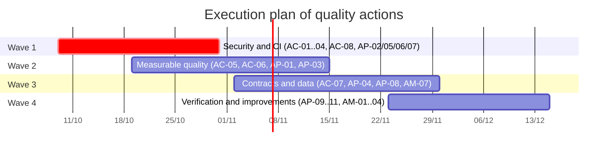

# EduAirControl — Quality and Improvements

> Corrective, preventive and improvement actions for the software

**Servicio Nacional de Aprendizaje** · Análisis y Desarrollo de Software – 3145556  
**Members:** María de los Ángeles Olaya García; Jhon Jairo Cortez Vargas  
**Instructors:** All program instructors  
**Version 1.0** · October 9, 2026 · 2025-2026

---

## Table of contents

- [1. Introduction and objective](#1-introduction-and-objective)
- [2. Quality management framework](#2-quality-management-framework)
  - [2.1 Types of action](#21-types-of-action)
  - [2.2 Priority and deadlines](#22-priority-and-deadlines)
  - [2.3 Life cycle of an action](#23-life-cycle-of-an-action)
  - [2.4 Sources of information](#24-sources-of-information)
- [3. Quality baseline](#3-quality-baseline)
  - [3.1 Tests per service](#31-tests-per-service)
  - [3.2 Verified quality practices](#32-verified-quality-practices)
  - [3.3 Status against non-functional requirements](#33-status-against-non-functional-requirements)
- [4. Corrective actions](#4-corrective-actions)
  - [4.1 Root cause analysis](#41-root-cause-analysis)
- [5. Preventive actions](#5-preventive-actions)
- [6. Improvement actions](#6-improvement-actions)
- [7. Lessons learned](#7-lessons-learned)
- [8. Execution plan](#8-execution-plan)
- [9. Indicators and monitoring](#9-indicators-and-monitoring)
- [10. Procedure for registration and closure](#10-procedure-for-registration-and-closure)
- [11. Traceability of actions, risks and requirements](#11-traceability-of-actions-risks-and-requirements)
- [12. References](#12-references)

---

## 1. Introduction and objective

This document collects the **corrective, preventive and improvement actions** for EduAirControl. It is based on findings from the source code audit of October 8, 2026 and the documentation review of October 9, and converts each finding and each risk from the register (`risks.md`) into a concrete action, with an owner, target date and verification criterion.

This document does not replace the risk register: it complements it. The register answers "what can go wrong"; this document answers "what we will do, who, and how we will know it is resolved".

> **Scope of measurements.** The figures in section 3 come from a static inspection of the code (count of files and of `@Test` annotations, review of `pom.xml`, Dockerfiles and CI workflows). They do not equate to executed tests nor to coverage percentage: that metric does not exist yet because the project does not measure coverage. All actions are in state **Open** as of October 9, 2026.

## 2. Quality management framework

### 2.1 Types of action

| Type | Definition | Example in the project |
|---|---|---|
| Corrective (AC) | Eliminates the cause of a defect or nonconformity already detected, so it does not recur (ISO 9001:2015, clause 10.2). | Remove the RSA private key that was committed to the repository. |
| Preventive (AP) | Eliminates the cause of a potential problem before it occurs; managed with risk-based thinking (ISO 9001:2015, clause 6.1). | Scan for secrets on every commit so no key is committed again. |
| Improvement (AM) | Increases quality or performance beyond what is required today (ISO 9001:2015, clause 10.3). | Automate the critical path with end-to-end tests. |

### 2.2 Priority and deadlines

| Priority | Criterion | Target deadline |
|---|---|---|
| P1 – Critical | Critical risk or exploitable security gap. | Up to 3 weeks |
| P2 – High | High risk or high-priority non-functional requirement not met. | Up to 6 weeks |
| P3 – Medium | Medium risk or verification gap. | Up to 10 weeks |
| P4 – Low / improvement | Desirable improvement without associated risk. | Next iteration or backlog |

### 2.3 Life cycle of an action

| Step | What is done | Evidence |
|---|---|---|
| 1. Detect and record | The finding is recorded with its source (audit, risk, retrospective or review). | Entry in the actions register |
| 2. Analyze the cause | Ask "why" until reaching a cause that can be corrected. | Documented root cause |
| 3. Classify and prioritize | Define whether it is corrective, preventive or improvement and assign priority P1–P4. | Type and priority |
| 4. Plan | Set owner, target date and verification criterion before starting. | Complete record |
| 5. Execute | Work is done on a branch (fix/ or chore/) and integrated via a reviewed pull request. | Pull request |
| 6. Verify | The verification criterion is checked with a test or objective evidence. | Test, screenshot or report |
| 7. Close and learn | Update the risk, the SRS and the documentation; record the lesson learned. | Risk closed and lesson |

### 2.4 Sources of information

- Source code audit of October 8, 2026 and risk register R-001 to R-011 (plus R-012 to R-015, already closed).
- SRS v1.1: the ten non-functional requirements (RNF1–RNF10) are listed as "to be verified".
- Direct verification in the code on October 9, 2026 (keys, CORS, CI, dependencies, Dockerfiles and tests).
- Weekly sprint retrospectives, where open actions are reviewed and rescheduled.

## 3. Quality baseline

### 3.1 Tests per service

The table shows the starting point of automated tests across the seven Spring Boot modules. The last column is only an approximate indicator of test density; it does not replace real coverage.

| Service | Production files | Test files | Tests (@Test) | Tests per production file |
|---|---|---|---|---|
| api-gateway | 21 | 7 | 27 | 1.29 |
| ms-security | 80 | 8 | 57 | 0.71 |
| ms-classroom-management | 55 | 5 | 33 | 0.60 |
| ms-sensor-management | 83 | 8 | 55 | 0.66 |
| ms-environment-monitoring | 72 | 14 | 82 | 1.14 |
| ms-user-experience | 35 | 4 | 10 | 0.29 |
| ms-user-management | 27 | 3 | 20 | 0.74 |
| **Total** | **373** | **49** | **284** | **0.76** |

Two important observations: **ms-user-experience** is the service with the lowest test density and is also the only one not in the continuous integration pipeline (R-005); and the **web and mobile frontend have no automated tests** (R-010).

### 3.2 Verified quality practices

| Practice | Verified status on 09/10/2026 | Result |
|---|---|---|
| Coverage measurement (JaCoCo) | No `pom.xml` includes it (0 of 7). | Fails RNF6 |
| Application metrics (actuator and micrometer) | No module includes them (0 of 7). | Fails RNF5 |
| Continuous integration | GitHub Actions runs `./mvnw verify` for 6 of 7 services and publishes images to GHCR; there is no Jenkinsfile. | Partial |
| Health check in containers | No Dockerfile declares `HEALTHCHECK`. | Fails RNF2 |
| Frontend tests | No `*.test.*` or `*.spec.*` files exist. | No coverage |
| Secrets management | RSA private key committed and superadmin password with default value in `application.properties`. | Fails RNF4 and RNF7 |
| Gateway CORS | `BffSecurityConfig` allows any origin with credentials. | Fails RNF4 |
| Identity between services | Services accept `X-User-*` headers without verifying their origin. | Fails RNF4 |

### 3.3 Status against non-functional requirements

The SRS declares the ten RNFs as "to be verified". The table relates each one to the ISO/IEC 25010 quality characteristic, the available evidence and the actions that close the gap.

| RNF | ISO/IEC 25010 characteristic | Current evidence | Actions |
|---|---|---|---|
| RNF1 Performance | Performance efficiency | No load tests or results. | AP-09 |
| RNF2 Availability | Reliability | No HEALTHCHECK or resilience tests; circuit breaker not implemented. | AP-05, AP-11, AM-02 |
| RNF3 Scalability | Performance efficiency | Kubernetes deployment without ms-user-experience; no scaling tests. | AC-04, AP-09 |
| RNF4 Security | Security | Three critical or high findings (R-001, R-002, R-003). | AC-01, AC-02, AC-03, AP-02, AP-03 |
| RNF5 Observability | Maintainability (analyzability) | Infrastructure declared, but no service emits metrics. | AC-05, AM-02 |
| RNF6 Maintainability | Maintainability (verifiability) | 284 counted tests, coverage not measured, frontend without tests. | AP-01, AP-04, AM-07 |
| RNF7 Portability | Portability | Docker images and compose exist; default secrets in repository. | AC-01 |
| RNF8 Recovery | Reliability (recoverability) | No evidence of recovery tests or backup restoration. | AP-10 |
| RNF9 Usability | Usability (accessibility) | No formal accessibility audit. | AM-04 |
| RNF10 Compatibility | Compatibility | No automated browser or device tests. | AM-01 |

## 4. Corrective actions

Corrective actions fix defects and nonconformities that already exist in the code or documentation. The first two (AC-01 and AC-02) address critical risks and must be closed before exposing the system outside the team.

| ID | Action | Priority · Target Responsible · Origin | Verification |
|---|---|---|---|
| AC-01 | Remove `dev-private.pem` from the repository and the classpath; load the key from an environment variable or secret manager; rotate the key and the superadmin password; require `SUPERADMIN_PASSWORD` and `JWT_SECRET` with no default value. | **P1** · 2026-10-15 Backend · R-002 | No private `.pem` keys remain in the repository; the service does not start without the variables; tokens signed with the previous key are rejected. |
| AC-02 | Prevent impersonation via `X-User-*` headers: each service validates the real JWT (JWKS from ms-security) and uses gateway headers only as a fallback; restrict direct access to internal ports. | **P1** · 2026-10-31 Backend · R-001 | A direct request with `X-User-Role: ADMIN` and without a valid token receives 401 or 403 (automated negative test). |
| AC-03 | Restrict the gateway CORS to real origins by reading `CORS_ALLOWED_ORIGINS`; remove the variable if it is ultimately unused. | **P1** · 2026-10-31 Backend · R-003 | A request with an unlisted `Origin` does not receive CORS headers (test at the gateway). |
| AC-04 | Include ms-user-experience in the CI matrix, in the Kubernetes manifests (Deployment and PostgreSQL) and in `wait-for-services.sh`. | **P2** · 2026-10-31 DevOps · R-005 | CI runs 7 of 7 services; a Kubernetes deployment brings up favorites and preferences. |
| AC-05 | Add `spring-boot-starter-actuator` and `micrometer-registry-prometheus` to the 7 modules; complete the scrape list; give the OpenTelemetry collector a real destination and create Grafana datasources. | **P2** · 2026-11-15 DevOps · R-006 | Prometheus shows the 7 targets in UP state. |
| AC-06 | Consolidate a single ESP32 firmware that uses a device credential (not forged headers) against the real ingestion contract and document the chosen channel in ADR-004. | **P2** · 2026-11-15 IoT · R-009 | A real device sends a measurement and it appears on the dashboard. |
| AC-07 | Define the final database topology, update ADR-003 and fix or remove `HistoricalBackfillService`. | **P3** · 2026-11-30 Backend · R-007 | ADR-003 matches compose and Kubernetes; the backfill runs without errors or is removed. |
| AC-08 | Align documentation with the code: real CI (GitHub Actions, not Jenkins) in SRS and documents, ms-security port (8081) in the local guide, about 18 references to nonexistent files, duplicated UX folder and UML diagrams without source. | **P2** · 2026-10-31 Team · R-011 | Cross-review without broken references; documents and SRS describe the same services, ports and tools as the code. |

### 4.1 Root cause analysis

For the most relevant corrective actions the probable root cause was identified. Fixing only the symptom would leave the door open for recurrence, which is why each row links to a preventive action.

| Finding | Probable root cause | Remedial action |
|---|---|---|
| AC-01 – Key and default password | Quick startup in development was prioritized with default values, and there was no automatic control to prevent committing secrets. | AP-02, AP-03 |
| AC-02 – X-User-* headers | The design assumes only the gateway reaches the services, but that assumption was not reinforced with network controls nor with validation in each service; additionally the test firmware depends on it. | AC-06, AP-04 |
| AC-03 – Open CORS | Configuration was written for development and the `CORS_ALLOWED_ORIGINS` variable was never wired into the code. | AP-03, AP-07 |
| AC-05 – Decorative observability | ADR-012 was accepted and infrastructure was provisioned, but dependencies were not added to services: an accepted ADR is not the same as implemented. | AP-07 |
| AC-08 – Desynchronized documentation | Documentation was written before or in parallel with the code and there is no cross-check against it on each delivery. | AP-06 |

## 5. Preventive actions

Preventive actions stop the problems from the previous section from reappearing and close verification gaps of non-functional requirements before they become failures.

| ID | Action | Priority · Target Responsible · Origin | Verification |
|---|---|---|---|
| AP-01 | Configure JaCoCo with threshold (≥ 80% lines and ≥ 90% in domain) in the 7 modules and make the pipeline fail if coverage drops. | **P2** · 2026-11-15 QA · R-004 | CI publishes the JaCoCo report and fails when coverage is below threshold. |
| AP-02 | Scan for secrets (e.g., gitleaks) in pre-commit and in CI so a key or password is not committed again. | **P1** · 2026-10-23 DevOps · R-002 | A commit with a test key is rejected. |
| AP-03 | Add static security analysis (CodeQL) and dependency analysis (Dependabot or OWASP Dependency-Check) to CI. | **P2** · 2026-11-15 DevOps · RNF4 | Each pull request generates a report; high vulnerabilities block integration. |
| AP-04 | Generate API types and clients from OpenAPI contracts, share them between web and mobile and add contract tests in the backend. | **P3** · 2026-11-30 Frontend · R-010 | A contract change that breaks the frontend causes CI to fail. |
| AP-05 | Expose `/health` and `/health/ready` in each service and declare `HEALTHCHECK` in Dockerfiles. | **P2** · 2026-10-31 Backend · RNF2 | `docker compose` reports each service as healthy; one with a failed dependency reports as not ready. |
| AP-06 | Automatically verify links and cross-references in documentation (e.g., markdown-link-check) and on every delivery. | **P3** · 2026-10-31 Team · R-011 | CI fails on links or references to nonexistent files. |
| AP-07 | Update the Definition of Done: reference the ADR being implemented, require an integration test against the real broker and record coverage. | **P2** · 2026-10-23 Team · Lessons R-012, R-013 | `definition-of-done.md` updated and used in pull request reviews. |
| AP-08 | Integration tests with Testcontainers (PostgreSQL and RabbitMQ) for the outbox and event consumers. | **P3** · 2026-11-30 QA · Lessons R-013, R-014 | An event published by a service is consumed in the test; the test fails if the outbox does not publish. |
| AP-09 | Repeatable load tests (k6, JMeter or Locust) with the SRS reference profile: 50 concurrent users and 5 measurements per second for 15 minutes. | **P3** · 2026-12-15 QA · RNF1, RNF3 | Report with P95 and error rate; RNF1 moves from "to be verified" to verified. |
| AP-10 | Define database backup and test restoration. | **P3** · 2026-12-15 DevOps · RNF8 | Successful restoration, timed (target < 30 min) and documented. |
| AP-11 | Bounded timeouts and retries in HTTP clients; implement circuit breaker where synchronous calls exist between services. | **P4** · 2026-12-15 Backend · R-008 | With fault injection, a failed dependency produces a controlled error without indefinite blocking. |

## 6. Improvement actions

Improvement actions do not correct a noncompliance: they raise product and process quality above the minimum required. They are planned after closing P1 and P2 actions.

| ID | Action | Priority · Target Responsible · Origin | Verification |
|---|---|---|---|
| AM-01 | End-to-end tests of the critical path ("authorized query") on the web (Playwright or Cypress) and smoke tests on mobile. | **P3** · 2026-12-15 QA · R-004, R-010 | The flow register → view environment → view history runs only in CI. |
| AM-02 | Grafana dashboards per service and alerts based on availability objective (99.5%). | **P3** · 2026-12-15 DevOps · RNF2, RNF5 | A test alert fires when a critical service misses the objective. |
| AM-03 | Delivery pipeline: build images, deploy to staging and run an automatic smoke test after each merge to main. | **P3** · 2026-12-15 DevOps · R-005 | Each merge to main produces an image and staging deployment with green smoke test. |
| AM-04 | Accessibility audit (WCAG 2.1 AA) for web and mobile using tools like axe or Lighthouse. | **P4** · 2026-12-15 Frontend · RNF9 | Report with findings and fixes; no critical accessibility errors. |
| AM-05 | Evaluate an NDIR CO₂ sensor as an alternative to the MQ-135 to obtain more reliable CO₂ readings. | **P4** · Backlog IoT · Hardware | Documented comparison of readings against a reference standard. |
| AM-06 | Complete pending SRS features: two-step verification (RF1.2) and external notification via push or email (RF6.5). | **P4** · Backlog Team · SRS | RF1.2 and RF6.5 move to "Implemented" in the SRS. |
| AM-07 | Quality indicators dashboard (coverage, open risks, CI duration) reviewed in each retrospective. | **P4** · 2026-11-30 QA · Monitoring | The indicators in section 9 are updated each sprint. |

## 7. Lessons learned

The risk register already closed four risks that occurred (R-012 to R-015). The lessons they left feed the preventive actions in this document.

| ID | What happened | How it was closed (08/10/2026) | Derived action |
|---|---|---|---|
| R-012 | ms-security tokens (HS256, shared secret) were not compatible with the rest of the services (RS256). | The five services validate RS256 against ms-security JWKS (ADR-006). | AP-07 |
| R-013 | The outbox of ms-classroom-management never published: table was missing, `@EnableScheduling` missing and events used random UUIDs. | The outbox was completed and events corrected. | AP-07, AP-08 |
| R-014 | The event flow lacked producers: ms-environment-monitoring consumed events that nobody published. | Outbox of installations in ms-sensor-management and HTTP ingestion as the only measurement path. | AP-08 |
| R-015 | Live metrics never reached the frontend (score always 100, temperature `undefined`). | `GET /api/v1/environments/current` was created. | AP-04 |

> **Common insight.** A feature without a real integration test can appear finished and not deliver a single message; an accepted ADR does not mean it is implemented. That is why AP-07 and AP-08 are the most cost-effective preventive actions.

## 8. Execution plan

Actions are grouped into four waves, ordered by priority and dependencies. Dates are a proposed schedule subject to the real capacity of the two-person team.

*Figure 1. Execution waves of the actions. AM-05 and AM-06 remain in the backlog.*

## 9. Indicators and monitoring

Indicators allow knowing, sprint by sprint, whether actions are working. The "Baseline" column shows the value verified on October 9, 2026.

| Indicator | Baseline | Target | Source | Frequency |
|---|---|---|---|---|
| Line coverage per service | Not measured (0 of 7 with JaCoCo) | ≥ 80% (≥ 90% in domain) | JaCoCo / CI | Each sprint |
| Services in the CI pipeline | 6 / 7 | 7 / 7 | GitHub Actions | Each sprint |
| Services with Prometheus metrics | 0 / 7 | 7 / 7 | Prometheus | Each sprint |
| Dockerfiles with HEALTHCHECK | None | All | Dockerfiles | Each sprint |
| Active critical risks | 2 | 0 | risks.md | Each sprint |
| Active high risks | 4 | 0 | risks.md | Each sprint |
| Automated frontend tests | 0 | ≥ 1 smoke test per application | CI | Monthly |
| Counted tests (@Test) | 284 | Do not decrease | Static count | Each sprint |
| RNFs verified with evidence | 0 / 10 | 10 / 10 | SRS | Monthly |
| Broken document references | ≈ 18 | 0 | Link checker | Each delivery |

## 10. Procedure for registration and closure

Each new action is recorded with the following record, which is the same used in the risk register to maintain coherence. An action is closed only when its verification criterion is met with objective evidence.

| Field | Content |
|---|---|
| ID | AC-nn, AP-nn or AM-nn. |
| Type and priority | Corrective, preventive or improvement; P1 to P4. |
| Origin | Risk, audit finding, RNF, retrospective or lesson learned. |
| Description and root cause | What happens, where it occurs (file or service) and why. |
| Action | What will be changed or added. |
| Responsible | Role and person in the team (Backend, DevOps, QA, IoT, Frontend). |
| Target date | Committed date; renegotiated in the retrospective if it changes. |
| Verification criterion | Test or evidence that demonstrates it was resolved. |
| State | Open, In progress, Verified or Closed. |
| Closure | Date, evidence, updated risk and lesson learned. |

## 11. Traceability of actions, risks and requirements

| Risk | Actions | Non-functional requirement |
|---|---|---|
| R-001 | AC-02 | RNF4 |
| R-002 | AC-01, AP-02 | RNF4, RNF7 |
| R-003 | AC-03 | RNF4 |
| R-004 | AP-01, AM-01 | RNF6 |
| R-005 | AC-04, AM-03 | RNF3, RNF7 |
| R-006 | AC-05, AM-02 | RNF5 |
| R-007 | AC-07 | RNF6 |
| R-008 | AP-11 | RNF2 |
| R-009 | AC-06 | RNF4 |
| R-010 | AP-04, AM-01 | RNF6, RNF10 |
| R-011 | AC-08, AP-06 | RNF6 |
| No registered risk (RNF gap) | AP-03, AP-05, AP-09, AP-10, AM-04 | RNF1, RNF2, RNF3, RNF4, RNF8, RNF9 |

## 12. References

- ISO/IEC. (2011). *ISO/IEC 25010:2011 Systems and software engineering – Systems and software Quality Requirements and Evaluation (SQuaRE) – System and software quality models*.
- ISO. (2015). *ISO 9001:2015 Quality management systems – Requirements* (clauses 6.1, 10.2 and 10.3).
- OWASP Foundation. (2021). *OWASP Top 10:2021* (A01 Broken Access Control, A05 Security Misconfiguration).
- MITRE. (n.d.). *CWE-798: Use of Hard-coded Credentials*. Common Weakness Enumeration.
- IEEE. (1998). *IEEE Std 830-1998: Recommended practice for software requirements specifications*. IEEE.
- EduAirControl. (2026). *Risk register (risks.md), definition of done and test strategy*. https://github.com/code-sena/ea-control-docs
- EduAirControl. (2026). *Software Requirements Specification, version 1.1*. SENA.