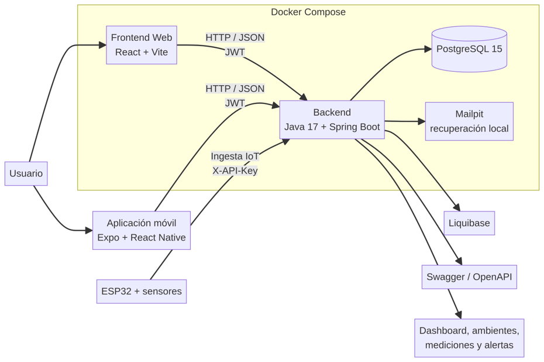
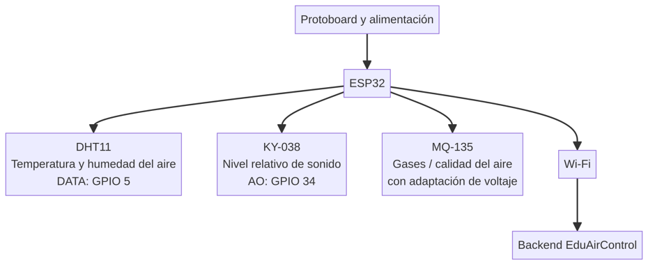

# EduAirControl · Technical Manual

**SENA INDUSTRIA**

**EDUAIRCONTROL**

**Technical Manual**

*Architecture, components, data, API and maintenance*

**Program:** Technologist in Software Analysis and Development

Group (Ficha): 3145556

Team members: Jhon Jairo Cortez Vargas · María de los Ángeles Olaya García

Instructor: Karol Daniela Correa

Neiva, Huila · October 5, 2026

**Version 1.1**

---

## Version Control

| **Version** | **Date** | **Description** | **Owner** |
| --- | --- | --- | --- |
| 1.0 | October 5, 2026 | Initial creation of the technical manual. | Development team |
| 1.1 | October 7, 2026 | Alignment with the current code: microservices architecture, API Gateway/OAuth2, RBAC roles, social login and Super Admin. | Development team |

---

## Table of Contents

- Introduction
- Objective
- Scope
- Technical description of the system
- Architecture
  - 5.1 Environmental information flow
  - 5.2 Components and versions
- Project structure
- Backend technical modules
- Database
- API and endpoints
- Security
- Web frontend and mobile application
- Hardware and IoT integration
- Maintenance
- Glossary
- Appendices and pending items for this version

---

## 1. Introduction

This technical manual documents the construction of EduAirControl, a platform for the management, monitoring and analysis of educational environments using environmental and IoT data. It is intended for developers, support staff, instructors and those responsible for maintaining the system.

## 2. Objective

To describe the architecture, technologies, code structure, persistence, services, security, device communication and maintenance recommendations for version 1.0 of EduAirControl.

## 3. Scope

The document covers the web system, the backend, the PostgreSQL database, the Expo/React Native mobile application, the Docker services and the conceptual integration with the ESP32. The ESP32 files included in the delivery correspond to sensor tests; the final firmware ingestion must be confirmed before going into production.

## 4. Technical Description of the System

EduAirControl is organized as a client-server solution. The web frontend and the mobile application consume the backend over HTTP and JSON. The backend manages authentication, environments, sensors, measurements, analysis, alerts, preferences and notifications. PostgreSQL stores the information and Liquibase controls the evolution of the schema.

## 5. Architecture



EduAirControl is implemented as a microservices architecture with Spring Boot. Each service is an independent project with its own database (a dedicated schema per ADR-003) and follows a hexagonal architecture (ADR-009). The services are: api-gateway (port 8080), ms-security (8081), ms-classroom-management (3002), ms-environment-monitoring (3003), ms-sensor-management (3004) and ms-user-management (3007). The api-gateway acts as a BFF (Backend for Frontend) with OAuth2/OIDC (ADR-017).

### 5.1 Environmental Information Flow

1. The sensors capture variables of the educational environment.
2. The ESP32 processes the readings and, in the final integration, sends them over the network to the ingestion endpoint.
3. The backend validates the device's authentication, processes the reading and stores it in PostgreSQL.
4. The web frontend and the mobile application query the API and present measurements, statuses, analyses and alerts.

### 5.2 Components and Versions

| **Component** | **Technology / version** | **Function** |
| --- | --- | --- |
| Web frontend | React 19.2.0, Vite 8.0.1 | Web interface and navigation |
| Backend | Java 17, Spring Boot 4.0.5 | API, business logic and security |
| Persistence | PostgreSQL 15 + Spring Data JPA | Information storage |
| Migrations | Liquibase | Schema creation and versioning |
| Authentication | JWT 0.11.5 | Sessions and authorization |
| API | Springdoc OpenAPI 2.5.0 | Swagger documentation |
| Mobile | Expo 54.0.37, React Native 0.81.5 | Android/iOS application |
| Containers | Docker Compose | Local orchestration |
| Local mail | Mailpit | Password recovery testing |
| Testing | JUnit/Spring Boot Testcontainers | Automated validation |
| API Gateway | Spring Cloud Gateway | Routing, authentication, rate limiting |
| Auth Server | Spring Authorization Server 7 | OAuth2/OIDC, issuance of RS256 JWTs |
| Social Login | Google OAuth2, Facebook Login | Login with social networks |
| Roles | SUPER_ADMIN, ADMIN, USER, VIEWER | RBAC access control |

## 6. Project Structure

```
EduAirControl/
├── Web/
│   ├── Front-End/             # React + Vite
│   ├── backend/               # Java + Spring Boot
│   ├── docker-compose.yml     # local services
│   └── docker-compose-jenkins.yml
├── MOBILE/                    # Expo + React Native
├── database/                  # Liquibase changelogs and models
├── iot/esp32/                 # ESP32 sensor tests
├── ms-monitoreo/              # analysis microservice under construction
├── jenkins/                   # auxiliary Jenkins image
└── Docs/                      # project documentation
```

| **Path** | **Responsibility** |
| --- | --- |
| Web/Front-End/src | Screens, components, services, viewmodels, routes and internationalization |
| Web/backend/src/main/java | Identity, classrooms, sensors, monitoring, analysis and UX modules |
| Web/backend/src/main/resources | Properties and packaged Liquibase changelogs |
| database/ | Data model separated by domain and migration files |
| MOBILE/.../src | Navigation, screens, services, BLE, storage and mobile styles |
| iot/esp32/ | Diagnostic programs and DHT11/KY-038 tests |

## 7. Backend Technical Modules

| **Module** | **Responsibilities** | **Highlighted elements** |
| --- | --- | --- |
| identity | Registration, login, JWT, recovery and profile | AuthController, ProfileController, User, Role |
| classrooms | Campuses, types and educational environments | CampusController, EnvironmentTypeController, EducationalEnvironmentController |
| sensors | Devices, sensors, variables and ingestion | DeviceController, SensorController, IngestController |
| monitoring | Measurements, dashboard, thresholds, alerts and notifications | DashboardController, NotificationController, Measurement services |
| analysis | Environmental analysis by period | AnalysisController, EnvironmentalAnalysis |
| ux | Favorites, preferences and notification states | FavoritesController, PreferencesController |

## 8. Database

The database uses PostgreSQL 15 and four main domains. Hibernate is configured with `ddl-auto=validate`; therefore, Hibernate validates the schema and Liquibase is the source of truth for creating and evolving it.

| **Schema** | **Content** |
| --- | --- |
| segurity | user, credential, role, permission, sessions, recovery, 2FA and audit |
| classrooms | campuses, environment_types, educational_environment |
| sensors | sensor, sensor_installation, variable, sensor_variable and related catalogs |
| monitoring | severity, variable_threshold, environment_measurement, environmental_analysis, analysis_result, environment_alert |
| ux | user_preferences, favorites, classroom_ratings and searches |

The changelogs are located in `Web/backend/src/main/resources/db/changelog` and also in `database/`. The `dev` context can load sample environments, sensors, measurements and alerts; an empty context leaves only the schema and the reference seed data.

## 9. API and Endpoints

The main API is published at `http://localhost:8080`. User operations use JWT; device ingestion uses `X-API-Key`. Errors are returned in JSON with the fields `status` and `message`.

| **Method** | **Route** | **Purpose** |
| --- | --- | --- |
| POST | /auth/login | Authenticate user and return JWT |
| POST | /auth/register | Register user |
| POST | /auth/forgot-password | Request password recovery |
| GET/PUT | /api/v1/profile | Retrieve or update profile |
| GET/POST/PATCH/DELETE | /api/v1/environments | Retrieve and manage environments |
| GET/POST/PATCH/DELETE | /api/v1/sensors | Retrieve and manage sensors |
| GET/POST/PUT/DELETE | /api/v1/devices | Manage IoT devices |
| POST | /ingest/v1/measurements | Receive device readings using X-API-Key |
| GET | /api/v1/dashboard/summary | Dashboard summary |
| GET | /api/v1/dashboard/series | Historical series |
| GET | /api/v1/notifications | Retrieve notifications |
| GET/POST/DELETE | /api/v1/favorites | Manage favorites |
| GET | /health | Check backend status |

## 10. Security

- JWT for user authentication and expiration control.
- Roles and protected routes to separate user and administrator operations.
- Social login (Google, Facebook) via the OAuth2 Authorization Code Flow.
- Super Admin: management of users, roles and institutions.
- Assignment of the ADMIN role to company administrators.
- `X-API-Key` device key for IoT ingestion; it is shown only once when the device is created or rotated.
- Sensitive variables through the environment: `JWT_SECRET`, `POSTGRES_PASSWORD`, `SMTP_PASSWORD` and administrator credentials.
- CORS configurable through `CORS_ALLOWED_ORIGINS`.
- Do not store real passwords, tokens or keys inside the repository or the manuals.

## 11. Web Frontend and Mobile Application

The web frontend uses React Router, HTTP services, forms, Zod/React Hook Form validations, i18next internationalization, Recharts charts and local preferences. The mobile application uses Expo, React Navigation, AsyncStorage, React Native BLE PLX, charts and the same authentication and query services.

| **Application** | **Main modules** |
| --- | --- |
| Web | Landing page, authentication, dashboard, environments, management, favorites, profile, settings, notifications, accessibility and languages |
| Mobile | Authentication, dashboard, environments, favorites, notifications, profile, settings, device management and BLE provisioning |

## 12. Hardware and IoT Integration



| **Component** | **Documented function / connection** |
| --- | --- |
| ESP32 | Controller and Wi-Fi communication |
| DHT11 | Air temperature and humidity; tests with DATA on GPIO 5 |
| KY-038 | Relative sound level; AO output on GPIO 34 in tests |
| MQ-135 | Gases and air quality; requires voltage adaptation before the ADC |
| Breadboard and jumpers | Prototype assembly |
| Battery | Portable power supply, voltage not yet confirmed |

> **Technical warning:** the MQ-135 must not be presented as a precision CO₂ meter, and its analog output must not be connected to an ESP32 GPIO without verifying the voltage level. The delivered files contain DHT11 and KY-038 tests at 115200 baud; no final firmware that sends readings to the API was found.

## 13. Maintenance

- Keep the frontend, backend, mobile app, changelogs and documentation synchronized.
- Update dependencies with review and testing; do not modify critical versions without validating Docker and Testcontainers.
- Back up the `postgres_data` volume before schema changes.
- Apply Liquibase instead of modifying tables manually.
- Rotate `JWT_SECRET` and device keys in real environments.
- Run `npm run lint`, `npm run build` and `mvn test` before delivering a version.
- Record changes to the firmware, pins, protocol and IoT sending frequency.

## 14. Glossary

| **Term** | **Definition** |
| --- | --- |
| API | Interface that enables communication between applications. |
| ESP32 | Microcontroller with Wi-Fi/Bluetooth connectivity. |
| JWT | Signed token used to authenticate user requests. |
| Liquibase | Tool for versioning database changes. |
| MQ-135 | Gas and relative air-quality sensor; requires calibration. |
| MQTT | IoT messaging protocol considered in the architecture, not confirmed in the firmware. |
| X-API-Key | Authentication key used by IoT devices. |
| BLE | Bluetooth Low Energy, used by the mobile app to provision the ESP32. |

---

*SENA Industria · Ficha 3145556*
