# EduAirControl · User Manual

**SENA – Servicio Nacional de Aprendizaje (National Learning Service)**

Technologist in Software Analysis and Development

**EduAirControl**

**User Manual**

*End-user guide*

| **Team members** | Jhon Jairo Cortez Vargas · María de los Ángeles Olaya García |
| --- | --- |
| **Group (Ficha)** | 3145556 |
| **Program** | Software Analysis and Development |
| **Instructor** | Karol Daniela Correa |
| **Center** | SENA – Industria |
| **Date** | 05/10/2026 |
| **Version** | 1.1 |

---

## Version Control

| **Version** | **Date** | **Description of change** | **Owner** |
| --- | --- | --- | --- |
| 1.0 | 05/10/2026 | Initial creation of the manual. | Development team |
| 1.1 | 07/10/2026 | Completed registration fields, added social login and aligned notifications with the alert system. | Development team |

---

## Table of Contents

1. Introduction
2. Objective
3. Scope
4. System overview
5. Usage requirements
6. Accessing the system
   - 6.1 Welcome screen (Landing)
   - 6.2 User registration
   - 6.3 Log in
7. Main menu
8. System modules
   - 8.1 Dashboard
   - 8.2 Environments
   - 8.3 Favorites
   - 8.4 Notifications
   - 8.5 Profile
   - 8.6 Settings
9. Accessibility
10. Messages and validations
11. Logging out
12. Frequently asked questions
13. Glossary
14. Appendices

---

## 1. Introduction

EduAirControl is a platform for managing, monitoring and controlling educational environments using IoT technology. It centralizes the information from environmental sensors installed in classrooms and other spaces of the institution and presents it in visual panels that are easy to interpret.

This manual explains in a simple way how to register, log in, navigate and make the most of each of the functions available to the User role, in both the web version and the mobile application.

## 2. Objective

To guide the end user step by step in using EduAirControl, so that they can consult the environmental information of educational spaces and personalize their experience without needing help from the development team.

## 3. Scope

This manual covers the functions available to the User role: landing page, registration, login, dashboard, environments, favorites, notifications, profile and settings. It does not cover the management of environments and sensors, which belongs to the Administrator role and is detailed in the Administrator Manual. Nor does it explain technical aspects (code, database or installation), which are documented in the Technical and Installation manuals.

## 4. System Overview

EduAirControl allows the user to:

- View, on a dashboard, the analysis of the data collected by the sensors (temperature, humidity and air quality).
- See the environments registered in the institution.
- Consult notifications: alerts, warnings and daily summary.
- Mark environments as favorites for quick access.
- View and review their profile information.
- Personalize the interface: theme, accessibility, language, date format, time zone and notifications.

## 5. Usage Requirements

| **Resource** | **Requirement** |
| --- | --- |
| Web version | Up-to-date browser (Google Chrome, Microsoft Edge or Mozilla Firefox). |
| Mobile version | Device with the EduAirControl application installed (developed in React Native). |
| Connection | Internet access or access to the network where the system is located. |
| Account | Registered user with an active email and password. |
| Access address | http://localhost:3000 (local development environment). |

## 6. Accessing the System

### 6.1 Welcome Screen (Landing)

When you open the system's address, the welcome page is displayed. It introduces EduAirControl and offers the links to log in or register.

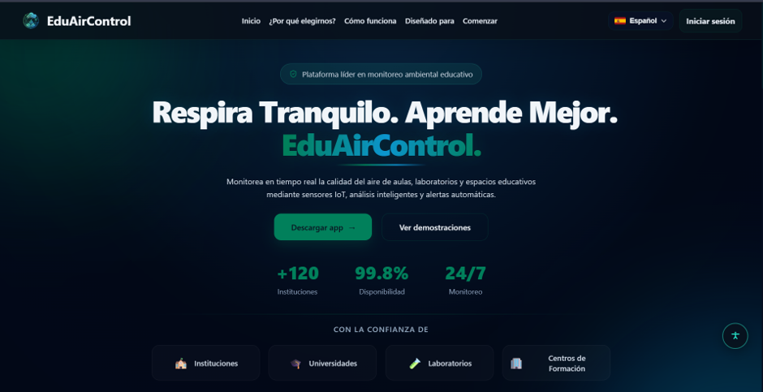
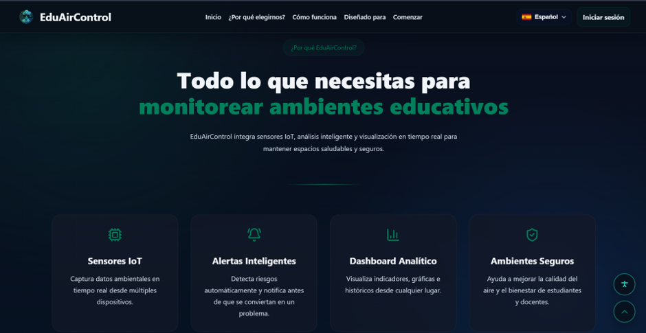
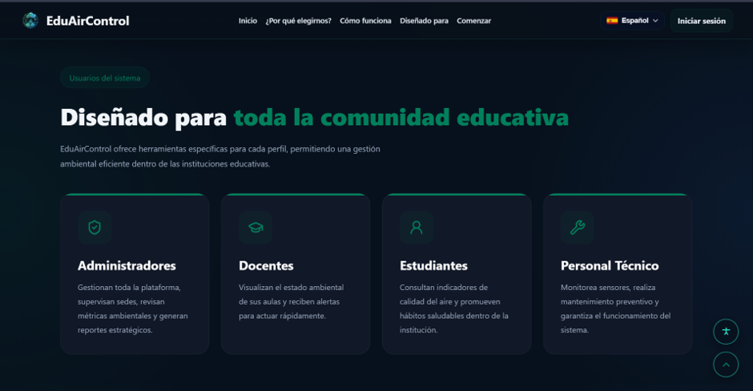
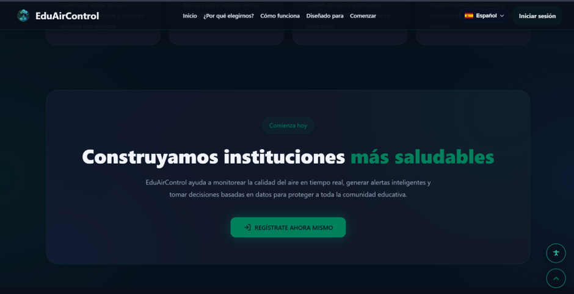
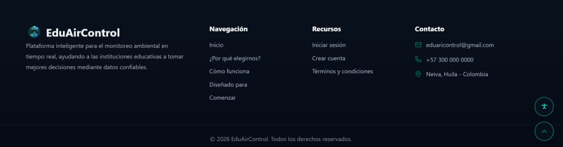

### 6.2 User Registration

| **Description** | Allows you to create a new account to access the system. |
| --- | --- |
| **Role that can use it** | Visitor (without an account) |
| **Route or menu** | Landing > Register |
| **Expected result** | The account is created and the user can log in. |
| **Notes** | The same email cannot be registered twice. The password must meet the requirements indicated by the form. |

**Steps**

1. Open the browser and go to http://localhost:3000.
2. Click the **Register** option.
3. Fill in the form fields: [COMPLETE: names, email, password, etc., according to your form].
4. Accept the terms and conditions, if the form requests it.
5. Click the register button.
6. Verify the confirmation message shown by the system.

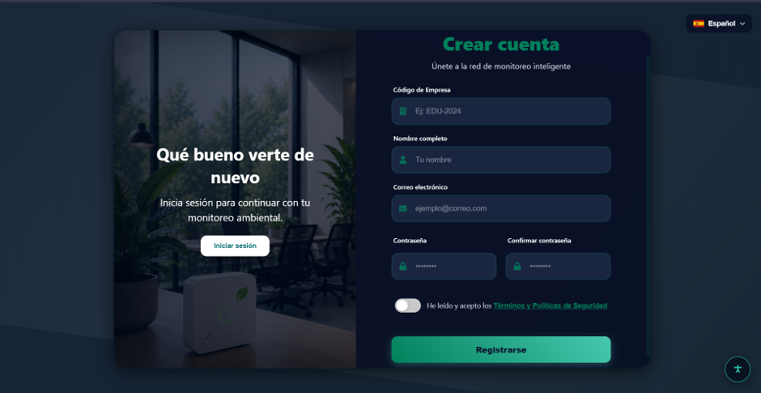

### 6.3 Log In

| **Description** | Allows you to enter the system with the registered credentials. |
| --- | --- |
| **Role that can use it** | User and Administrator |
| **Route or menu** | Landing > Log in |
| **Expected result** | The system shows the main panel according to the user's role. |
| **Notes** | If the data is incorrect, the system shows an error message. Check that the email and password are typed correctly. |

**Steps**

1. Open the browser and go to http://localhost:3000.
2. Click **Log in**.
3. Enter the email and password.
4. Click the **Log in** button.

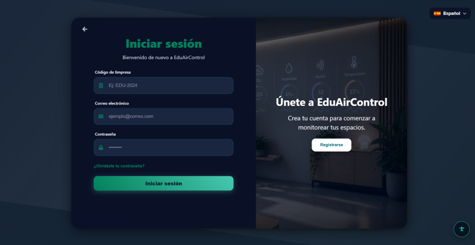

## 7. Main Menu

Once inside, the menu lets you navigate between the sections of the system:

| **Option** | **Description** |
| --- | --- |
| Dashboard | Analysis of the collected environmental data. |
| Environments | List of registered environments. |
| Favorites | Environments marked as favorites by the user. |
| Notifications | Button that shows Alerts, Warnings and Daily summary. |
| Profile | Information the user registered with. |
| Settings | Personalization of the account and the interface. |
| Log out | Safe exit from the system. |
| Accessibility | Button to change the font size, the color blindness mode and the light or dark theme. |

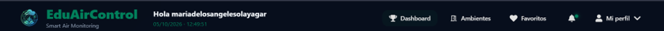

## 8. System Modules

### 8.1 Dashboard

| **Description** | Presents the analysis of the data collected by the sensors in charts and indicators that make it easier to interpret and support decision-making. |
| --- | --- |
| **Role that can use it** | User |
| **Route or menu** | Menu > Dashboard |
| **Expected result** | The user sees up-to-date environmental information for the monitored spaces. |
| **Notes** | The data depends on the measurements sent by the IoT sensors; if a sensor is inactive, no new readings will be shown. |

**Steps**

1. Log in to the system with an active account.
2. Select the **Dashboard** option from the menu.
3. Observe the indicators and charts for temperature, humidity and air quality.
4. [COMPLETE: use filters, date ranges or environment selection, if they exist].
5. Identify abnormal values that may require attention.

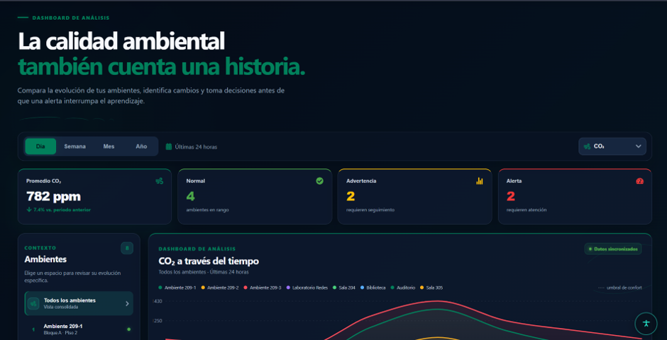
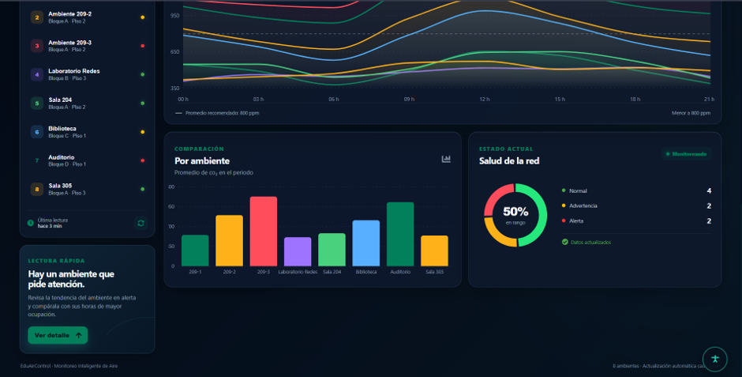

### 8.2 Environments

| **Description** | Shows the environments (classrooms and other spaces) registered in the system. |
| --- | --- |
| **Role that can use it** | User |
| **Route or menu** | Menu > Environments |
| **Expected result** | The user views the environments and their environmental information. |
| **Notes** | The User role can only view; creating and editing environments belongs to the Administrator. |

**Steps**

1. Select the **Environments** option from the menu.
2. Review the list of registered environments.
3. Search using the filters for name, block, floor and added favorites.
4. Click an environment to see its details and measurements.
5. To save it as a favorite, click the favorite icon [heart icon].

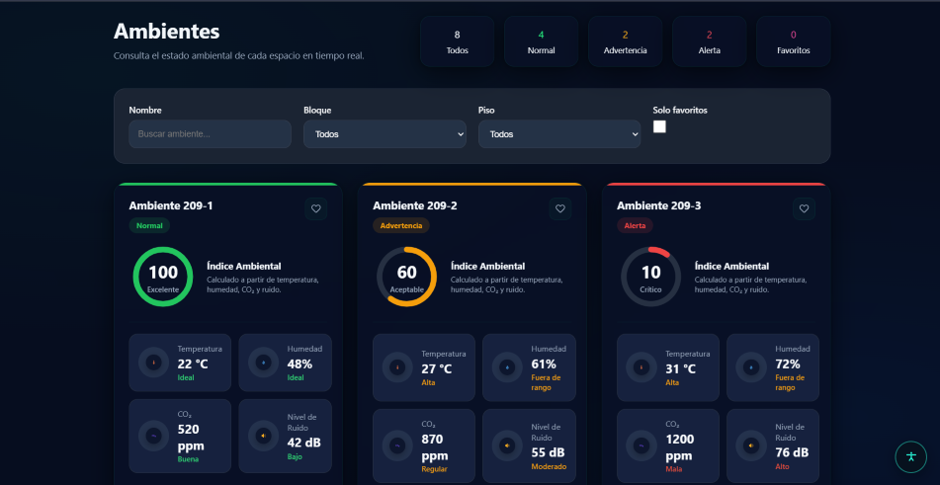
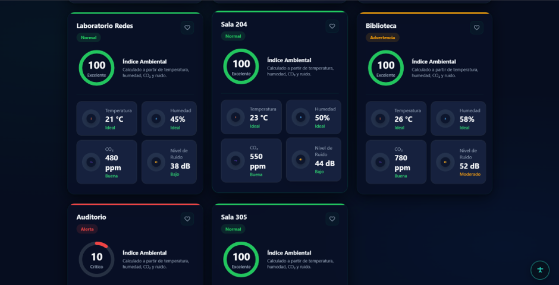

### 8.3 Favorites

| **Description** | Allows quick access to the environments the user marked as favorites. |
| --- | --- |
| **Role that can use it** | User |
| **Route or menu** | Menu > Favorites |
| **Expected result** | Favorite environments are visible in a personal list. |
| **Notes** | Favorites are specific to each user and are not seen by other users. |

**Steps**

1. From Environments, mark an environment as a favorite.
2. Select the **Favorites** option from the menu.
3. Verify that the environment appears in the list.
4. To remove it, unmark the favorite icon [Heart].

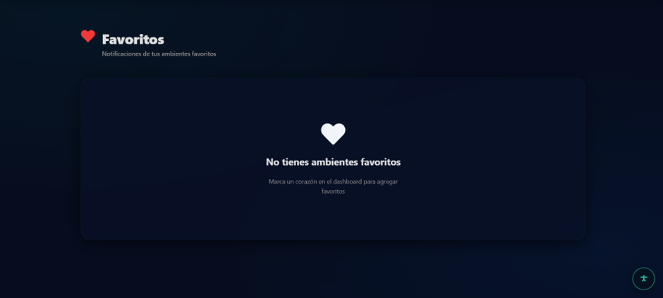

### 8.4 Notifications

| **Description** | Shows the notices generated by the system about the status of the monitored environments, organized into three types: Alerts, Warnings and Daily summary. |
| --- | --- |
| **Role that can use it** | User and Administrator |
| **Route or menu** | Main menu > Notifications |
| **Expected result** | The user views recent notices about their environments. |
| **Notes** | Alerts: generated when a measurement reaches a critical threshold. Warnings: generated when a measurement approaches the warning limit. Daily summary: summary of the day's conditions. |

**Steps**

1. Log in to the system with an active account.
2. Click the **Notifications** button in the main menu.
3. Review the three types of notices: Alerts, Warnings and Daily summary.

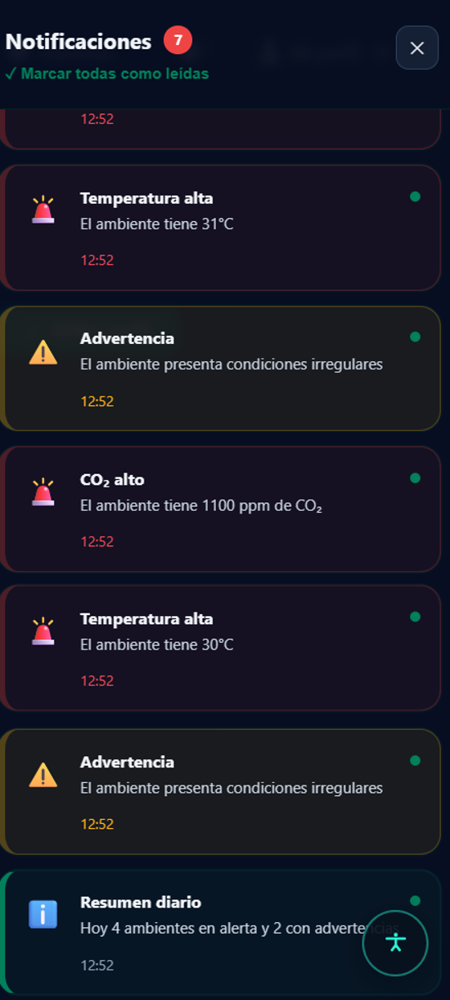

| **Type** | **Description** |
| --- | --- |
| Alerts | Notices about critical environmental conditions that require attention. |
| Warnings | Preventive notices when a measurement approaches the recommended limits. |
| Daily summary | Summary of the behavior of the environmental conditions during the day. |

### 8.5 Profile

| **Description** | Shows the information the user registered with. |
| --- | --- |
| **Role that can use it** | User and Administrator |
| **Route or menu** | Menu > Profile |
| **Expected result** | The user verifies their personal information. |
| **Notes** | If any data is incorrect and cannot be edited, ask the administrator for support. |

**Steps**

1. Select the **Profile** option.
2. Review the data shown: name, email, position and phone.
3. Edit data/photos and save.

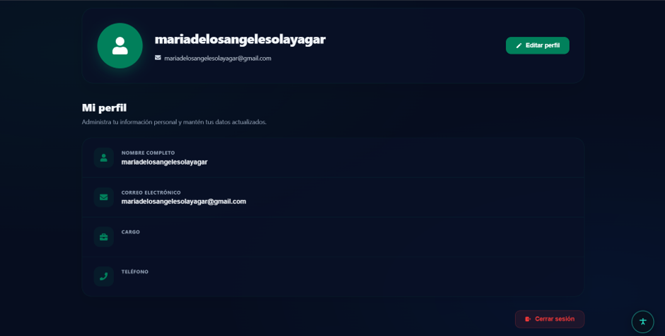

### 8.6 Settings

This section gathers the account's personalization and security options. It is accessed from Menu > Settings.

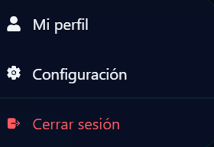
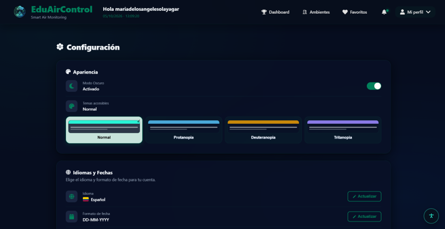

| **Option** | **What it allows** | **How to use it** |
| --- | --- | --- |
| Light / dark mode | Change the interface's visual theme. | Select Light or Dark. |
| Color blindness modes | Adapt the colors for people with color vision difficulties: protanopia, deuteranopia and tritanopia. | Choose the mode that matches the visual need. |
| Language | Change the interface language: Spanish, English, Portuguese or French. | Open the selector and choose the language. |
| Date format | Define how dates are displayed. | Select the desired format. |
| Time zone | Adjust the time of the measurements to the user's time zone. | Select the time zone. |
| Reminders | Turn the system reminders on or off. | Move the Reminders switch. See section 8.6.3. |
| Privacy and security | View the terms and conditions and the privacy policies. | Open the option and read the content. |
| Change password | Update the access password. | See section 8.6.1. |
| Delete account | Delete the user's account. | See section 8.6.2. |
| Help and support | Get help on using the system. | Open the option: content: contact, terms and conditions, versions, questions. |

#### 8.6.1 Change Password

1. Go to Settings > Change password.
2. Enter the current password.
3. Enter the new password and confirm it.
4. Click **Save** or **Update**.
5. Confirm that the system shows the success message.

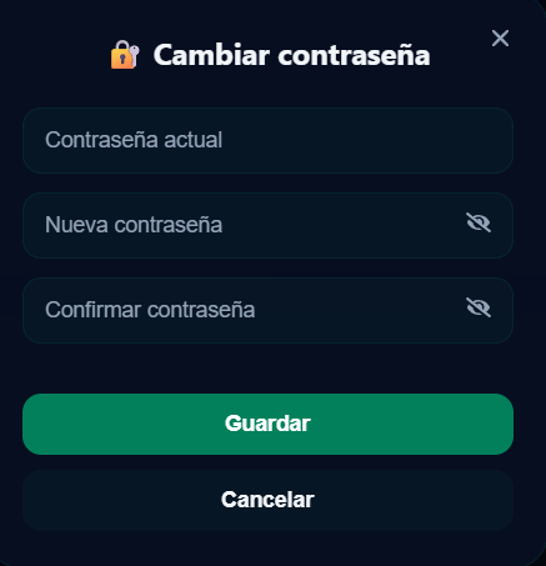

#### 8.6.2 Delete Account

> **Attention:** deleting the account is a significant action. It is recommended to confirm whether the deletion is permanent in the system before documenting it as irreversible.

1. Go to Settings > Delete account.
2. Read the warning message carefully.
3. Confirm the action (password and requested confirmation).
4. Verify that the system logs you out and does not allow you to log in again with that account.

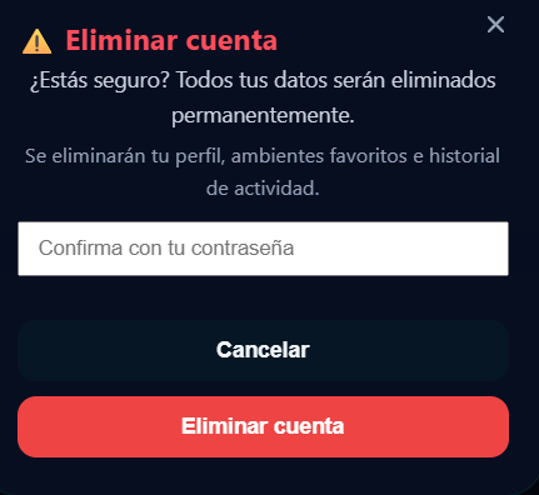

#### 8.6.3 Reminders

Allows you to turn the system reminders on or off using a switch. The notices generated by the system are consulted in the **Notifications** button of the main menu (section 9).

- Notify critical alerts
- Notify warnings
- Daily summary
- Notification sound

1. Move the switch to turn the reminders on or off.
2. Verify that the switch is in the desired position. The change is applied automatically.

**Expected result:** the system sends reminders only when the switch is on.

They arrive via (screen and email on web, and via phone notification on mobile).

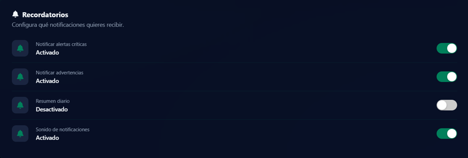

## 9. Accessibility

| **Description** | Allows you to adapt the interface to the user's visual needs through the accessibility button. From there you can change the font size, activate a color blindness mode and choose between light or dark mode. |
| --- | --- |
| **Role that can use it** | User and Administrator |
| **Route or menu** | Accessibility button at the bottom of the screen |
| **Available options** | - Font size: lets you choose between three sizes: Base (normal size), LG (large) and XL (extra large). - Color blindness: adapts the interface colors for people with color vision difficulties. Available modes: protanopia, deuteranopia and tritanopia. - Light or dark mode: switches the interface's visual theme between a light and a dark background. |
| **Expected result** | The interface is shown with the font size, colors and theme selected by the user. |
| **Notes** | Preferences are saved for the next session. It is recommended to choose the font size and color mode that are most comfortable for reading. |

**Steps**

1. Log in to the system with an active account.
2. Click the accessibility button.
3. To change the font size, select Base, LG or XL.
4. To adapt the colors, select the corresponding color blindness mode (protanopia, deuteranopia or tritanopia).
5. To change the theme, select Light mode or Dark mode.
6. Verify that the interface updates with the chosen option.

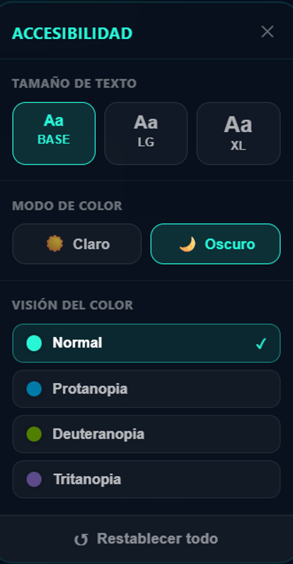

## 10. Messages and Validations

Replace the texts in the "Message" column with the exact messages shown by EduAirControl.

| **System message** | **Meaning** | **User action** |
| --- | --- | --- |
| Required field | A required piece of data is missing. | Fill in the marked field. |
| Registration successful | The account was created successfully. | Log in. |
| Invalid credentials | The email and password do not match. | Check the data and try again. |
| Email already registered | An account with that email already exists. | Log in or use another email. |
| Password updated | The password change was successful. | Use the new password at the next login. |

## 11. Logging Out

1. Locate the **Log out** option in the menu or profile.
2. Click **Log out**.
3. Verify that the system returns to the login screen.

It is recommended to always log out when finished, especially on shared computers.

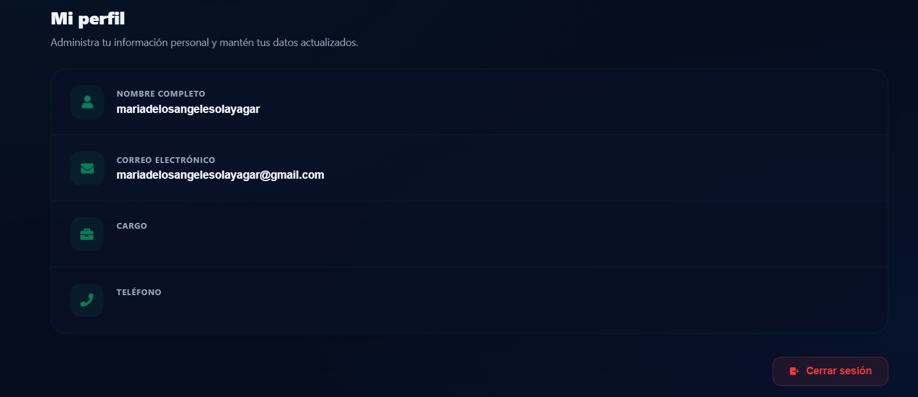

## 12. Frequently Asked Questions

| **Question** | **Answer** |
| --- | --- |
| What do I do if I forgot my password? | There is a "Forgot my password" option in settings. |
| How do I change the language? | Go to Settings and choose the language in the selector (Spanish, English, Portuguese or French). |
| How do I add an environment to favorites? | From Environments, click the favorite icon of the desired environment. |
| Where do I see the alerts, warnings and daily summary? | In the Notifications button of the main menu. |
| How do I turn reminders on or off? | Go to Settings > Reminders and move the switch. |
| How do I activate dark mode or the color blindness mode? | In Settings, select the desired mode in the appearance and accessibility options. |
| I don't see new data on the dashboard, what do I do? | The data depends on the sensors. If there are no recent readings, inform the administrator so they can check the sensor's status. |
| How do I make the text larger? | Click the accessibility button and select the LG or XL size. |

## 13. Glossary

| **Term** | **Definition** |
| --- | --- |
| IoT | Internet of Things: connected devices that send data over the internet. |
| Sensor | Device that measures an environmental condition, such as temperature or humidity. |
| Environment | Classroom or other space of the institution monitored by the system. |
| Dashboard | Visual panel that summarizes and analyzes the collected data. |
| Notification | Notice generated by the system: alert, warning or daily summary. |
| Favorite | Environment marked by the user for quick access. |
| Color blindness | Difficulty distinguishing certain colors; the system offers adaptation modes. |
| Time zone | Time region used to display dates and times. |
| Accessibility | Set of options that adapt the interface to the user's visual needs, such as font size and color modes. |

## 14. Appendices

Space for additional screenshots, test evidence or complementary information about the system.

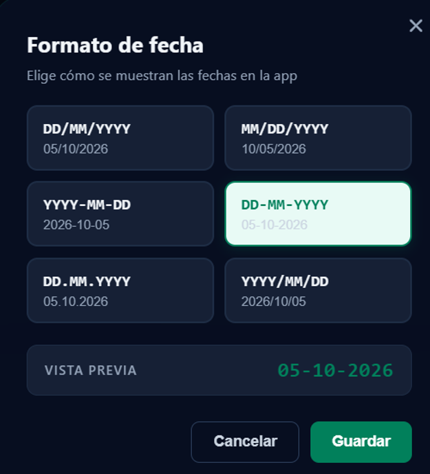
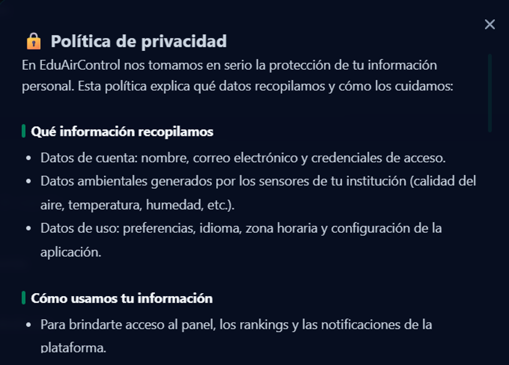
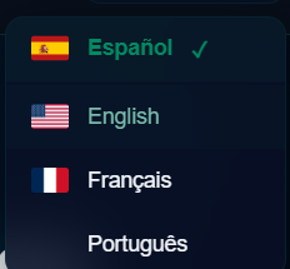
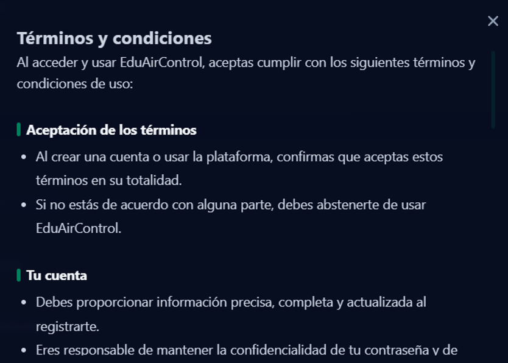

---

*EduAirControl – User Manual*
